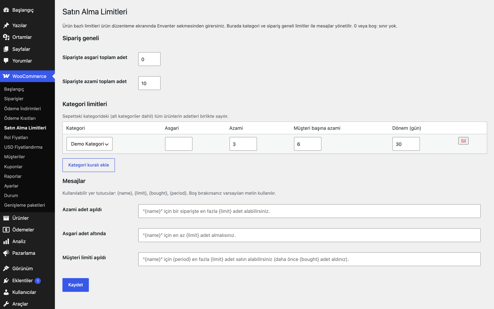

# Purchase Limits for WooCommerce

Ürün, kategori ve sipariş bazında asgari/azami adet ile dönemlik müşteri limiti koyar.

> **English:** Minimum and maximum quantities per product, per category and per order, plus a per-customer limit within a rolling period (by user or billing e-mail). Messages are configurable. No limits are active until you set them.

   

## Ne işe yarar

Stok koruma, kampanya ürünü veya toptan alım düzeni için sepete konabilecek adetleri sınırlar. Ürün düzenleme ekranındaki Envanter sekmesinden ürün başına, Ayarlar ekranından kategori ve sipariş geneli limit tanımlarsınız; "müşteri başına" limit geçmiş siparişleri sayar.

## Özellikler

- Ürün başına asgari / azami adet ve müşteri başına azami adet + dönem (gün)
- Kategori başına asgari / azami / müşteri limiti (alt kategoriler dahil, kategorideki tüm ürünler birlikte sayılır)
- Sipariş genelinde asgari / azami toplam adet
- Müşteri limiti giriş yapmış kullanıcıda kullanıcı hesabına, misafirde ödeme sırasında fatura e-postasına göre; işlenen, beklemede ve tamamlanan siparişler sayılır
- Sepete ekleme, sepet güncelleme, sepet/ödeme doğrulaması ve blok sepet (Store API) denetlenir; kodla eklenen ürünler de geri alınır
- Adet kutusu ürün sayfasında asgari/azami değerlerine uyar
- Mesajlar ayarlanabilir; `{name}`, `{limit}`, `{bought}`, `{period}` yer tutucuları kullanılır

## Kurulum

1. `purchase-limits-for-woocommerce` klasörünü `wp-content/plugins/` altına kopyalayın (veya zip olarak yükleyin).
2. Eklentiler ekranından etkinleştirin (WooCommerce gereklidir).
3. Aşağıdaki ayar ekranından yapılandırın. Yapılandırma yapılana kadar mağazanızda hiçbir değişiklik olmaz.

## Ayarlar

WooCommerce → **Satın Alma Limitleri** (kategori, sipariş, mesajlar) ve ürün düzenleme → Envanter (ürün limitleri). Seçenek `eru_pl_settings`; ürün meta alanları `_eru_pl_min`, `_eru_pl_max`, `_eru_pl_customer_max`, `_eru_pl_period_days`. Varsayılan: hiç limit yok.

## Kancalar, filtreler ve veri alanları

| Ad | Tür | Açıklama |
|---|---|---|
| `eru_pl_settings` | seçenek | `order_min`, `order_max`, `category_rules`, `msg_max`, `msg_min`, `msg_customer` |
| `eru_pl_constraints` | filtre | Kısıt listesini değiştirin veya kendi kısıtınızı ekleyin |
| `eru_pl_counted_statuses` | filtre | Müşteri limitinde sayılan sipariş durumları (varsayılan: processing, on-hold, completed) |

## Entegrasyonlar ve gereksinimler

WordPress 6.5+, PHP 8.0+, WooCommerce 9.0+. HPOS (özel sipariş tabloları) ile uyumludur. WooCommerce yoksa eklenti bir uyarı gösterir ve hiçbir şey yapmaz. Harici servis kullanmaz; dış HTTP isteği yapmaz.

## Sınırlamalar

- Müşteri limiti iade/iptal edilen adetleri düşmez; sayılacak durumlar `eru_pl_counted_statuses` ile değiştirilebilir.
- Giriş yapmamış müşterinin geçmişi yalnızca ödeme adımında, girdiği e-postayla denetlenir: misafir için "müşteri başına azami adet" sepete eklerken uygulanmaz (e-posta henüz bilinmez), siparişi ödeme adımında durdurur.
- Müşteri limiti her denetimde ilgili müşterinin siparişlerini tarar; çok yüksek sipariş hacimli mağazalarda dönemi kısa tutun.
- Limitler varyasyonlar toplamı üzerinden üst ürüne uygulanır; varyasyon başına ayrı limit yoktur.
- Eklenti silindiğinde (Eklentiler → Sil) yalnızca kendi ayarları (`eru_pl_*` seçenekleri) silinir; ürünlere yazılmış meta alanları korunur.

## SSS

**Asgari adet sepete eklemeyi engeller mi?** Hayır; ekleme sırasında azami denetlenir, asgari ise sepet ve ödeme sayfasında doğrulanır (sipariş tamamlanamaz).

**Aynı kişi farklı e-postayla alırsa?** Müşteri limiti hesap veya e-posta tabanlıdır; kimlik doğrulaması yapmaz.

## Değişiklik geçmişi

Bkz. [CHANGELOG.md](CHANGELOG.md).

## Lisans

GPL-2.0-or-later.

Diğer Erusoft eklentileri: https://wordpress.erusoft.com/
