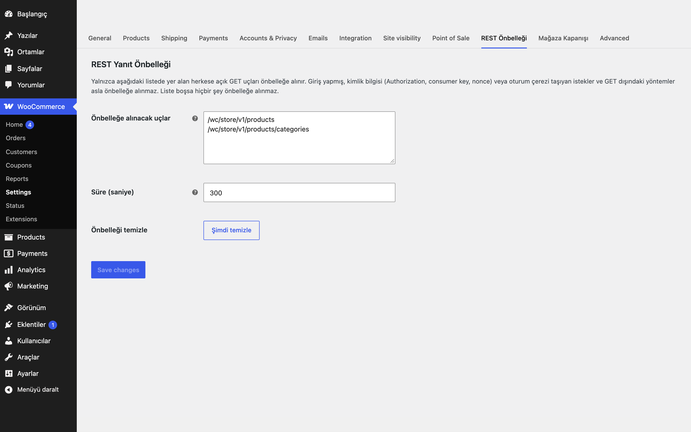

# REST Response Cache for WooCommerce

İzin listesindeki herkese açık REST GET uçlarının (ör. `/wc/store/v1/products`) yanıtlarını önbellekler; tekrarlanan isteklerde veritabanı ve ürün sorgularını atlar. Varsayılan olarak liste boştur: hiçbir şey önbelleğe alınmaz.

## Özellikler

- Uç izin listesi (satır başına bir yol; sonuna `*` ile alt yollar)
- Önbellek anahtarı: tam normalize yol + sıralanmış sorgu dizesi + dil; sorgu sırası fark etmez
- Asla önbelleğe alınmayanlar: giriş yapmış kullanıcılar, `Authorization`/nonce/cart-token başlıkları, `consumer_key` gibi parametreler, WooCommerce oturum ve giriş çerezleri, GET dışı yöntemler
- Yalnızca 200 yanıtlar; `Set-Cookie`, `no-store`/`private` içeren veya oturuma özgü başlık taşıyan yanıtlar saklanmaz
- Sayfalama başlıkları (`X-WP-Total`, `Link`) saklanır ve geri verilir
- Yanıtlarda `X-Eru-Cache: HIT` / `MISS` başlığı
- Ürün, varyasyon, stok ve ürün terimi değişince otomatik temizlik; elle "Şimdi temizle" düğmesi
- Şişirmeye karşı sınırlar: 12'den fazla sorgu parametresi, 512 baytı aşan sorgu dizesi, `_embed` içeren istekler ve 512 KB'ı aşan yanıtlar önbelleğe alınmaz (`eru_rrc_limits`)
- Yanıtın `_links` alanı ve başlıkları HIT'te MISS ile aynıdır
- Süre (TTL) ayarlanabilir (10 - 86400 sn, varsayılan 300)

## Nasıl kullanılır

1. Eklentiyi etkinleştirin; WooCommerce → Ayarlar → **REST Önbelleği** sekmesini açın.
2. Uç listesine her satıra bir yol yazın, örneğin `/wc/store/v1/products`.
3. Süreyi (TTL) 300 saniye olarak bırakın ve kaydedin.
4. Çıkış yapmış bir tarayıcıdan (veya tarayıcı geliştirici araçlarından, oturum çerezi olmadan) bu adrese iki kez GET isteği atın.
5. İlk yanıtta `X-Eru-Cache: MISS`, ikincisinde `X-Eru-Cache: HIT` başlığını görün.
6. "Demo Ürün"ün fiyatını değiştirip kaydedin: ürün değişimi önbelleği temizler, sonraki istek yeniden `MISS` olur.

## Kurulum

1. `rest-response-cache-for-woocommerce` klasörünü `wp-content/plugins/` altına kopyalayın ve etkinleştirin.
2. WooCommerce → Ayarlar → REST Önbelleği sekmesinde önbelleğe alınacak uçları yazın.

## Ayarlar

WooCommerce → Ayarlar → REST Önbelleği: `eru_rrc_routes` (uç listesi), `eru_rrc_ttl` (saniye).

## Kancalar ve filtreler

| Ad | Tür | Açıklama |
|---|---|---|
| `eru_rrc_routes` | filtre | İzin listesini değiştirir (`string[]`) |
| `eru_rrc_ttl` | filtre | Süre (saniye) |
| `eru_rrc_limits` | filtre | Sınırlar: `max_params` (12), `max_query` (512 bayt), `max_payload` (524288 bayt) |
| `eru_rrc_key_parts` | filtre | Anahtara ek parçalar ekler (para birimi, ülke gibi yanıtı değiştiren eklentiler için; `array`, `WP_REST_Request`) |
| `eru_rrc_cacheable` | filtre | Bir isteğin önbelleğe uygunluğunu son kez değiştirir (`bool`, `WP_REST_Request`) |
| `eru_rrc_flushed` | eylem | Önbellek temizlendiğinde |

Kodla temizlemek için: `Eru_Rrc::flush();`

## Gereksinimler

WordPress 6.5+, PHP 8.0+, WooCommerce 9.0+.

## Sınırlamalar

- Eklentiler yüklendikten sonra çalışır (WordPress'in tam yüklenmesini atlamaz); kazanç ürün sorgularının ve yanıt hazırlamanın atlanmasıdır.
- Önbellek WordPress transient sistemini kullanır; kalıcı nesne önbelleği varsa orada, yoksa veritabanında saklanır. Temizlik sürüm sayacıyla yapılır, eski kayıtlar süresi dolunca silinir.
- Müşteriye özel fiyat, indirim veya kur dönüşümü yapan eklentiler kullanıyorsanız ilgili uçları listeye eklemeyin.
- Stok değişimi (satış dahil) tüm önbelleği temizler; yoğun mağazalarda isabet oranı bu yüzden düşebilir.
- Ürün dışındaki değişiklikler (ör. ayar değişimi) otomatik temizlik tetiklemez; süre dolana kadar veya elle temizlenene kadar eski yanıt sunulabilir.
- Eklenti silindiğinde (Eklentiler → Sil) yalnızca kendi ayarları ve geçici verileri (`eru_rrc_*` seçenekleri ve transient'leri) silinir; eklenti başka kalıcı veri saklamaz.

## SSS

**Önbellek çalışıyor mu?** Aynı adrese iki kez GET atın; ikinci yanıtta `X-Eru-Cache: HIT` görünür.

**Yönetici olarak neden HIT görmüyorum?** Giriş yapmış istekler asla önbelleğe alınmaz.

**Eklentiyi silersem ne olur?** Silme sırasında `eru_rrc_routes`, `eru_rrc_ttl`, `eru_rrc_version` seçenekleri ve `eru_rrc_` önekli transient'ler silinir; başka veri yoktur. Devre dışı bırakmak ayarları silmez.

**Dış servise bağlanır mı?** Hayır, kodda dış HTTP isteği yoktur.

**Sayfa önbelleği eklentisiyle birlikte kullanılır mı?** Bu eklenti yalnızca izin listesindeki REST GET yanıtlarını önbelleğe alır, sayfaları değil. Müşteriye göre değişen yanıt veren uçları listeye eklemeyin (bkz. Sınırlamalar).

**Çeviri nasıl yapılır?** Metin alanı `rest-response-cache-for-woocommerce`; çeviri yolu `/languages`.

## English summary

Caches anonymous GET responses of allow-listed public REST routes (default list is empty, so nothing is cached). Keys include the normalised route, sorted query and locale. Never caches authenticated, credentialed, session-cookie, non-GET, `Set-Cookie`/`no-store` responses. Flushes on product/term changes and via a manual button. Adds `X-Eru-Cache: HIT|MISS`.

## Sürüm notları

Bkz. [CHANGELOG.md](CHANGELOG.md).

## Destek

- Önce bu sayfadaki **SSS** ve **Sınırlamalar** bölümlerine göz atın; sık karşılaşılan durumlar orada.
- Hata mı buldunuz? [GitHub Issues](https://github.com/erayusta/erusoft-wp/issues) üzerinden bildirin. WordPress, WooCommerce, PHP ve eklenti sürümünü, adımları ve beklenen/gerçekleşen sonucu yazmanız işi hızlandırır.
- Kurulum, yapılandırma, özel geliştirme veya entegrasyon desteği için **[hello@erusoft.com](mailto:hello@erusoft.com)** adresine yazın. Erusoft hakkında: [erusoft.com](https://erusoft.com).
- Lütfen şifre, API anahtarı veya müşteri verisi (ad, telefon, TCKN, sipariş dökümü) göndermeyin; ekran görüntülerindeki kişisel verileri karartın.

## Lisans

GPL-2.0-or-later. Diğer Erusoft eklentileri: https://wordpress.erusoft.com
