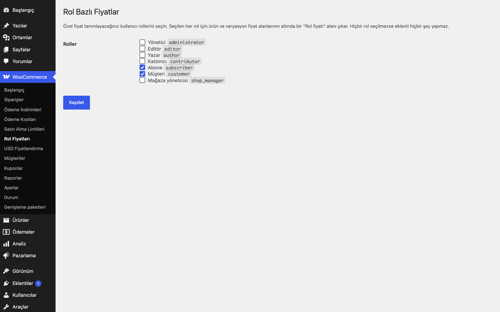

# Role-Based Prices for WooCommerce

Ürün ve varyasyonlara kullanıcı rolüne göre farklı fiyat tanımlayın.

> **English:** Set a different price per user role on products and variations. The roles that get custom prices are picked in the settings (none by default), so nothing changes until you configure it.

   

## Ne işe yarar

Bayi, üye veya kendi tanımladığınız herhangi bir WordPress rolüne özel fiyat vermenizi sağlar. Ayarlarda rolleri seçersiniz; seçilen her rol için ürün ve varyasyon fiyat alanlarının altında bir alan belirir. Alan boşsa o role normal fiyat gösterilir.

## Özellikler

- Rol listesi ayarlardan seçilir (mevcut tüm WordPress rolleri); varsayılan hiçbiri
- Ürün ve varyasyon bazında rol fiyatı
- Birden çok rolü olan kullanıcıda en düşük rol fiyatı geçerlidir
- Katalog, ürün sayfası, sepet ve ödeme aynı fiyatı kullanır; varyasyonlu ürün fiyat aralığı role göre önbelleklenir
- Rol fiyatı olan üründe indirimli fiyat rozeti gösterilmez
- Misafirler ve seçilmemiş roller normal fiyatı görür

## Hangisini seçmeliyim?

Erusoft kataloğunda fiyatı kişiye göre değiştiren üç eklenti vardır:

- **Role-Based Prices for WooCommerce**: Az sayıda rol için ürün başına sabit fiyat girmek istiyorsanız. En basit seçenek.
- **Price Lists for WooCommerce**: Adlandırılmış fiyat listeleri (yüzde, kategori, sabit fiyat) tanımlayıp role veya kişiye atamak istiyorsanız.
- **B2B Customer Pricing for WooCommerce**: Belirli müşteriye veya müşteri grubuna özel fiyat/iskonto kuralları yazmak istiyorsanız.

Üçü aynı mağazada birlikte etkin olabilir; çakışmada öncelik şöyledir: **müşteriye özel kural (B2B Customer Pricing) > fiyat listesi (Price Lists) > rol fiyatı (Role-Based Prices)**. Bu, filtre önceliğiyle sağlanır (USD Pricing 998 temel fiyatı dolardan çevirir; rol fiyatı 999, fiyat listesi 1000, müşteri kuralı 1001; sonra çalışan kazanır). Bir üründe üst düzey eklenti fiyat vermiyorsa bir alttaki uygulanır. Yine de kafa karışıklığını önlemek için mümkünse tek bir yaklaşım seçin.

## Kurulum

1. `role-based-prices-for-woocommerce` klasörünü `wp-content/plugins/` altına kopyalayın (veya zip olarak yükleyin).
2. Eklentiler ekranından etkinleştirin (WooCommerce gereklidir).
3. Aşağıdaki ayar ekranından yapılandırın. Yapılandırma yapılana kadar mağazanızda hiçbir değişiklik olmaz.

## Ayarlar

WooCommerce → **Rol Fiyatları**. Seçenek `eru_rbp_roles`; fiyatlar `_eru_rbp_price_<rol>` meta alanlarında.

**Yönetim ekranı ve sipariş düzenleme:** wp-admin'de yöneticinin kendi kuralları hiçbir ürüne uygulanmaz (ürün listesi, ürün düzenleme). Yönetimden siparişe ürün eklerken (WooCommerce sipariş kalemi AJAX'ı) siparişin müşterisinin fiyatı kullanılır; misafir siparişte temel fiyat. Farklı davranış için `eru_rbp_pricing_user_id` filtresi.

**Çalışma anında konan fiyat:** Bir eklenti sepet satırının fiyatını `set_price()` ile değiştirdiyse (ör. Gift Product Rules hediye satırı 0) bu eklenti o satıra dokunmaz.

## Kancalar, filtreler ve veri alanları

| Ad | Tür | Açıklama |
|---|---|---|
| `eru_rbp_roles` | seçenek | Rol fiyatı verilecek rol anahtarları (varsayılan boş) |
| `_eru_rbp_price_<rol>` | meta | Ürün/varyasyon rol fiyatı |
| `eru_rbp_price` | filtre | Rol fiyatını değiştirin (`$price`, `$product`, `$roles`) |
| `eru_rbp_pricing_user_id` | filtre | Fiyatı belirlenecek kullanıcı (`$uid`; wp-admin'de 0, sipariş kalemi AJAX'ında siparişin müşterisi) |

## Entegrasyonlar ve gereksinimler

WordPress 6.5+, PHP 8.0+, WooCommerce 9.0+. HPOS (özel sipariş tabloları) ile uyumludur. WooCommerce yoksa eklenti bir uyarı gösterir ve hiçbir şey yapmaz. Harici servis kullanmaz; dış HTTP isteği yapmaz.

## Sınırlamalar

- Sayfa önbelleği (sayfa cache) kullanıyorsanız giriş yapmış kullanıcıları önbellekten hariç tutun, yoksa fiyatlar karışabilir.
- Rol fiyatı sabit tutardır; yüzde bazlı kural, müşteri bazlı fiyat veya fiyat listesi yoktur.
- Rol fiyatları vergi ayarlarınıza göre (vergi dahil/hariç) girilmiş sayılır.
- Eklenti silindiğinde (Eklentiler → Sil) yalnızca kendi ayarları (`eru_rbp_*` seçenekleri) silinir; ürünlere yazılmış meta alanları korunur.

## SSS

**Seçtiğim rolü sonradan kaldırırsam?** Girilen fiyatlar silinmez ama rol seçili olmadığı sürece uygulanmaz.

**İndirimli fiyatla birlikte çalışır mı?** Rol fiyatı olan kullanıcıda rol fiyatı geçerlidir ve indirimli fiyat uygulanmaz.

## Değişiklik geçmişi

Bkz. [CHANGELOG.md](CHANGELOG.md).

## Lisans

GPL-2.0-or-later.

Diğer Erusoft eklentileri: https://wordpress.erusoft.com/
