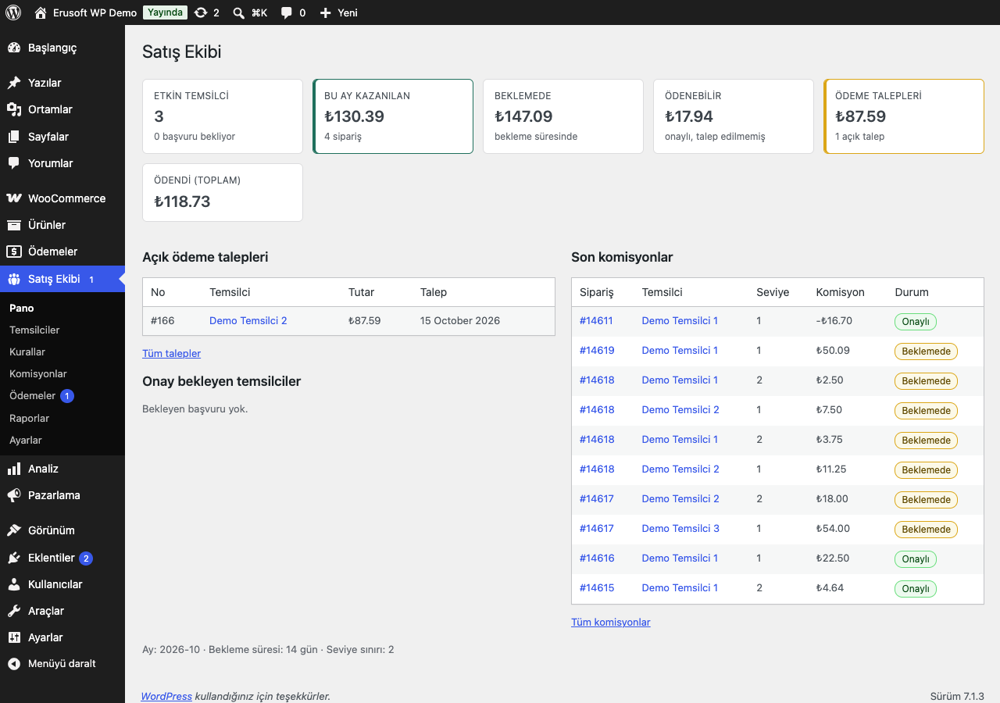
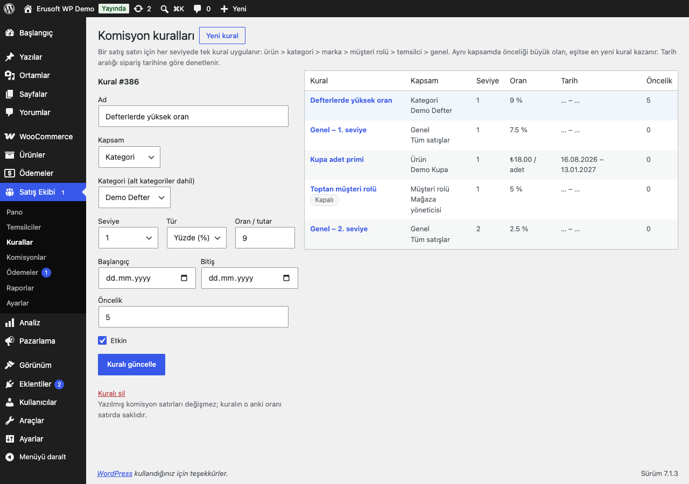
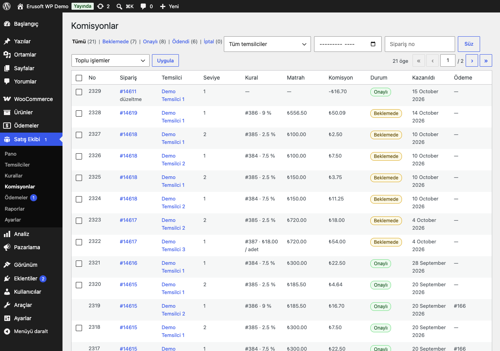
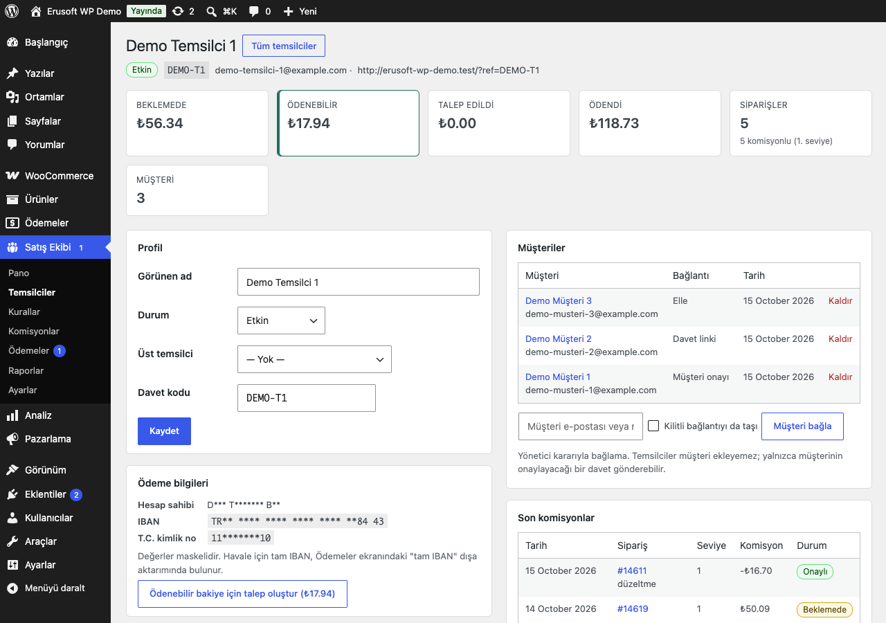
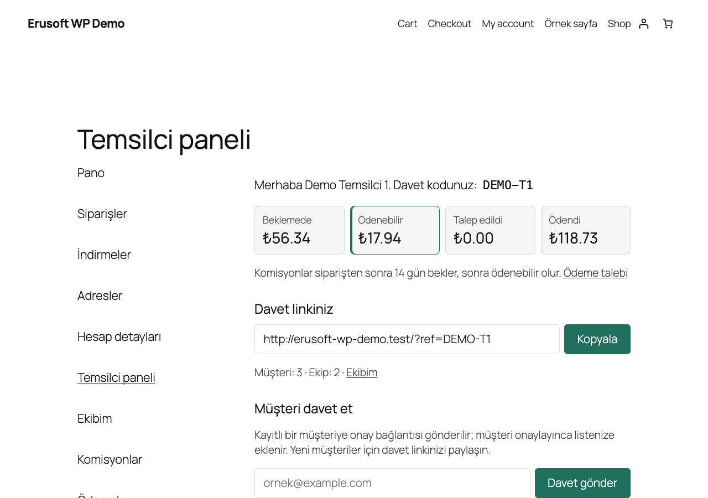
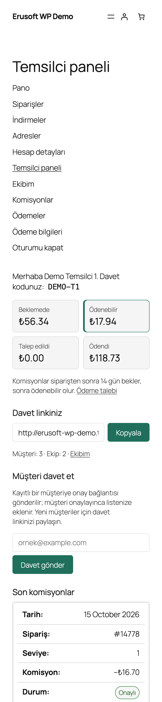
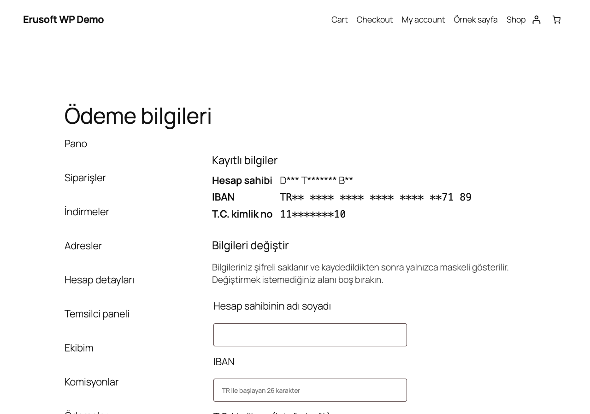

# Sales Team Commissions for WooCommerce

> **English:** Commissions for an in-house sales team. Agents form a hierarchy capped at 1–5 levels (default 2, cycle-guarded); customers are assigned by referral link (last touch or first-touch lock), round-robin, a customer-confirmed invitation or by an admin. One rule system pays each level a percentage or a fixed amount per unit by product, category, brand, customer role, agent or globally, with priority and date range. Commissions are written per order line on the chosen status, follow refunds and cancellations (pro rata or void, adjustment rows after a payout), and become payable after a hold period. Agents get a My Account panel (balance, referral link, invitations, team, commissions, payout requests) and enter payout details that are encrypted with libsodium using a key from `wp-config.php`. Admin screens, CSV exports (masked by default), read-only REST, WP-CLI (`wp eru-stc`) and a privacy exporter/eraser complete it. No front-end change until the module is switched on.

[](https://www.gnu.org/licenses/gpl-2.0.html)   

Mağazanın kendi satış ekibi için komisyon sistemi: temsilciler müşterilerle eşleşir, her siparişin satırlarından seviye seviye komisyon kazanır, bekleme süresi dolunca bakiyelerini Hesabım'dan talep eder; mağaza ödemeyi yapıp referansıyla kapatır.



## Özellikler

- **Temsilci hiyerarşisi ve müşteri atama:** üst/alt temsilci ağacı (döngü engelli), davet linki (`?ref=KOD`, en son gelen kod geçerli ya da ilk temsilciye kilit), sırayla dağıtım, müşterinin onayladığı davet ve yöneticinin elle bağlaması.
- **Tek kural sistemi:** ürün, kategori (alt kategoriler dahil), marka, müşteri rolü, temsilci ve genel kapsam; her seviyeye ayrı kural, yüzde ya da adet başına tutar, öncelik ve tarih aralığı.
- **İade ve iptallerde otomatik düzeltme:** iade oranında azaltma ya da iptal, ödenmiş satır için düzeltme satırı, iptal edilip yeniden tamamlanan siparişte satırların geri gelmesi; komisyonlar bekleme süresi dolunca onaylanır.
- **Hesabım → Temsilci paneli:** bakiye, davet linki, müşteri daveti, ekip, komisyonlar, ödeme talebi ve ödeme bilgileri.
- **Şifreli ödeme bilgileri:** hesap sahibi, IBAN ve isteğe bağlı T.C. kimlik no libsodium ile şifrelenir; arayüzde, dışa aktarımda ve REST'te yalnızca maskeli görünür.
- **Yönetim:** "Satış Ekibi" menüsünde pano, temsilciler, kurallar, komisyonlar (toplu onay/iptal, yeniden hesaplama), ödemeler, raporlar ve ayarlar; CSV ve `wp eru-stc` komutları.
- Etkinleştirildiğinde yalnızca tablolar oluşur: modül açılana kadar mağaza önünde değişiklik, çerez, zamanlanmış iş ve dış istek yoktur.

## Kurulum

1. `sales-team-commissions-for-woocommerce` klasörünü `wp-content/plugins/` altına kopyalayın ve etkinleştirin.
2. Ödeme bilgileri formunu kullanacaksanız şifreleme anahtarını ekleyin (bkz. [Şifreleme anahtarı](#şifreleme-anahtarı)).
3. **Satış Ekibi → Kurallar** ekranından en az bir kural ekleyin (ör. "Genel, 1. seviye, %7,5"). Kural olmadan komisyon yazılmaz.
4. **Satış Ekibi → Temsilciler → Temsilci ekle** ile mevcut bir hesabı temsilci yapın; üst temsilciyi seçin.
5. **Satış Ekibi → Ayarlar** ekranında modülü açın.

Menü `manage_woocommerce` yetkisi olan herkese açıktır. Eklenti `manage_eru_stc` yetkisini rollere yazmaz, çalışma anında `manage_woocommerce` sahiplerine verir; rol sıfırlansa da yetki kaybolmaz.

## Nasıl çalışır

1. **Müşterinin temsilcisi.** Ödeme sırasında sipariş temsilciyle işaretlenir: önce müşterinin bağlı olduğu temsilci, yoksa davet linki çerezi (misafir siparişlerde yalnızca çerez). Atama yöntemleri:
   - **Davet linki (en son kod geçerli):** yeni bir kod, yalnızca davet linkiyle kurulmuş ve kilitsiz bağlantıyı taşır.
   - **Davet linki (ilk temsilciye kilitli):** ilk kod kalır.
   - **Sırayla dağıtım:** link yoksa etkin temsilciler sırayla.
   - **Yalnızca elle:** çerez ve otomatik bağlantı yok.

   Elle, sırayla dağıtımla ya da müşteri onayıyla kurulan bağlantıyı çerez hiçbir zaman taşımaz.
2. **Komisyon.** Sipariş seçilen duruma gelince (tamamlandı ya da hazırlanıyor) her satır ve her seviye için bir kayıt yazılır. Matrah indirim sonrası, KDV hariç satır tutarıdır. İsteğe bağlı olarak KDV hariç kargo satırlara tutarlarına göre bölünüp eklenir. Bütün hesap kuruş cinsinden tam sayıyla yapılır. Temsilci kendi siparişinden komisyon almaz: kendi hesabıyla verdiği siparişte ve fatura e-postası temsilcinin hesap e-postası olan misafir siparişinde ne kendi davet kodu sayılır ne de ona komisyon yazılır.
3. **Bekleme ve onay.** Satır "Beklemede" başlar. Ayardaki gün sayısı dolunca günlük iş onu "Onaylı" (ödenebilir) yapar. Yönetici **Komisyonlar** ekranından toplu onaylayıp bekleme süresini atlayabilir.
4. **Ödeme talebi.** Temsilci, ödenebilir bakiyesi en düşük ödeme tutarını geçince Hesabım'dan talep oluşturur. Talep bütün onaylı satırları kilitli olarak tutar. Temsilci başına aynı anda tek açık talep olur. Aynı anda gelen iki istek tek talep yazar (temsilci başına veritabanı kilidi).
5. **Ödeme.** Yönetici **Ödemeler** ekranında yöntemi ve referansı girip "Ödendi" der; satırlar "Ödendi" olur. Talep tutarı, tuttuğu satırların (düzeltmeler dahil) toplamıdır. İptal edilen talebin satırları yeniden ödenebilir olur.



### Kuralların önceliği

Bir satış satırı için her seviyede tek kural uygulanır. Kapsamların sırası: ürün (varyasyon ana ürünü de eşler) > kategori (üst kategoriler dahil) > marka (WooCommerce markaları, `eru_stc_brand_taxonomies` filtresi) > müşteri rolü > kazanan temsilci > genel.

- Aynı kapsamda önceliği büyük olan, eşitse en yeni kural kazanır.
- Tarih aralığı siparişin oluşturulma tarihine göre denetlenir.
- Adet başına tutar hiçbir zaman satırın matrahını geçmez.
- Kural silinse de yazılmış satırlar değişmez; satır, kuralın o anki oranını saklar.

## İade, iptal ve düzeltmeler

- **İade oranında azalt** (varsayılan): satırın iade edilen kısmı kadar komisyon azalır. Küçük iadeler de kuruşu kuruşuna dağıtılır.
- **İade edilen satırı iptal et:** bir ürün satırının kendi iadesi o satırın komisyonlarını iptal eder. Tutar olarak girilen (satır seçilmeden yapılan) iadeler ve kargo iadeleri oranla azaltır. Yalnızca tam iade (sipariş "İade edildi") her şeyi iptal eder.
- **Satır seçilmeden yapılan iadeler** kargoya mı ürüne mi ait, ayırt edilemez. Bu yüzden ürün satırlarına "satır tutarı + KDV" oranında dağıtılır ve kargo matraha dahil olmasa da komisyonu azaltır. Kargo ya da ücret iadesinin komisyona dokunmaması için iadeyi o kargo/ücret satırının kendisinden yapın.
- **Kargo iadeleri** yalnızca komisyon yazılırken kargo matraha dahilse sayılır.
- **Ödenmiş ya da talepteki satıra iade:** satır değişmez, eksi tutarlı bir **düzeltme satırı** yazılır ve bir sonraki ödemeden düşülür. Talep iptal edilirse düzeltme satıra katlanır; aynı kesinti iki kez alınmaz.
- **İptal ve başarısız sipariş:** ödenmemiş satırlar iptal olur. Sipariş yeniden tamamlanırsa (ya da tetikleyici "hazırlanıyor" ise yeniden ödenirse) bu satırlar beklemeye döner, bekleme süresi o andan yeniden başlar ve mevcut iadeler tekrar uygulanır. Sipariş iptalliyken gelen olaylar hiçbir satırı geri getirmez.
- **Çöpe atılan ya da silinen sipariş** iptal gibi işlenir: ödenmemiş satırlar iptal olur, ödenmiş ya da talepteki satırlar için eksi düzeltme yazılır. Çöpten tamamlandı / hazırlanıyor durumuyla geri alınan siparişin satırları beklemeye döner.
- Yönetici **Komisyonlar** ekranından satırı elle iptal edebilir. Elle iptal kalıcıdır.



## Temsilciler ve müşteriler

**Satış Ekibi → Temsilciler** listesi durum, üst temsilci, müşteri sayısı, sipariş sayısı (ödeme sırasında temsilciyle işaretlenen siparişler) ve bakiyeyi gösterir. Sipariş sayısı HPOS meta tablosundan tek, gruplanmış bir sorguyla okunur; klasik sipariş tablosunda `postmeta` kullanılır. Toplu işlemler: başvuruyu onayla, etkinleştir, askıya al.

Temsilci ayrıntısında şunlar bulunur: profil (görünen ad, durum, üst temsilci, davet kodu), bakiye kutuları, maskeli ödeme bilgileri, ekip ağacı, müşteriler ve son komisyonlar. Ödenebilir bakiye için yönetici talep oluşturabilir; bu talepte en düşük tutar uygulanmaz. Komisyon geçmişi olan temsilci silinemez, askıya alınır. Askıdaki bir üst temsilci komisyon kazanmaz ama seviyesini korur; ekip zinciri ondan atlamaz. Müşterinin kendi temsilcisi askıdaysa ya da onay bekliyorsa o siparişten hiçbir seviye komisyon almaz.



- **Temsilci başvurusu** (Ayarlar, varsayılan kapalı): müşteriler Hesabım'dan başvurur, yönetici onaylar.
- **Müşteri daveti** (varsayılan açık): temsilci, kayıtlı bir müşterinin e-postasını yazarak ona imzalı, 7 gün geçerli, **tek kullanımlık** bir onay bağlantısı gönderir. E-posta, Action Scheduler ile arka planda gönderilir; istek her adres için aynı işi yapar.
  - Bağlantı açılınca yalnızca bir "Daveti onayla" düğmesi gösterilir. Bağlantı, müşteri düğmeye basana kadar hiçbir şeyi değiştirmez.
  - Temsilci her durumda aynı yanıtı görür: adresin hesabı olup olmadığı, başka temsilciye bağlı olup olmadığı belli olmaz.
  - Yalnızca temsilcisi olmayan kayıtlı müşterilere e-posta gider. Kayıtlı olmayan adreslere e-posta gönderilmez; yeni müşteriler için davet linki paylaşılır.
  - Temsilci başına saatte 5, günde 20 deneme (`eru_stc_invite_limits`), müşteri başına günde bir e-posta.
  - Onay, başka bir temsilciye bağlanmış müşteriyi asla taşımaz.
  - Bağlantı onaylanınca, yönetici müşterinin bağlantısını kaldırınca ya da yeni bir davet gidince eski bağlantı geçersiz olur.
- **Elle bağlama** yalnızca yönetici kararıdır. "Kilitli bağlantıyı da taşı" ilk temsilciye kilitlenmiş müşteriyi de taşır. Temsilciler müşteriyi doğrudan ekleyemez.

## Hesabım → Temsilci paneli

| Bölüm | Varsayılan adres | İçerik |
|---|---|---|
| Temsilci paneli | `temsilci-paneli` | Bakiye (beklemede, ödenebilir, talep edildi, ödendi), davet linki ve kopyala düğmesi, müşteri daveti, son komisyonlar |
| Ekibim | `ekibim` | Bağlı müşteriler (ad, maskeli e-posta, bağlantı türü), seviye sınırına kadar alt temsilciler |
| Komisyonlar | `komisyonlar` | Satırlar, durum süzgeci, düzeltmeler |
| Ödemeler | `odemeler` | Ödeme talebi düğmesi (ya da neden oluşturulamadığı), ödeme geçmişi |
| Ödeme bilgileri | `odeme-bilgileri` | Maskeli kayıtlı bilgiler, yazılırken bile geri gösterilmeyen form, "bilgilerimi sil" |

Adresler Ayarlar'dan değiştirilir; kalıcı bağlantılar bir sonraki istekte bir kez yenilenir. Bütün formlar sayfa çıktısından önce bir denetleyicide işlenir (yetki ve nonce), şablon hiçbir şey yazmaz. Şablonlar temada `sales-team-commissions-for-woocommerce/myaccount/*.php` olarak değiştirilebilir. Ödeme bilgileri formu açıkken ve anahtar tanımlıyken, ödeme talebi için hesap sahibi ve IBAN gerekir. Bekleyen ya da askıdaki temsilci yalnızca durumunu görür.

 

## Şifreleme anahtarı

Hesap sahibi, IBAN ve T.C. kimlik no `wp-config.php` içindeki bir anahtarla libsodium (`sodium_crypto_secretbox`) kullanılarak şifrelenir. Her değer kendi rastgele nonce'ıyla şifrelenir ve `v1:` önekiyle saklanır. Anahtarı bir kez üretin:

```bash
wp config set ERU_STC_ENCRYPTION_KEY "$(php -r 'echo base64_encode(random_bytes(32));')" --type=constant
```

- Anahtar 32 baytın base64 hâli olmalıdır. Veritabanında değil, yalnızca `wp-config.php` içinde durur; veritabanı yedeği tek başına bilgileri açmaz.
- **Anahtarı yedekleyin.** Anahtar değişirse ya da kaybolursa kayıtlı değerler "okunamıyor" görünür; temsilcilerin bilgileri yeniden girmesi gerekir. 1.0.0 anahtar değişimini (yeniden şifreleme) desteklemez.
- **Anahtar yoksa** IBAN ve T.C. kimlik no alanları gizlenir ve kayıt reddedilir. Kayıtlı değerler "anahtar yok" görünür; yönetim ekranlarında bunu anlatan bir uyarı çıkar.
- IBAN TR biçimi ve kontrol basamaklarıyla, T.C. kimlik no kontrol basamaklarıyla denetlenir. T.C. kimlik no isteğe bağlıdır.
- Ödeme bilgileri değiştiğinde ya da silindiğinde temsilcinin hesap e-postasına maskeli değerlerle "Ödeme bilgileriniz güncellendi" bildirimi gider. Yalnızca etkin temsilciler bilgilerini değiştirebilir.
- Kaydedilen değer bir daha tarayıcıya gönderilmez: form alanları hep boştur, boş bırakılan alan kayıtlı değeri korur. Ekranlarda maske görünür: IBAN `TR** **** **** **** **** **12 34` (son 4 hane), T.C. kimlik no `12*******34`, ad baş harflerle. Değerler günlüklere yazılmaz.
- Ödeme talebi, bilgilerin o anki şifreli kopyasını saklar. Temsilci bilgilerini sonradan değiştirse de açık talep eski hesaba yönlenmez.
- **Ödemeler → Toplu ödeme listesi (CSV)** varsayılan olarak maskelidir ve bütün talepleri (sınırsız, 500'lük partilerle) içerir. Havale için gereken tam IBAN ve hesap sahibi yalnızca "Tam IBAN" ve "dosyayı güvenli saklayacağım" kutuları işaretlenince yazılır; onay sunucuda ayrı bir nonce ile denetlenir. Her tam dışa aktarım kim, ne zaman, hangi süzgeçle ve kaç talep olarak son 50 kayıtlık bir denetim listesine yazılır (**Raporlar** ekranında görünür) ve `eru_stc_full_iban_exported` eylemi tetiklenir. T.C. kimlik no her zaman maskelidir.



## Çok seviyeli komisyon sınırı

Seviye, satışın müşterinin temsilcisinden yukarı uzaklığıdır: 1. seviye müşterinin temsilcisi, 2. seviye onun üst temsilcisi ve devamı. **Seviye sınırı** (Ayarlar, 1–5, varsayılan 2) bir satıştan kaç seviyenin kazanacağını belirler. Her seviye ancak o seviyeye yazılmış bir kural varsa kazanır.

- Askıdaki ya da onay bekleyen bir üst temsilci kazanmaz ama seviyesini korur. Örneğin C → B (askıda) → A zincirinde ve sınır 3 iken C 1., A 3. seviyeden kazanır.
- Hiyerarşide döngü kurulamaz (temsilci kendisinin ya da alt temsilcisinin altına alınamaz). Veritabanına dışarıdan yazılmış bir döngüde zincir yürüyüşü durur ve olay günlüğe bir kez yazılır.
- Hesabım → Ekibim, sınırın dışında kalan alt temsilcileri "seviye sınırının dışında" diye işaretler.

## SplitShare ile farkı

Erusoft kataloğundaki [SplitShare Affiliates](https://wordpress.erusoft.com/splitshare-affiliates-for-woocommerce/) bir **ortaklık programıdır**: dışarıdan başvuran ortaklar kupon ya da `?ref=` bağlantısıyla satış getirir, komisyonları bir defterde tutulur. Bu eklenti ise mağazanın **kendi satış ekibi** içindir:

| | Sales Team Commissions |
|---|---|
| Kimler için | Yöneticinin eklediği (ya da onayladığı) satış temsilcileri ve ekip liderleri |
| Müşteri ilişkisi | Müşteri bir temsilciye **bağlanır**; sonraki siparişleri de o temsilcinindir (davet linki, sırayla dağıtım, müşteri onayı, elle) |
| Hiyerarşi | Çok seviyeli ekip (1–5 seviye) |
| Kurallar | Ürün, kategori, marka, müşteri rolü, temsilci ve seviye bazında |
| Ödeme | Hesabım'dan talep, yönetici öder; IBAN ve T.C. kimlik no şifreli |

Dış ortak (affiliate), kuponla takip ve ortak başvurusu için SplitShare Affiliates'i, iç satış ekibi için bu eklentiyi kullanın. İkisini birlikte kullanırsanız aynı siparişe iki komisyon yazılabilir; bir müşteriyi yalnızca birinde takip edin.

## Önbellek

Davet linki çerezi (`eru_stc_ref`, HttpOnly, SameSite=Lax, ayardaki gün kadar) PHP çalıştığında yazılır. Tam sayfa önbelleği (LiteSpeed Cache, Cloudflare vb.) `?ref=` içeren adresleri önbellekten verirse çerez hiç yazılmaz. Önbellek eklentinizde `ref` sorgu parametresini ya da `eru_stc_ref` çerezini önbellek dışında tutun. Parametre adı `eru_stc_referral_param` filtresiyle değiştirilebilir. PHP oturumu kullanılmaz.

## Modül kapalıyken

Ayarlar'daki modül anahtarı kapalıyken yeni komisyon yazılmaz, çerez yazılmaz, Hesabım bölümleri ve REST uçları kayıtlı olmaz. **Onaylar da duraklar:** bekleme süresi dolan satırlar, modül yeniden açılana kadar "Beklemede" kalır. Ayarlar, Pano ve Komisyonlar ekranında bunu anlatan bir uyarı görünür. Gerekirse `wp eru-stc approve-due` modül kapalıyken de onaylar. İade ve iptaller, var olan satırları düzeltmeye her zaman devam eder.

## Yeniden hesaplama

Sipariş tetikleyici duruma geldiğinde temsilcisi (ya da uyan kuralı) yoksa "hesaplandı" işareti alır ve sonradan bir temsilciye bağlansa da kendiliğinden yeniden ele alınmaz. Böyle bir siparişi şöyle kurtarırsınız:

- müşteriyi temsilciye bağlayıp `wp eru-stc recalc <sipariş>` çalıştırın, ya da
- `wp eru-stc recalc <sipariş> --agent=<temsilci>` ile siparişi doğrudan işaretleyin.

Aynı işlem **Komisyonlar → Siparişi yeniden hesapla** formundan da yapılır. Yeniden hesaplama yalnızca canlı (iptal edilmemiş) satırı olmayan satır/seviye yerlerini doldurur, ardından siparişin iadelerini yeni satırlara uygular. Aynı sipariş satırı ve seviye için hiçbir zaman ikinci bir temsilciye komisyon yazılmaz; atama ya da hiyerarşi sonradan değişse de mevcut satırlar kalır ve yanlarına yenisi eklenmez. Siparişi başka bir temsilciye geçirmek için önce mevcut satırları **Komisyonlar** ekranında iptal edin, sonra temsilciyi seçerek yeniden hesaplayın; canlı satırlar başka bir 1. seviye temsilcideyken temsilci seçilerek yapılan yeniden hesaplama reddedilir. Kurallar siparişin tarihine göre, hiyerarşi bugünkü hâliyle değerlendirilir.

## WP-CLI

```bash
wp eru-stc recalc 1234 [1235 …] [--agent=<id>] [--dry-run]  # boş satır/seviye yerlerini doldur (--dry-run: yalnızca göster)
wp eru-stc approve-due [--max-batches=50]                    # süresi dolan satırları şimdi onayla
wp eru-stc report --month=2026-09 [--agent=<id>] [--format=table|csv|json]
```

## REST (yalnızca okuma)

Ad alanı `eru-stc/v1`, yalnızca modül açıkken ve yalnızca `GET`. Yazma ucu yoktur.

- **Temsilci** (giriş yapmış, kendi verisi; `agent_id` parametresi yok sayılır): `/me`, `/me/commissions`, `/me/payouts`, `/me/team`.
- **Yönetici** (`manage_eru_stc`): `/agents`, `/agents/<id>`, `/commissions?agent_id=&order_id=&status=`, `/payouts?agent_id=&status=`.

Ödeme bilgileri yalnızca maskeli döner; listeler `X-WP-Total` başlığıyla sayfalanır.

## Kancalar ve filtreler

| Ad | Tür | Açıklama |
|---|---|---|
| `eru_stc_brand_taxonomies` | filtre | Marka sayılan taksonomiler (varsayılan `product_brand`) |
| `eru_stc_referral_param` | filtre | Davet linki parametresi (varsayılan `ref`) |
| `eru_stc_round_robin_agents` | filtre | Sırayla dağıtıma katılan temsilciler |
| `eru_stc_rule_for_line`, `eru_stc_order_agent`, `eru_stc_order_plan` | filtre | Seçilen kural, siparişin temsilcisi, yazılacak satırlar |
| `eru_stc_eligibility_interval`, `eru_stc_eligibility_batch` | filtre | Onay işinin aralığı (günlük) ve parti boyu (200) |
| `eru_stc_invite_limits`, `eru_stc_invite_ttl` | filtre | Davet sınırları (saat 5 / gün 20) ve bağlantı süresi (7 gün) |
| `eru_stc_lock_wait` | filtre | Ödeme talebinin temsilci kilidini bekleme süresi (10 sn) |
| `eru_stc_payout_methods` | filtre | "Ödendi" formundaki yöntemler |
| `eru_stc_commission_created`, `eru_stc_commission_approved`, `eru_stc_commission_adjusted`, `eru_stc_commissions_voided`, `eru_stc_commissions_revived` | eylem | Komisyon satırı olayları |
| `eru_stc_payout_requested`, `eru_stc_payout_paid`, `eru_stc_payout_cancelled`, `eru_stc_full_iban_exported` | eylem | Ödeme olayları |
| `eru_stc_agent_created`, `eru_stc_agent_updated`, `eru_stc_agent_deleted`, `eru_stc_customer_linked`, `eru_stc_customer_unlinked` | eylem | Temsilci ve müşteri bağlantısı |
| `eru_stc_invitation_requested`, `eru_stc_invitation_confirmed`, `eru_stc_payout_details_saved` | eylem | Davet ve ödeme bilgisi (değer içermez) |

## Kişisel veriler

Eklenti WordPress'in kişisel veri araçlarına "Satış ekibi komisyonları" adıyla bağlanır.

- **Dışa aktarma:** temsilci kodu, durumu, görünen adı, maskeli ödeme bilgileri ve ödeme talepleri. Müşteri için bağlı olduğu temsilci. Komisyon satırları dışa aktarıma girmez: bunlar temsilci numarasıyla tutulan muhasebe kayıtlarıdır (Komisyonlar ekranından ya da CSV ile alınabilir).
- **Silme (temsilci):** ödeme bilgileri ve ödeme taleplerindeki şifreli kopyaları silinir, görünen ad kaldırılır, temsilci askıya alınır. Komisyon ve ödeme kayıtları muhasebe kaydı olarak yalnızca temsilci numarasıyla kalır. Açık (ödenmemiş) bir ödeme talebi varken ödeme bilgileri ve o talebin kopyası, ödeme yapılabilsin diye saklanır ve silme sonucunda "saklandı" olarak bildirilir; talep ödenince ya da iptal edilince silmeyi tekrar çalıştırın.
- **Silme (müşteri):** temsilci bağlantısı ve davet işaretleri silinir. Komisyon satırlarında müşteri numarası 0 yapılır; sipariş numarası muhasebe için kalır.

Tablolarda e-posta ya da IP yoktur; kişiler kullanıcı numarasıyla tutulur. Kişisel veri olarak yalnızca temsilcinin görünen adı ve şifreli ödeme bilgileri saklanır.

Otomatik bir saklama süresi (zamanlanmış temizlik) yoktur: komisyon ve ödeme satırları, ödemenin dayanağı olan muhasebe kayıtlarıdır ve mağazanın yasal saklama yükümlülüğüne göre tutulur. Bu kayıtlardaki kişisel veriler (görünen ad, şifreli ödeme bilgileri ve ödeme taleplerindeki kopyaları, müşteri bağlantısı) WordPress'in kişisel veri silme aracıyla istek üzerine silinir.

## Kaldırma

Eklenti silindiğinde:

- **Her zaman silinir:** ayarlar, sırayla dağıtım sırası, onay işi ve kilidi, kuyruktaki davet e-postaları, davet sayaçları ve davet kimlikleri (kullanıcı metası), geçici yönetim bildirimleri.
- **`ERU_STC_REMOVE_DATA` tanımlanıp `true` yapılmadıkça korunur:** temsilciler (şifreli ödeme bilgileriyle), müşteri bağlantıları, kurallar, komisyonlar, ödemeler ve tam IBAN dışa aktarım denetim kaydı. Bunlar muhasebe ve denetim kaydıdır.
- **Hiçbir zaman silinmez:** sipariş metası (`_eru_stc_agent_id`, `_eru_stc_source`, `_eru_stc_calculated`) ve sipariş notları.

## Gereksinimler

WordPress 6.5+, WooCommerce 9.0+, PHP 8.0+ ve PHP sodium eklentisi (ödeme bilgileri için). HPOS (özel sipariş tabloları) ile uyumludur. WooCommerce yoksa eklenti bir uyarı gösterir ve hiçbir şey yapmaz.

## Sınırlamalar

- Para birimi dönüşümü yoktur; satırlar siparişin para birimiyle yazılır ve raporlar tutarları olduğu gibi toplar.
- Temsilci, ödeme talebinde bütün ödenebilir bakiyesini ister; kısmi talep yoktur.
- Şifreleme anahtarı değişimi (yeniden şifreleme) 1.0.0'da yoktur.
- Davet linki çerezi tam sayfa önbelleğinin arkasında ancak `?ref=` önbellek dışındaysa çalışır (bkz. Önbellek).
- Yönetici siparişi ekrandan oluşturduğunda (ödeme sayfası kullanılmadan) sipariş temsilciyle işaretlenmez; komisyon müşterinin bağlı temsilcisinden hesaplanır.

## SSS

**Temsilci müşteriyi kendisi ekleyebilir mi?** Hayır. Yalnızca müşterinin onaylayacağı bir davet gönderebilir. Elle bağlama yönetici işidir.

**En düşük ödeme tutarı var mı?** Varsayılan 0'dır (yok). Ayarlar'dan belirlenir.

**Komisyon KDV dahil mi hesaplanır?** Hayır. İndirim sonrası, KDV hariç satır tutarı; isteğe bağlı olarak KDV hariç kargo payı eklenir.

## Sürüm notları

Bkz. [CHANGELOG.md](CHANGELOG.md).

## Lisans

GPL-2.0-or-later. Diğer Erusoft eklentileri: https://wordpress.erusoft.com
