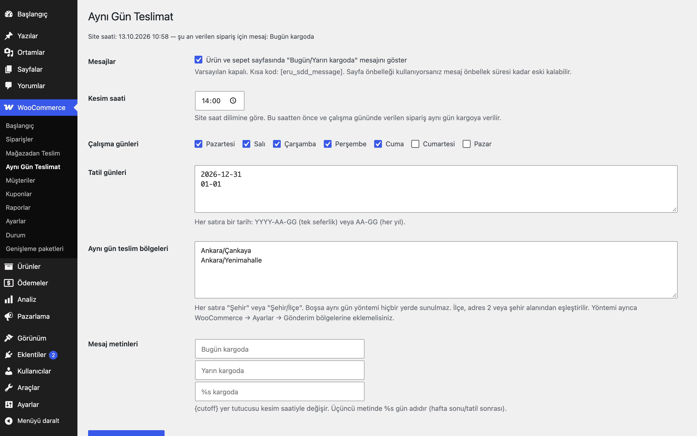
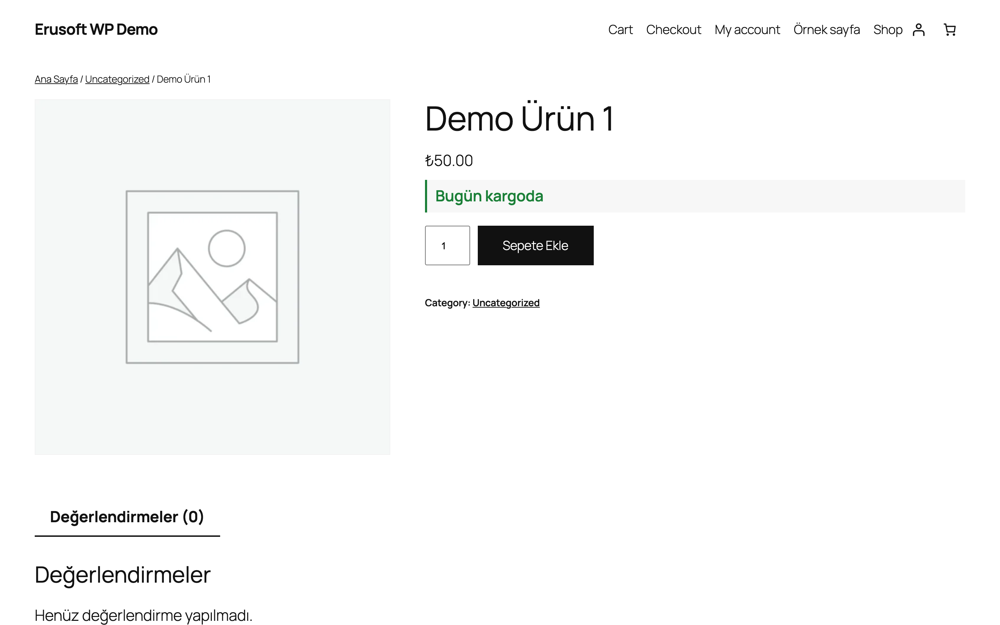
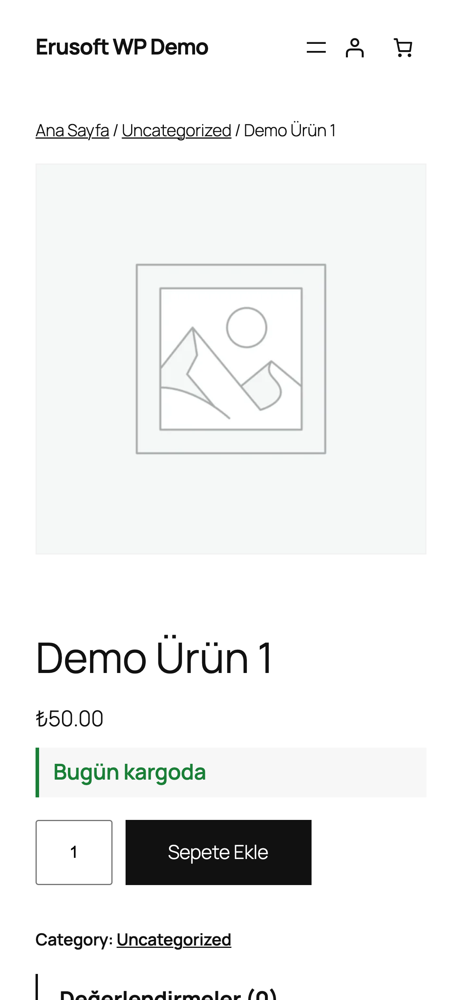

# Same-Day Delivery for WooCommerce

Kesim saati, çalışma günleri ve tatillere göre "Bugün kargoda / Yarın kargoda" mesajı ve uygun şehir/ilçeler için isteğe bağlı aynı gün teslimat yöntemi.

> **English:** Cut-off time, working days and holidays: shows "Ships today / tomorrow / <weekday>" on product and cart pages (site timezone) and adds an optional same-day shipping method with its own fee for eligible cities/districts. Everything is off or empty until configured.

   

## Ne işe yarar

Müşteriye siparişin ne zaman kargoya verileceğini söyler ve belirlediğiniz bölgelerde, kesim saatinden önce, ücretli bir aynı gün teslimat seçeneği sunar.

## Özellikler

- Kesim saati, çalışma günleri, tatil listesi (tek seferlik `YYYY-AA-GG` veya her yıl `AA-GG`)
- Ürün ve sepet sayfasında mesaj: Bugün kargoda / Yarın kargoda / `<gün>` kargoda (metinler ayarlanabilir); kısa kod `[eru_sdd_message]`
- Şehir veya `Şehir/İlçe` listesiyle uygunluk (Türkçe harfe duyarsız); liste boşsa hiçbir yerde sunulmaz
- Kendi ücreti olan, gönderim bölgeleriyle uyumlu **Aynı gün teslimat** kargo yöntemi
- Tüm hesaplar site saat diliminde (`wp_timezone()`)

## Kurulum

1. Klasörü `wp-content/plugins/` altına kopyalayın ve etkinleştirin.
2. WooCommerce → **Aynı Gün Teslimat**: kesim saatini, çalışma günlerini, tatilleri ve bölgeleri girin; mesajı göstermek için kutuyu işaretleyin.
3. Aynı gün yöntemi için WooCommerce → Ayarlar → Gönderim bölgelerinde bölgenize **Aynı gün teslimat** yöntemini ekleyin ve ücretini yazın.

## Ayarlar

| Ayar | Varsayılan |
|---|---|
| Mesajları göster | kapalı |
| Kesim saati | 14:00 |
| Çalışma günleri | Pazartesi-Cuma |
| Tatil günleri | boş |
| Aynı gün bölgeleri | boş (hiçbir yerde sunulmaz) |
| Mesaj metinleri | Bugün kargoda / Yarın kargoda / `%s` kargoda; `{cutoff}` yer tutucusu desteklenir |

Ayarlar `eru_sdd_settings` seçeneğindedir.

## Kısa kodlar, kancalar ve filtreler

| Ad | Tür | Açıklama |
|---|---|---|
| `eru_sdd_now` | filtre | "Şimdi" değeri (`DateTimeInterface` veya zaman damgası); testler ve simülasyon için |
| `eru_sdd_show_for_product` | filtre | Ürün sayfasında mesajı göster/gizle (`$show`, `$product`) |
| `eru_sdd_destination_eligible` | filtre | Teslimat adresi uygunluğunu değiştir (`$ok`, `$destination`) |
| `[eru_sdd_message]` | kısa kod | Mesajı istenen yere basar |

## Entegrasyonlar ve gereksinimler

WordPress 6.5+, PHP 8.0+, WooCommerce 9.0+, HPOS uyumlu.

## Sınırlamalar

- Ürün ve sepet sayfasındaki "bugün kargoda / yarın kargoda" mesajı yalnızca saate, çalışma günlerine ve tatillere bakar; teslimat bölgesi kuralını (il/ilçe) dikkate almaz, çünkü ziyaretçinin adresi o sırada bilinmez. Bölge kuralı yalnızca ödeme adımındaki kargo seçeneğinde uygulanır.
- Kargo ücreti önbelleğine günlük açık/kapalı durumu eklenmesi, yalnızca "Aynı Gün Teslimat" kargo yöntemi bir bölgeye eklenmişse yapılır (`eru_sdd_method_configured` filtresi).
- Mesaj sayfa oluşturulurken hesaplanır; sayfa önbelleği kullanıyorsanız önbellek süresi kadar eski kalabilir.
- İlçe, WooCommerce'in şehir alanından veya adres 2 alanından eşleştirilir; eklenti kendi ilçe alanı eklemez.
- Geri sayım sayacı yoktur; kesim saati metin olarak (`{cutoff}`) gösterilebilir.

## SSS

**Resmi tatilleri kendisi bilir mi?** Hayır, tatil günlerini siz girersiniz.

**Hafta sonu verilen sipariş?** Bir sonraki çalışma günü için `<gün> kargoda` mesajı gösterilir.

Kaldırma: `eru_sdd_settings` silinir.

## Değişiklik geçmişi

Bkz. [CHANGELOG.md](CHANGELOG.md).

## Lisans

GPL-2.0-or-later. Diğer Erusoft eklentileri: https://wordpress.erusoft.com/
