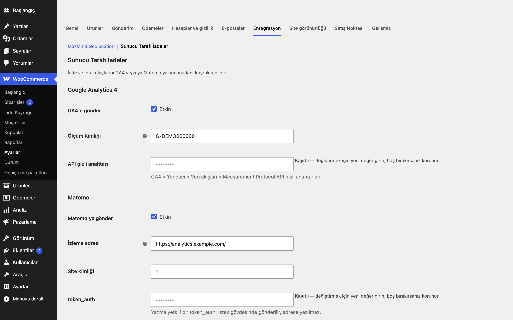

# Server-Side Refunds for WooCommerce

> **English:** Reports WooCommerce partial/full refunds and cancellations of already-paid orders to Google Analytics 4 (Measurement Protocol) and/or Matomo from the server. Events go through a queue table processed by Action Scheduler, with exponential backoff, de-duplication, a queue screen, an order metabox, a test button and `wp eru-ssr queue`. Refund events only: no purchase tracking and no item-level refunds in 1.0.0. Inert until you enable and configure a destination.

   

> **Beta:** canlı API ile kendi hesabınızla doğrulayın.

İade ve iptalleri GA4 ve Matomo'ya tarayıcıdan bağımsız, sunucu tarafında bildirir. Gönderim bir kuyruktan yapılır; başarısız istekler üstel geri çekilmeyle yeniden denenir ve aynı iade iki kez gönderilmez.

## Neden sunucu tarafı?

İadeler çoğunlukla yönetici panelinde, müşterinin tarayıcısı yokken yapılır. Tarayıcı etiketleri bu olayı göremez; raporlardaki gelir şişkin kalır. Bu eklenti iadeyi WooCommerce'in kendi olayından yakalar ve ölçüm hizmetine sunucudan gönderir.

- Kısmi ve tam iade, ayrı ayrı açılıp kapatılabilir.
- Ödenmiş bir sipariş iptal edilir veya başarısız olursa, **kalan** tutar (sipariş toplamı − önceden iade edilen) düzeltme olarak gönderilir. Kısmi iadeden sonra iptal, gelirin iki kez düşülmesine yol açmaz.
- "Ödenmiş" kararı, durum değişiminden **önceki** durum ödenmiş durumlardan biriyse veya siparişin ödeme tarihi varsa verilir. Hiç ödenmemiş bir sipariş iptal edilirse hiçbir şey gönderilmez.
- Sipariş oluşurken `_ga` çerezinden `client_id` (`GA1.1.X.Y` → `X.Y`) sipariş metasına (`_eru_ssr_client_id`) yazılır. Çerez yoksa ayara bağlı olarak `<sipariş no>.<oluşturma zamanı>` yedeği kullanılır.

## Kurulum

1. `server-side-refunds-for-woocommerce` klasörünü `wp-content/plugins/` altına kopyalayın (veya zip olarak yükleyin).
2. Eklentiler ekranından etkinleştirin. WooCommerce gereklidir.
3. WooCommerce → Ayarlar → Entegrasyon → **Sunucu Tarafı İadeler**'den hedefi açıp bilgileri girin.

Etkinleştirme sonrası eklenti pasiftir: hedef açılıp yapılandırılmadıkça dış istek, zamanlanmış iş veya ön yüz çıktısı yoktur.

## Nasıl kullanılır

1. Eklentiyi etkinleştirin; WooCommerce → Ayarlar → Entegrasyon → **Sunucu Tarafı İadeler** ekranını açın.
2. "GA4'e gönder"i işaretleyin, Ölçüm Kimliğini ve API gizli anahtarını girin (ya da Matomo için izleme adresi, site kimliği ve token_auth).
3. **GA4 test gönderimi** düğmesine basın; sonuç ekranında doğrulama iletisinin hatasız geldiğini görün.
4. Demo bir sipariş (ör. "Demo Ürün", 250 TL) oluşturup ödenmiş duruma getirin, ardından siparişte 50 TL kısmi iade yapın.
5. WooCommerce → **İade Kuyruğu** ekranında `refund` satırının eklendiğini, kısa süre içinde durumunun "Gönderildi"ye döndüğünü doğrulayın.
6. Aynı satır sipariş ekranındaki kutuda da görünür. Hata varsa satırı buradan yeniden deneyebilirsiniz.

## GA4 kurulumu

1. GA4 → Yönetici → Veri akışları → akışınız: **Ölçüm Kimliği** (`G-…`) ve "Measurement Protocol API gizli anahtarları" altında bir **API gizli anahtarı** oluşturun.
2. Ayarlarda "GA4'e gönder"i işaretleyin, kimliği ve gizli anahtarı girin.
3. **GA4 test gönderimi** düğmesi Google'ın doğrulama (`/debug/mp/collect`) uç noktasını çağırır ve `validationMessages` sonucunu gösterir; veri kaydedilmez.

Gönderilen olay: `refund` — `transaction_id` (sipariş numarası), `currency`, `value`. İstek `https://www.google-analytics.com/mp/collect?measurement_id=…&api_secret=…` adresine JSON olarak gider. API gizli anahtarının sorgu parametresi olması Google uç noktasının tasarımıdır; eklenti bunu günlüklerde ve kuyruk hata alanında maskeler. Kullanıcı kimliği (`user_id`) yalnızca "Kullanıcı kimliği" ayarı açıksa gönderilir (varsayılan kapalı).

## Matomo kurulumu

1. Matomo'da yazma yetkili bir kullanıcı için **token_auth** oluşturun; site kimliğini not edin.
2. Ayarlarda "Matomo'ya gönder"i işaretleyin; izleme adresini (https; yalnızca `localhost` için http), site kimliğini ve token_auth'u girin.
3. **Matomo test gönderimi** düğmesi, geçersiz bir site kimliğiyle (`idsite=0`) tek istekli bir toplu (bulk) istek yollar: Matomo'nun erişilebilir olduğunu ve token'ın kabul edildiğini doğrular, hiçbir şey kaydetmez.

İstek `matomo.php` adresine form gövdesiyle POST edilir (`idsite`, `rec`, `token_auth`, `cdt`, `url`, …). `token_auth` hiçbir zaman adrese yazılmaz.

## Mod A / Mod B

| | Mod A (varsayılan) | Mod B |
|---|---|---|
| Ne gönderilir | Negatif gelirli e-ticaret siparişi: `idgoal=0`, `ec_id`, `revenue=-<tutar>` | Özel olay: `e_c=ecommerce`, `e_a=refund`, `e_n=<sipariş no>`, `e_v=<tutar>` |
| `ec_id` | `<sipariş no>-refund-<iade id>` veya `<sipariş no>-cancel` (belirleyici) | – |
| Gelir raporu | Gelir düşer | Düşmez; olay raporundan okunur |
| Sipariş sayısı | **Artar:** Matomo'nun yerel bir iade API'si yoktur, her iade yeni bir sipariş olarak sayılır | Etkilenmez |

Gelir düzeltmesi istiyor ve sipariş sayısındaki artışı kabul edebiliyorsanız Mod A; sayıları bozmak istemiyorsanız Mod B'yi seçin.

## Kuyruk

Olaylar `{önek}eru_ssr_queue` tablosuna yazılır (tablo `plugins_loaded` sırasında sürüm kontrolüyle oluşturulur/güncellenir). Tekilleştirme anahtarı: `refund:<iade id>:<hedef>` ve `cancel:<sipariş id>:<hedef>`; aynı anahtar ikinci kez eklenmez.

- Her ekleme için Action Scheduler'da bir iş planlanır; bekleyen satır olduğu sürece 5 dakikada bir süpürme çalışır (her seferde 20 satır, kilit altında).
- Yeniden deneme bekleme süresi `min(6 saat, 60 sn × 2^deneme)`; en çok 10 deneme, sonra "Başarısız".
- GA4 için 2xx, Matomo için 2xx/204 başarıdır. Ağ hatası, 429 ve 5xx yeniden denenir; diğer 4xx kalıcı hatadır.
- Gönderilmiş satırlar ve saklama süresinden (varsayılan 30 gün) eski **başarısız** satırlar (istemci/kullanıcı kimliği taşırlar) günlük olarak silinir. Hâlâ yeniden denenen bekleyen satırlar silinmez.
- Süpürme ve günlük temizlik zinciri, kuyrukta satır kaldığı sürece kendini yeniden planlar; kuyruk boşalınca Action Scheduler'da bu işler kalmaz. Eklenti devre dışı bırakılınca bekleyen işler kaldırılır; yeniden etkinleştirilince kuyrukta satır varsa ilk istekte yeniden planlanır.
- WooCommerce → **İade Kuyruğu**: durum süzgeci, yeniden dene, sil. Sipariş ekranında o siparişin kuyruk satırlarını gösteren bir kutu bulunur.
- WP-CLI: `wp eru-ssr queue status`, `run`, `retry [--id=]`, `purge`.

Kuyrukta kimlik bilgisi saklanmaz; API gizli anahtarı ve token gönderim anında ayarlardan okunur. Ayar ekranında bu alanlar yazma-yalnız çalışır (boş bırakmak mevcut değeri korur) ve `autoload=no` ile kaydedilir.

## Kişisel veri

- **Ne saklanır:** bir hedef (GA4 veya Matomo) açıkken ödeme sırasında siparişe `_eru_ssr_client_id` (GA4 `_ga` çerezinden okunan takma adlı istemci kimliği, ör. `123456789.1700000000`) yazılır. "Kullanıcı kimliğini gönder" açıksa ve sipariş bir hesaba bağlıysa `_eru_ssr_user_id` (WordPress kullanıcı numarası) de yazılır. Ad, e-posta, telefon, adres veya IP saklanmaz ve gönderilmez. Hiçbir hedef açık değilken hiçbir şey yazılmaz.
- **Ne gönderilir:** GA4'e `client_id` (çerez yoksa ve yedek açıksa `<sipariş id>.<oluşturma zamanı>`), açıksa `user_id`, işlem numarası, tutar ve para birimi; Matomo'ya aynı tutar/işlem bilgisi ve açıksa `uid`. Bu kimlikler sizin analiz hesabınızdaki ziyaretçiyle eşleşmek içindir.
- **Kuyruk ve saklama:** gönderilecek olay, bu kimliklerle birlikte `{önek}eru_ssr_queue` tablosunda bekler. Gönderilmiş satırlar ve saklama süresinden (varsayılan 30 gün) eski başarısız satırlar günlük işle silinir.
- **Sipariş metası** (`_eru_ssr_client_id`, `_eru_ssr_user_id`) sipariş kaydının parçası olarak kalır; eklenti silindiğinde de korunur. Takma adlı kimlikler olduğundan ayrı bir WordPress dışa aktarıcı/silici kaydedilmez; sipariş silindiğinde bu metalar da silinir. Analiz hesabınızdaki veriler için Google Analytics / Matomo'nun kendi silme araçlarını kullanın.

## Kancalar ve filtreler

| Ad | Tür | Açıklama |
|---|---|---|
| `eru_ssr_ga4_payload` | filtre | GA4 istek gövdesi (`$body`, `$payload`) |
| `eru_ssr_matomo_params` | filtre | Matomo form alanları (`$params`, `$payload`); `token_auth` sonradan eklenir |
| `eru_ssr_should_send` | filtre | Kuyruğa eklemeden önce son karar (`$send`, `$destination`, `$order`, `$type`, `$payload`) |

## Gereksinimler

WordPress 6.5+, PHP 8.0+, WooCommerce 9.0+ (Action Scheduler WooCommerce ile gelir). HPOS ile uyumludur; sipariş verisi yalnızca `WC_Order` üzerinden okunur ve yazılır. Sipariş meta alanları: `_eru_ssr_client_id`, `_eru_ssr_user_id`.

## Sınırlamalar

- **Beta:** GA4 ve Matomo istekleri yalnızca sahte (mock) yanıtlara karşı sınandı. Canlı API ile kendi hesabınızla doğrulayın.
- Yalnızca iade ve iptal olayları gönderilir; satın alma (purchase) izleme yoktur.
- 1.0.0'da kalem bazlı iade yoktur; iade tutar olarak bildirilir.
- Bir sipariş iptal edilip (kalan tutar bildirildi) sonradan ayrıca iade edilirse, ikinci kez gelir düşülmesin diye o iade bildirilmez.
- Hiçbir hedef açık değilken ödeme sırasında sipariş metasına hiçbir şey yazılmaz; hedefi açmadan önce verilen siparişler için `client_id` yedeği kullanılır.
- GA4 `client_id` zorunludur: çerez yoksa ve yedek kapalıysa GA4 olayı gönderilmez (Matomo etkilenmez).
- Matomo Mod A sipariş sayısını artırır (yukarıya bakın). Matomo para birimi site ayarınızdan gelir; dönüşüm yapılmaz.
- Google, 72 saatten eski olayları kabul etmeyebilir; uzun süre başarısız kalan satırlar bu yüzden sonuçsuz kalabilir.
- Aynı sipariş için ikinci bir iptal olayı gönderilmez (`cancel:<sipariş id>`).
- Eklenti silindiğinde (Eklentiler → Sil) ayarlar, kuyruk tablosu ve zamanlanmış işler silinir; sipariş metası (`_eru_ssr_*`) ve sipariş notları korunur.

## SSS

**Eklentiyi devre dışı bırakırsam ya da silersem ne olur?** Devre dışı bırakınca bekleyen zamanlanmış işler kaldırılır; ayarlar ve kuyruk tablosu durur. Eklentiyi silince ayarlar, kuyruk tablosu ve zamanlanmış işler silinir; sipariş metası (`_eru_ssr_*`) ve sipariş notları korunur.

**HPOS ile uyumlu mu?** Evet, eklenti özel sipariş tabloları uyumluluğunu bildirir ve sipariş verisini yalnızca `WC_Order` üzerinden okur/yazar.

**Hangi dış servislere istek yapar?** Yalnızca siz açtığınızda: GA4 Measurement Protocol (`google-analytics.com`) ve kendi Matomo adresiniz. Hedef açılmadıkça dış istek yoktur.

**Satın alma (purchase) olaylarını da gönderir mi?** Hayır; yalnızca iade ve iptal. Satın alma izlemeyi kendi etiket kurulumunuz sürdürür.

**Gönderim başarısız olursa ne olur?** Kuyrukta bekler ve üstel geri çekilmeyle en çok 10 kez denenir; sonra "Başarısız" olur ve İade Kuyruğu ekranından elle yeniden denenebilir.

**Aynı iade iki kez gönderilebilir mi?** Hayır; her iade ve iptal için tekilleştirme anahtarı vardır, aynı anahtar kuyruğa ikinci kez eklenmez.

## English summary

Reports refunds and cancellations of paid orders to GA4 and/or Matomo server-side. A cancellation sends only the remaining amount (total minus already refunded), and an order that was never paid sends nothing. Delivery uses a queue table with a unique de-duplication key, Action Scheduler processing (20 rows per run), exponential backoff capped at 6 hours and 10 attempts. Matomo mode A records a negative-revenue ecommerce order (raises the order count); mode B records a custom event. Credentials are write-only and never logged. Beta: verified against mocked HTTP only.

## Sürüm notları

Bkz. [CHANGELOG.md](CHANGELOG.md).

## Destek

- Önce bu sayfadaki **SSS** ve **Sınırlamalar** bölümlerine göz atın; sık karşılaşılan durumlar orada.
- Hata mı buldunuz? [GitHub Issues](https://github.com/erayusta/erusoft-wp/issues) üzerinden bildirin. WordPress, WooCommerce, PHP ve eklenti sürümünü, adımları ve beklenen/gerçekleşen sonucu yazmanız işi hızlandırır.
- Kurulum, yapılandırma, özel geliştirme veya entegrasyon desteği için **[hello@erusoft.com](mailto:hello@erusoft.com)** adresine yazın. Erusoft hakkında: [erusoft.com](https://erusoft.com).
- Lütfen şifre, API anahtarı veya müşteri verisi (ad, telefon, TCKN, sipariş dökümü) göndermeyin; ekran görüntülerindeki kişisel verileri karartın.

## Lisans

GPL-2.0-or-later. Diğer Erusoft eklentileri: https://wordpress.erusoft.com
