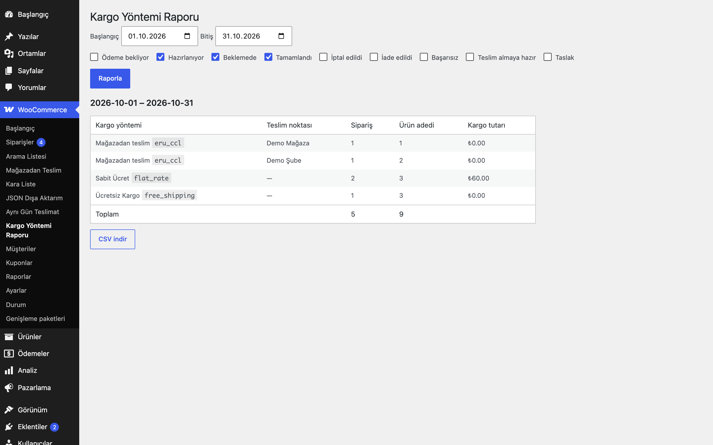

# Shipping Method Report for WooCommerce

Tarih aralığında kargo yöntemi (ve teslim noktası) başına sipariş, ürün adedi ve kargo tutarı raporu; CSV dışa aktarma.

> **English:** Admin report of orders, item quantities and shipping totals per shipping method for a date range, split by pickup location when Click & Collect for WooCommerce is active. CSV export (UTF-8, formula-safe).

   

## Ne işe yarar

Hangi kargo yönteminden kaç sipariş çıktığını ve kaç ürün adedi gönderildiğini tek ekranda görürsünüz. Mağazadan Teslim eklentisi etkinse teslim noktası bazında da ayrılır.

## Özellikler

- WooCommerce → Kargo Yöntemi Raporu: tarih aralığı ve sipariş durumu seçimi
- Yöntem başına sipariş sayısı, ürün adedi ve kargo tutarı; kargosuz siparişler ayrı satır
- Teslim noktası kırılımı: sipariş metası `_eru_ccl_location` varsa okunur
- CSV indirme (UTF-8 BOM, `;` ayracı, elektronik tablo formül enjeksiyonuna karşı korumalı)
- HPOS uyumlu; siparişler 200'lük gruplarla okunur

## Kurulum

1. Klasörü `wp-content/plugins/` altına kopyalayın ve etkinleştirin.
2. WooCommerce → **Kargo Yöntemi Raporu** ekranını açın.

## Ayarlar

Ayar yoktur; varsayılan durumlar Hazırlanıyor, Beklemede ve Tamamlandı'dır.

**Teslim noktası arayüzü:** Rapor, sipariş metasındaki `_eru_ccl_location` (teslim noktası adı) değerini okur. Click & Collect for WooCommerce bu alanı yazar; kendi eklentiniz de aynı anahtarı yazabilir.

## Kısa kodlar, kancalar ve filtreler

Kanca yoktur.

## Entegrasyonlar ve gereksinimler

WordPress 6.5+, PHP 8.0+, WooCommerce 9.0+, HPOS uyumlu. İsteğe bağlı: Click & Collect for WooCommerce.

## Sınırlamalar

- Haftalık e-postayla rapor gönderme yoktur.
- En çok 20.000 sipariş işlenir; aşılırsa uyarı gösterilir.
- Yöntemler `method_id` ve sipariş satırındaki ada göre gruplanır.

## SSS

**Neden rapor boş?** Tarih aralığında seçili durumlarda sipariş yoktur; durumları genişletin.

Kaldırma: Saklanan veri yoktur.

## Değişiklik geçmişi

Bkz. [CHANGELOG.md](CHANGELOG.md).

## Lisans

GPL-2.0-or-later. Diğer Erusoft eklentileri: https://wordpress.erusoft.com/
