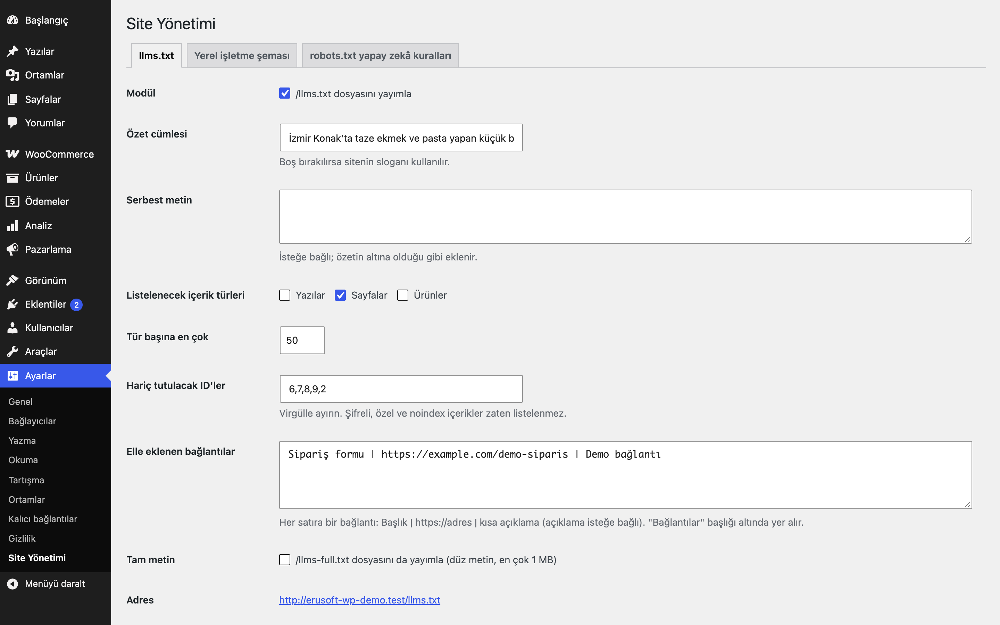
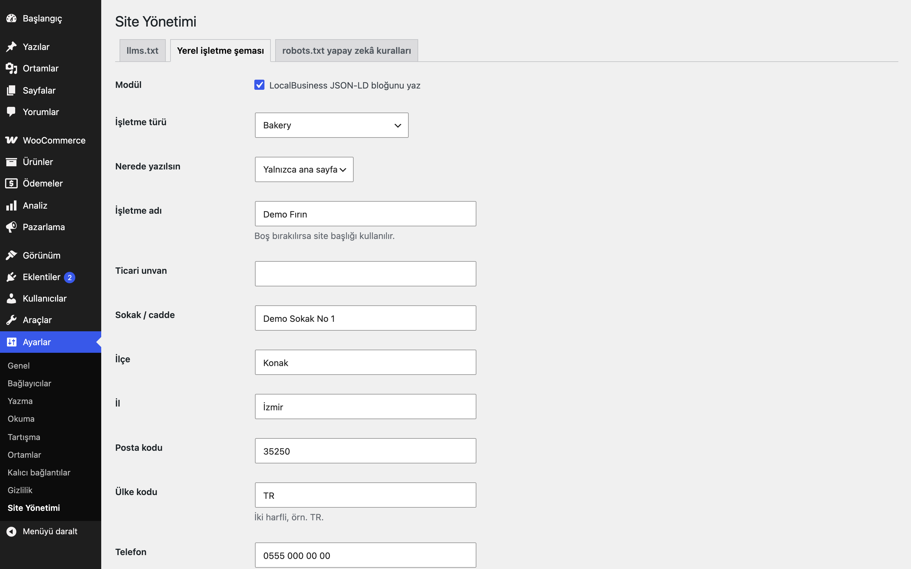
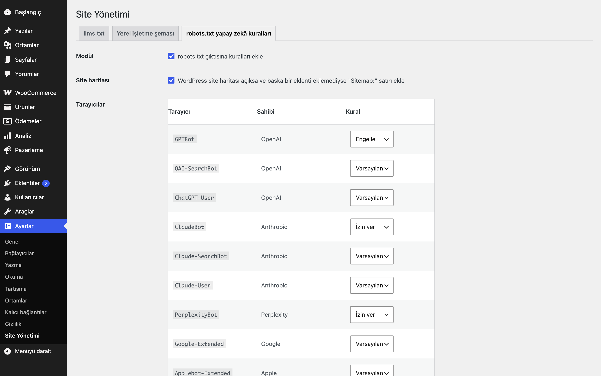
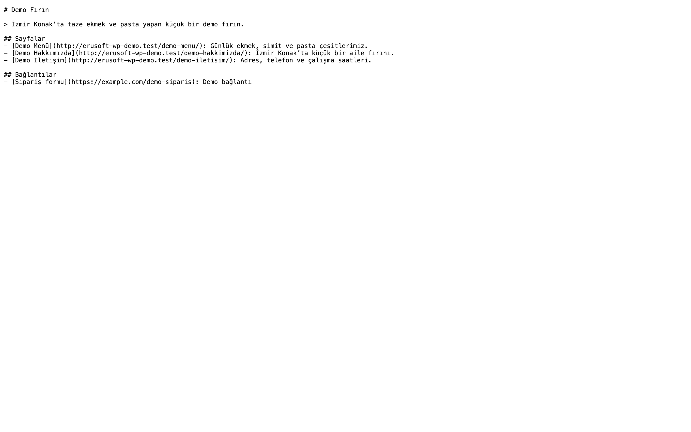

# Site Manager for WordPress

llms.txt, yerel işletme şeması ve robots.txt yapay zekâ tarayıcı kuralları için hafif site yönetimi.

> **English:** Three small opt-in modules: a virtual `/llms.txt`, LocalBusiness JSON-LD and per-crawler AI rules for `robots.txt`. Everything is off after activation. WP-CLI: `wp eru-sm llms|schema|robots`.

[](https://www.gnu.org/licenses/gpl-2.0.html)  






## Ne işe yarar

Ayarlar → **Site Yönetimi** altında her biri ayrı sekmede ve kendi açma düğmesiyle üç modül bulunur. Eklentiyi etkinleştirmek siteyi hiç değiştirmez; hangi modülü açarsanız yalnızca o çalışır.

### llms.txt nedir?

`llms.txt`, sitenizin kök adresinde duran basit bir metin dosyasıdır. Yapay zekâ asistanlarına "bu site ne hakkında, hangi sayfalar önemli" sorusunu kısa ve okunaklı biçimde yanıtlar. Dosya `# Site adı` başlığıyla başlar, `>` ile bir özet cümlesi içerir, ardından `## Sayfalar`, `## Yazılar` gibi bölümlerde `- [Başlık](adres): kısa açıklama` satırları listeler. Eklenti bu dosyayı sizin yerinize sanal olarak üretir (diske dosya yazmaz) ve içerik değiştikçe yeniler.

- Listelenecek içerik türleri, tür başına en çok kayıt sayısı (varsayılan 50) ve hariç tutulacak ID'ler seçilir. Etkinleştirilince varsayılan olarak sayfalar ve yazılar listelenir; WooCommerce etkinse ürünler de seçilebilir.
- Şifre korumalı, özel ve noindex (Yoast / Rank Math) içerikler hiçbir zaman listelenmez. Ürünlerde "Katalog görünürlüğü" ayarı yalnızca mağaza, yalnızca arama veya gizli olanlar (`product_visibility` terimleri `exclude-from-catalog` / `exclude-from-search`) da llms.txt ve llms-full.txt'de listelenmez.
- Elle bağlantı eklenebilir (`Başlık | adres | açıklama`), "Bağlantılar" bölümünde görünür.
- İsteğe bağlı `/llms-full.txt` (varsayılan kapalı) içeriklerin düz metnini verir; 1 MB ile sınırlıdır.
- Yanıt `text/plain; charset=utf-8` ve `X-Robots-Tag: noindex` ile verilir. Çıktı önbelleğe alınır; içerik kaydedildiğinde veya ayar değiştiğinde temizlenir.
- `eru_sm_llms_lines` filtresiyle satırlar değiştirilebilir.

### Yerel işletme şeması

LocalBusiness JSON-LD: işletme türü (LocalBusiness, Store, Restaurant, Bakery, AutoRepair, ProfessionalService ve diğerleri), ad, ticari unvan, adres (ilçe `addressLocality`, il `addressRegion` olarak yazılır), telefon, e-posta, fiyat aralığı, çalışma saatleri, sameAs bağlantıları, logo ve enlem/boylam. Boş alanlar çıktıya hiç yazılmaz; eklenti hiçbir bilgiyi kendiliğinden üretmez. Ana sayfada (varsayılan) veya tüm sayfalarda yazılır. Yoast Local SEO, Rank Math'in yerel SEO modülü veya SEOPress Local Business açıksa çift çıktıyı önlemek için şema yazılmaz ve ayar ekranında uyarı çıkar. Filtreler: `eru_sm_schema_enabled`, `eru_sm_schema`.

### robots.txt yapay zekâ kuralları

Her tarayıcı için **Varsayılan** (hiçbir satır eklenmez), **İzin ver** veya **Engelle** seçilir.

| Tarayıcı | Sahibi |
|---|---|
| GPTBot, OAI-SearchBot, ChatGPT-User | OpenAI |
| ClaudeBot, Claude-SearchBot, Claude-User | Anthropic |
| PerplexityBot | Perplexity |
| Google-Extended | Google |
| Applebot-Extended | Apple |
| CCBot | Common Crawl |
| Bytespider | ByteDance |
| Amazonbot | Amazon |
| meta-externalagent | Meta |

WordPress site haritası açıksa ve başka bir eklenti `Sitemap:` satırı eklememişse bir satır eklenir. Kök dizinde fiziksel `robots.txt` veya `llms.txt` dosyası varsa ya da "Arama motorlarının siteyi dizine eklemesini engelle" açıksa ayar ekranı uyarır.

## Kurulum

1. `site-manager-for-wordpress` klasörünü `wp-content/plugins/` altına kopyalayın (veya zip olarak yükleyin).
2. Eklentiler ekranından etkinleştirin.
3. Ayarlar → Site Yönetimi'nde istediğiniz modülü açın. `llms.txt` modülü açıldığında adres kuralı bir kez yenilenir.

## WP-CLI

```
wp eru-sm llms [--full]   # llms.txt çıktısı
wp eru-sm schema          # JSON-LD
wp eru-sm robots          # robots.txt
```

Modül kapalıysa komutlar uyarı verir ve çıktıyı yalnızca önizleme olarak gösterir.

## Sınırlamalar

- robots.txt kuralları tavsiye niteliğindedir; uyup uymamak tarayıcıya bağlıdır ve erişimi teknik olarak engellemez.
- Eklenti bir SEO eklentisinin yerel işletme modülünün yerini tutmaz; yalnızca küçük siteler için hafif bir seçenektir.
- noindex algılaması yalnızca Yoast ve Rank Math meta alanlarını kapsar; başka SEO eklentilerinin noindex işaretleri llms.txt'de dikkate alınmaz (gerekirse hariç tutulacak ID'leri elle girin).
- "Arama motorlarının siteyi dizine eklemesini engelle" açıkken llms.txt yayımlanmaz ve Sitemap satırı eklenmez.
- Kök dizinde fiziksel dosya varsa sanal sürümün önüne geçer.
- Düz kalıcı bağlantı ayarında `/llms.txt` yalnızca sunucu istekleri `index.php`'ye yönlendiriyorsa çalışır.

## Kaldırma

Eklenti silindiğinde yalnızca kendi ayarı (`eru_sm_settings`) ve önbelleği silinir. Sitenizdeki içeriklere dokunulmaz.

## SSS

**Kök dizinde zaten bir `robots.txt` veya `llms.txt` dosyam var, ne olur?** Sunucu fiziksel dosyayı doğrudan verir, WordPress'e hiç uğramaz; bu yüzden eklentinin sanal sürümü görünmez. Ayar ekranı bu durumda uyarır. Eklentinin çıktısını kullanmak için dosyayı kaldırın; dosyanızı korumak istiyorsanız ilgili modülü kapalı tutun.

**Bir yapay zekâ tarayıcısını "Engelle" yapmak erişimi gerçekten keser mi?** Hayır. robots.txt kuralları tavsiye niteliğindedir; kurala uyan tarayıcılar siteyi taramaz, uymayanları teknik olarak durdurmaz.

**Gizlediğim ürünler llms.txt'de görünür mü?** Hayır. Katalog görünürlüğü "Yalnızca mağaza", "Yalnızca arama sonuçları" veya "Gizli" olan ürünler listelenmez; şifreli, özel ve noindex içerikler de dışarıda kalır. Tek tek gizlemek istediğiniz içerikler için hariç tutulacak ID'leri girin.

## Değişiklik geçmişi

Bkz. [CHANGELOG.md](CHANGELOG.md).

## Lisans

GPL-2.0-or-later. Diğer Erusoft eklentileri: https://wordpress.erusoft.com/
