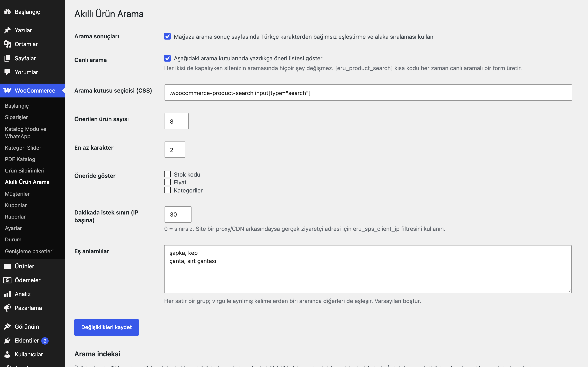
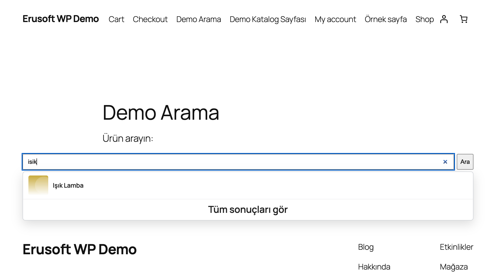
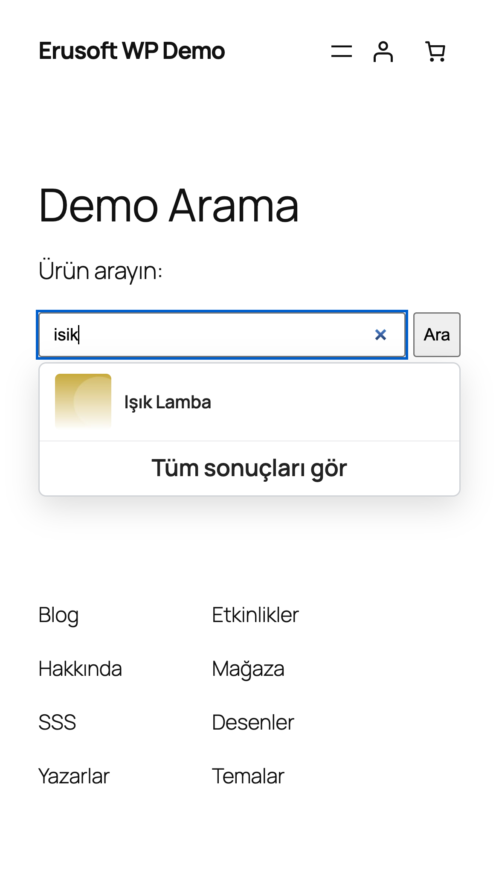
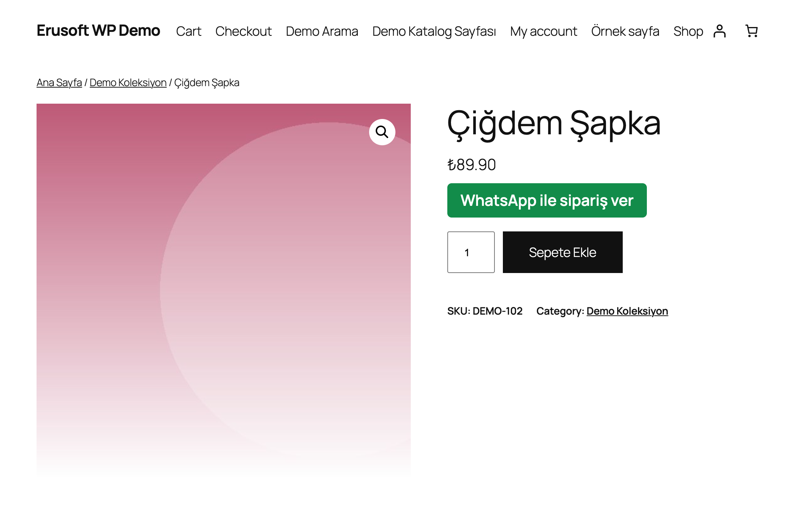

# Smart Product Search for WooCommerce

Ürün aramasını Türkçe karakterden bağımsız (ı/i, ş/s, ğ/g, ç/c, ö/o, ü/u) yapar, stok koduna göre bulur ve isteğe bağlı canlı öneri listesi gösterir.

> **English:** Turkish-aware product search: matches ı/i, ş/s, ğ/g, ç/c, ö/o, ü/u and SKUs in SQL, ranks by relevance, supports synonyms and offers an optional live dropdown. Default: both switches off, so your search is unchanged until you enable them.

   

## Ne işe yarar

"isik" yazan ziyaretçi "Işık Lamba" ürününü bulur. Eşleştirme veritabanı tarafında, ürün başına tutulan sadeleştirilmiş bir arama indeksi (post meta) üzerinden yapılır; bu yüzden yüzlerce ürünle de hızlıdır ve sınırlı bir sonuç kümesinin PHP'de süzülmesine dayanmaz.

## Özellikler

- Türkçe karakterden ve büyük/küçük harften bağımsız eşleştirme (SQL tarafında)
- Başlık, stok kodu (varyasyon stok kodları dahil) ve kategori adı üzerinde arama
- Alaka sıralaması: tam stok kodu, tam başlık, başlık başı, başlıkta geçme, diğer
- Canlı arama önerisi: ürünler, kategoriler, klavye gezinmesi, mobil uyumlu
- Eş anlamlılar kutusu (varsayılan boş)
- Herkese açık salt-okunur REST uç noktası, IP başına dakika sınırı
- `[eru_product_search]` kısa kodu: canlı aramalı hazır form
- Taslak, özel, şifre korumalı ve aramadan gizli ürünler hiçbir zaman sonuçlarda çıkmaz; varyasyon stok kodları kaydedilince üst ürün yeniden indekslenir
- İndekslenmemiş ürünler de başlık ve stok koduyla bulunur; toplu yeniden indeksleme düğmesi

## Kurulum

1. `smart-product-search-for-woocommerce` klasörünü `wp-content/plugins/` altına kopyalayın (veya zip olarak yükleyin).
2. Eklentiler ekranından etkinleştirin (WooCommerce gereklidir).
3. WooCommerce → **Akıllı Ürün Arama**: "Arama sonuçları" ve/veya "Canlı arama" kutusunu işaretleyin. Mevcut ürünleri **Yeniden indeksle** düğmesiyle bir kez indeksleyin (yeni/güncellenen ürünler otomatik indekslenir).

## Ayarlar

Seçenek: `eru_sps_settings` (ana sorgu, canlı arama, CSS seçici, ürün sayısı, en az karakter, gösterilecek alanlar, istek sınırı, eş anlamlılar). İndeks: `_eru_sps_index`, `_eru_sps_title` (ürün meta). Eş anlamlılar her satırda bir grup, virgülle: `kulaklık, headphone`.

## Kısa kodlar, kancalar ve filtreler

| Ad | Tür | Açıklama |
|---|---|---|
| `GET /wp-json/eru-sps/v1/search?q=` | REST | Ürünler, kategoriler ve tüm sonuçlar bağlantısı döndürür; `Cache-Control: no-store`; sınırı aşınca 429 |
| `[eru_product_search placeholder="…"]` | kısa kod | Canlı aramalı arama formu |
| `eru_sps_client_ip` | filtre | İstek sınırı için ziyaretçi IP'si (varsayılan `REMOTE_ADDR`). Proxy/CDN arkasında gerçek adresi döndürün. |
| `eru_sps_synonym_groups` | filtre | Eş anlamlı grupları (dizi dizisi) |
| `eru_sps_index_parts` | filtre | Ürünün arama indeksine girecek metin parçaları (`$parts`, `$product`) |
| `eru_sps_exclude_term_ids` | filtre | Ürünleri aramadan çıkarılacak `product_cat` terim kimlikleri (alt kategoriler otomatik eklenmez) |
| `eru_sps_search_ids` | filtre | Eşleşen ürün kimlikleri, en iyi eşleşme önce (`$ids`, `$query`) |
| `eru_sps_categories` | filtre | Eşleştirmeden önce kategori listesi (`id`, `name`, `fold`, `count` satırları) |
| `eru_sps_categories_version` | filtre | Kategori önbelleği sürümü; değişince önbellek yeniden kurulur |

## Entegrasyonlar ve gereksinimler

WordPress 6.5+, PHP 8.0+, WooCommerce 9.0+, MySQL/MariaDB. HPOS uyumludur. Harici servis kullanmaz. Hide Categories for WooCommerce etkinse gizli kategorilerdeki ürünler ve kategoriler açılır listede gösterilmez.

## Sınırlamalar

- Yazım hatası toleransı (bulanık eşleştirme) yoktur; eşleştirme alt dize üzerinedir.
- Kategori adı değişiklikleri ürün indekslerine yeniden indeksleme ile yansır.
- Ana arama sonucu en fazla 200 ürünle sınırlıdır (alaka sırasına göre).
- Canlı arama yalnızca seçici ile eşleşen ve `.eru-sps-input` sınıflı kutulara bağlanır; temanızın özel arama penceresi için CSS seçiciyi ayarlayın.
- Önbellekli sayfalarda ziyaretçiye özel içerik üretilmez; öneriler REST çağrısıyla yüklenir.

## SSS

**"isik" yazınca ürün gelmiyor.** "Arama sonuçları" kutusunu işaretleyin. Ürün yeni içe aktarıldıysa Yeniden indeksle düğmesini kullanın.

**Proxy/CDN arkasındayım, sınır herkesi etkiliyor.** `eru_sps_client_ip` filtresiyle gerçek ziyaretçi adresini döndürün.

## Değişiklik geçmişi

Bkz. [CHANGELOG.md](CHANGELOG.md).

## Lisans

GPL-2.0-or-later.

Diğer Erusoft eklentileri: https://wordpress.erusoft.com/
