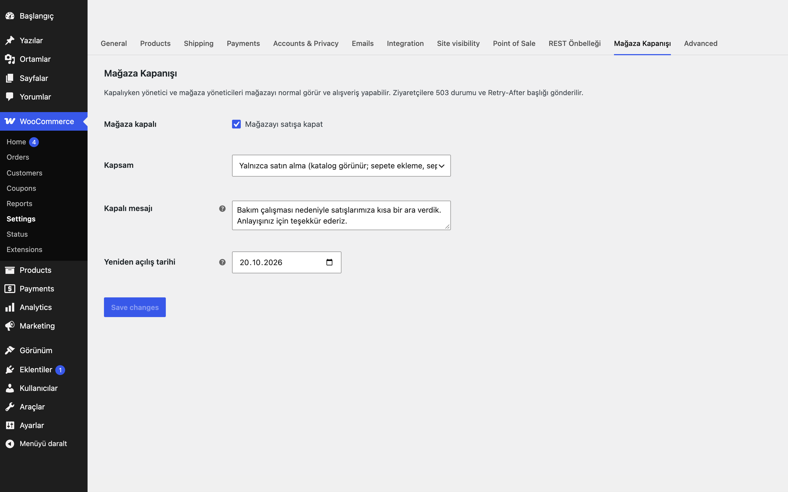
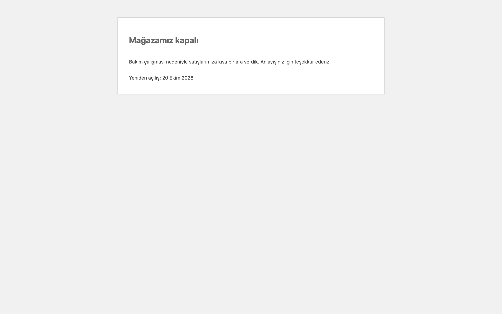

# Store Closure Switch for WooCommerce

Mağazayı tek anahtarla satışa kapatır. Kapalıyken sepete ekleme kalkar; sepet ve ödeme sayfaları (ve Store API sepet/ödeme yazma uçları: add-item, items, update-item, remove-item, update-customer, kupon, kargo seçimi, extensions, checkout, batch) `503 Service Unavailable` + `Retry-After` döner. Yönetici ve mağaza yöneticileri etkilenmez. Varsayılan olarak kapalı değildir: eklentiyi etkinleştirmek mağazayı kapatmaz.

## Özellikler

- Aç/kapa anahtarı (varsayılan: mağaza açık)
- İki kapsam: yalnızca satın alma (katalog görünür kalır) veya tüm ön yüz
- Marka içermeyen varsayılan mesaj; kendi mesajınızı yazabilirsiniz
- İsteğe bağlı yeniden açılış tarihi: tarihte kapanış kendiliğinden biter, `Retry-After` o tarihe göre hesaplanır
- Yönetici ve mağaza yöneticileri muaf; yönetim çubuğunda "Mağaza kapalı" göstergesi
- wp-admin, giriş sayfası, WP-CLI ve cron etkilenmez (satın alınabilirlik filtresi de bu bağlamlarda uygulanmaz)
- Sipariş alındı (teşekkür) sayfası kapanıştan etkilenmez

## Kurulum

1. `store-closure-switch-for-woocommerce` klasörünü `wp-content/plugins/` altına kopyalayın ve etkinleştirin.
2. WooCommerce → Ayarlar → Mağaza Kapanışı sekmesinden anahtarı açın.

## Ayarlar

WooCommerce → Ayarlar → Mağaza Kapanışı: `eru_scs_enabled`, `eru_scs_scope` (`purchase` | `site`), `eru_scs_message`, `eru_scs_reopen` (YYYY-AA-GG).

## Nasıl kullanılır

1. Eklentiyi etkinleştirin; mağaza hâlâ açıktır.
2. WooCommerce → Ayarlar → **Mağaza Kapanışı** sekmesini açın.
3. Kapsam olarak "yalnızca satın alma"yı seçin (katalog görünür kalır).
4. İsterseniz mesaj alanına "Demo mağaza kısa süreliğine satışa kapalıdır." yazın ve yeniden açılış tarihini girin.
5. Anahtarı açıp kaydedin.
6. Çıkış yaparak veya gizli pencerede mağazayı açın: ürünler satın alınamaz görünür, sepet ve ödeme sayfaları 503 ile kapanış mesajını gösterir. Yönetici olarak oturum açıkken mağazayı normal görürsünüz.
7. Satışı yeniden açmak için anahtarı kapatın ya da yeniden açılış tarihinin gelmesini bekleyin.

## Kancalar ve filtreler

| Ad | Tür | Açıklama |
|---|---|---|
| `eru_scs_is_closed` | filtre | Mağazanın kapalı olup olmadığını değiştirir (`bool`) |
| `eru_scs_bypass` | filtre | Kapanıştan muaf kullanıcıyı belirler (`bool`) |
| `eru_scs_retry_after` | filtre | `Retry-After` saniyesi (varsayılan: yeniden açılışa kalan süre veya 86400) |

## Gereksinimler

WordPress 6.5+, PHP 8.0+, WooCommerce 9.0+.

## Sınırlamalar

- "Yalnızca satın alma" kapsamında ürünler satın alınamaz görünür; bunu kendi temanızdaki özel sepet bileşenleri atlatıyorsa `eru_scs_is_closed` filtresiyle ek kontrol ekleyin.
- Giden e-postaları veya zamanlanmış görevleri durdurmaz.
- Sayfa önbelleği kullanıyorsanız kapanışı açıp kapattıktan sonra önbelleği temizleyin; 503 yanıtı `no-store` ile gelir.
- Yeniden açılış tarihi o günün başlangıcıdır (site saat dilimi).
- Eklenti silindiğinde (Eklentiler → Sil) yalnızca kendi ayarları (`eru_scs_*` seçenekleri) silinir; eklenti başka kalıcı veri saklamaz.

## SSS

**Yöneticiyken mağazayı normal görüyorum, doğru mu?** Evet; kapanışı denemek için çıkış yapın veya gizli pencere kullanın.

**Arama motorları ne görür?** 503 ve `Retry-After`; kısa süreli kapanışta sıralamayı korumak için önerilen yanıttır.

**Eklentiyi devre dışı bırakınca ne olur?** Kapanış anında kalkar, çünkü tüm kontroller eklenti koduyla yapılır; ayarlar veritabanında kalır. Eklenti silinince (Eklentiler → Sil) yalnızca `eru_scs_*` seçenekleri silinir.

**HPOS ve bloklar?** HPOS uyumluluğu bildirilir. Blok tabanlı sepet ve ödemenin kullandığı Store API yazma uçları da kapanışta 503 döner (bkz. üstteki açıklama).

**Yeniden açılış tarihi geldiğinde bir şey yapmam gerekir mi?** Hayır, kapanış o günün başlangıcında (site saat dilimi) kendiliğinden biter; zamanlanmış iş gerekmez. Önbellek kullanıyorsanız yine de önbelleği temizleyin.

**Dış servis kullanıyor mu?** Hayır, hiçbir dış çağrı yapmaz.

**Kapanışa kendi koşulumu ekleyebilir miyim?** Evet: `eru_scs_is_closed` filtresi kapalı/açık durumunu, `eru_scs_bypass` muaf kullanıcıyı değiştirir.

## English summary

One switch to close the shop to buyers: add-to-cart is disabled and the cart/checkout (plus Store API write routes) return 503 with `Retry-After`. Admins and shop managers bypass it. Optional reopen date, generic default message, two scopes (purchase-only or whole front end). Off by default.

## Sürüm notları

Bkz. [CHANGELOG.md](CHANGELOG.md).

## Destek

- Önce bu sayfadaki **SSS** ve **Sınırlamalar** bölümlerine göz atın; sık karşılaşılan durumlar orada.
- Hata mı buldunuz? [GitHub Issues](https://github.com/erayusta/erusoft-wp/issues) üzerinden bildirin. WordPress, WooCommerce, PHP ve eklenti sürümünü, adımları ve beklenen/gerçekleşen sonucu yazmanız işi hızlandırır.
- Kurulum, yapılandırma, özel geliştirme veya entegrasyon desteği için **[hello@erusoft.com](mailto:hello@erusoft.com)** adresine yazın. Erusoft hakkında: [erusoft.com](https://erusoft.com).
- Lütfen şifre, API anahtarı veya müşteri verisi (ad, telefon, TCKN, sipariş dökümü) göndermeyin; ekran görüntülerindeki kişisel verileri karartın.

## Lisans

GPL-2.0-or-later. Diğer Erusoft eklentileri: https://wordpress.erusoft.com
