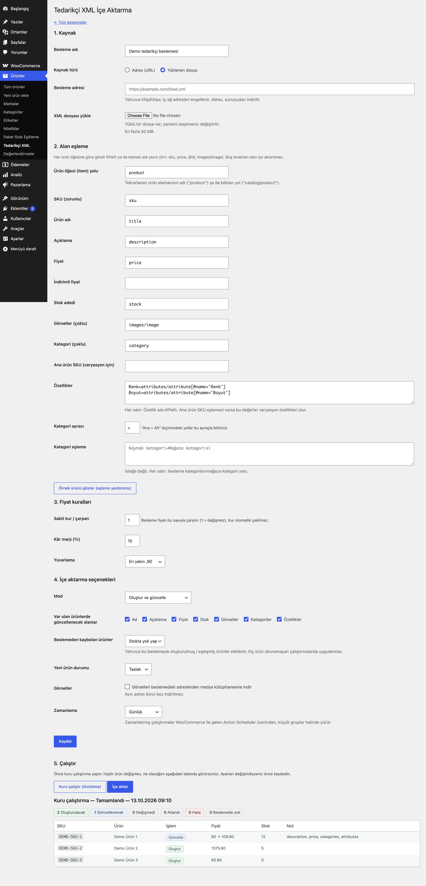

# Supplier XML Importer for WooCommerce

Tedarikçi XML beslemelerinden ürün oluşturun ve güncelleyin; alan eşleme, fiyat kuralları ve kuru çalıştırma önizlemesi ile.

> **English:** Import and update WooCommerce products from supplier XML feeds (URL or uploaded file). Map XML elements/XPath to product fields, apply markup / fixed rate / .90-.99 rounding, preview with a dry run, and run batched imports manually or on a schedule through Action Scheduler. XML is parsed safely (streaming, no DOCTYPE/entities, no network access, size cap).

   

## Ne işe yarar

Tedarikçinizin XML dosyası ya da adresi ile mağazanızdaki ürünleri senkron tutar: yeni ürünleri açar, fiyat ve stoğu günceller, beslemeden kaybolanları stokta yok yapar ya da taslağa alır. Değişiklik yapmadan önce kuru çalıştırma tablosu ne olacağını gösterir.

## Özellikler

- Kaynak: adres (URL) ya da yüklenen .xml dosyası; birden çok besleme
- Alan eşleme: SKU, ad, açıklama, fiyat, indirimli fiyat, stok, görseller, kategoriler, özellikler, ana ürün SKU (varyasyonlu ürün); eleman adı veya göreli XPath. "Örnek ürünü göster" yardımcısı ilk ürünün yollarını listeler
- Fiyat kuralları: sabit kur/çarpan, kâr marjı %, en yakın ,90 / ,99 / tam sayı yuvarlama
- Mod: oluştur+güncelle, yalnızca güncelle, yalnızca oluştur; güncellenecek alanları seçme (örn. yalnızca stok)
- Beslemeden kaybolan ürünler: dokunma / stokta yok / taslak
- Kuru çalıştırma: hiçbir şey yazmadan oluşturulacak / güncellenecek / değişmeyecek ürünleri listeler
- Gruplar halinde işlem (varsayılan 20 satır), ilerleme çubuğu; zamanlanmış çalıştırmalar Action Scheduler ile (saatlik, günde iki kez, günlük)
- Görseller yalnızca beslemedeki adreslerden indirilir; aynı adres ikinci kez indirilmez
- Aynı beslemenin çakışan çalıştırmalarına karşı kilit

## Güvenlik

XML, `XMLReader` ile akış olarak okunur (`LIBXML_NONET`); DOCTYPE/varlık (entity) içeren dosyalar reddedilir; dosya boyutu sınırlıdır (varsayılan 50 MB, `eru_sxi_max_bytes`). Adresler `wp_safe_remote_get` ile zaman aşımlı çekilir (iç ağ adresleri engellenir). Yüklenen dosyalar web erişimine kapalı özel bir klasörde tutulur. Tüm ekranlar `manage_woocommerce` yetkisi ve nonce ister.

## Kurulum

1. `supplier-xml-importer-for-woocommerce` klasörünü `wp-content/plugins/` altına kopyalayın.
2. Eklentiler ekranından etkinleştirin (WooCommerce gereklidir).
3. Ürünler → **Tedarikçi XML** → Yeni besleme ekle.

## Ayarlar

Her besleme için: kaynak, ürün öğesi yolu (`product` ya da `catalog/product`), alan eşlemeleri, özellikler (`Ad=XPath` satırları), kategori ayracı ve isteğe bağlı kategori eşleme (`Kaynak=Hedef`), fiyat kuralları, mod, güncellenecek alanlar, kayıp ürün davranışı, yeni ürün durumu, görsel indirme, zamanlama. Eklenti, besleme tanımlanana kadar hiçbir şey yapmaz. `samples/demo-feed.xml` tamamen kurgusal bir örnek beslemedir.

## Kancalar, filtreler ve veri alanları

| Ad | Tür | Açıklama |
|---|---|---|
| `eru_sxi_max_bytes` | filtre | En büyük XML boyutu (50 MB) |
| `eru_sxi_timeout` | filtre | URL indirme zaman aşımı (30 sn) |
| `eru_sxi_batch_size` | filtre | Adımda işlenen satır (20) |
| `eru_sxi_time_budget` | filtre | Adım başına süre bütçesi, sn (20) |
| `eru_sxi_action_budget` | filtre | Bir Action Scheduler eyleminin art arda adım atma süresi, sn (20) |
| `eru_sxi_max_items` | filtre | Beslemeden okunacak en çok ürün (200000) |
| `eru_sxi_max_images` | filtre | Ürün başına en çok görsel (10) |
| `eru_sxi_row` | filtre | Eşlenmiş satırı değiştir; `false` döndürürse atlanır |
| `eru_sxi_price` | filtre | Kurallar uygulandıktan sonraki fiyat |
| `eru_sxi_stock` | filtre | İçe aktarılacak stok |
| `eru_sxi_stale_seconds` | filtre | Takılı kalmış çalıştırma / kilit süresi (900) |
| `eru_sxi_scheduled`, `eru_sxi_batch` | eylem | Action Scheduler (grup: `eru-sxi`) |
| `_eru_sxi_feed`, `_eru_sxi_run` | ürün meta | Ürünü getiren besleme ve son çalıştırma |

## Entegrasyonlar ve gereksinimler

WordPress 6.5+, PHP 8.0+, WooCommerce 9.0+ (Action Scheduler WooCommerce ile gelir). HPOS uyumludur. Harici servis kullanmaz; yalnızca sizin tanımladığınız besleme ve görsel adreslerine bağlanır.

## Sınırlamalar

- İndirilemeyen bir görsel her çalıştırmada yeniden denenmez; aynı URL listesi 7 gün sonra tekrar denenir (`eru_sxi_image_retry_days`). URL listesi değişirse hemen uygulanır.
- Ürünler SKU ile eşleşir; aynı SKU'lu mevcut bir ürün (beslemeyle gelmemiş olsa bile) güncellenir.
- Yüklenen dosyalar `.htaccess` ile web erişimine kapatılır; nginx kullanıyorsanız `wp-content/uploads/eru-sxi/` için `deny all` kuralını kendiniz ekleyin (dosya adları rastgeledir ve işlem bitince hazırlık dosyaları silinir).
- Besleme tek seferde ayrıştırılır (satırlar özel bir dosyaya hazırlanır); çok büyük beslemelerde bu adım tek istekte çalışır ve `max_execution_time` sınırına takılabilir (büyük beslemeler için zamanlanmış çalıştırmayı tercih edin).
- Kimlik doğrulamalı (kullanıcı/parola) adresler ve sıkıştırılmış (.gz) beslemeler desteklenmez; adres içindeki anahtar parametresi çalışır.
- Döviz kuru otomatik çekilmez; sabit çarpan girilir.
- Varyasyonlar yalnızca fiyat, stok ve özellik taşır; ad/açıklama/kategori ana ürüne ait ilk satırdan gelir.
- Ürün başına özellikler özel (taksonomisiz) nitelik olarak yazılır.

## SSS

**Kuru çalıştırma bir şey değiştirir mi?** Hayır; ürün, kategori ya da görsel oluşturmaz.

**Yanlış öğe yolu girersem ürünler silinir mi?** Hayır; hiç ürün okunamazsa çalıştırma başarısız olur ve "kayıp ürün" işlemi uygulanmaz.

## Değişiklik geçmişi

Bkz. [CHANGELOG.md](CHANGELOG.md).

## Lisans

GPL-2.0-or-later.

Diğer Erusoft eklentileri: https://wordpress.erusoft.com/
