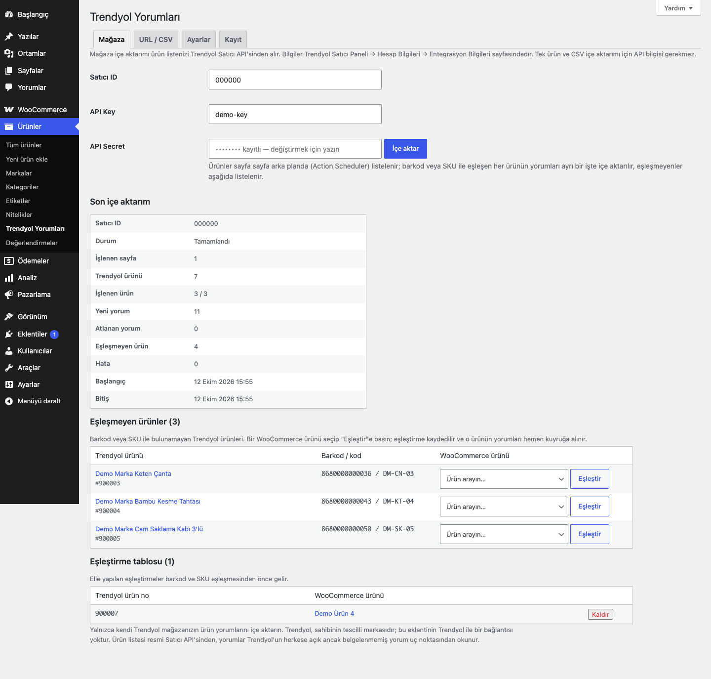
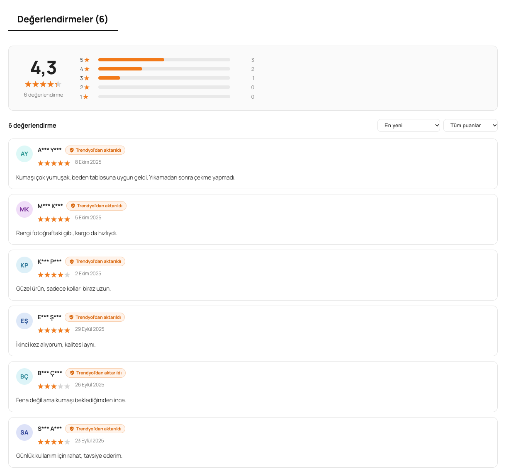

# Trendyol Reviews for WooCommerce

Kendi Trendyol mağazanızın ürün yorumlarını WooCommerce'e ürün değerlendirmesi olarak aktarır. Satıcı ID ve Trendyol Satıcı API bilgilerinizi girip "İçe aktar"a basın: ürün listeniz resmi Satıcı API'sinden alınır, ürünler barkod veya SKU ile WooCommerce ürünlerinize eşlenir, yorumlar yıldız puanıyla ve maskelenmiş isimle eklenir. Tek bir ürün için Trendyol linkiyle veya toplu eşleştirme için CSV ile de çalışır (bu iki mod API bilgisi gerektirmez).





## Özellikler

- **Mağaza bazlı içe aktarma:** ürün listesi (barkod, stok kodu, Trendyol ürün numarası) kendi Trendyol Satıcı API bilgilerinizle alınır; her liste sayfası ve her eşleşen ürün arka planda ayrı bir Action Scheduler işidir; 30 dakika ilerlemeyen çalışma hata olarak işaretlenir ve yeniden başlatılabilir
- **Otomatik ürün eşleme:** önce eşleştirme tablosu, sonra barkod (varsayılan WooCommerce GTIN/EAN alanı `_global_unique_id`, meta anahtarı ayarlanabilir), sonra SKU (Trendyol stok kodu / model kodu, ardından barkod); aynı ürünün varyantları tek ürün olarak işlenir, WooCommerce varyasyonları ana ürüne bağlanır
- **Eşleşmeyen ürünler listesi:** her satırda ürün arama kutusu ve "Eşleştir" düğmesi; eşleştirme kaydedilir ve o ürünün yorumları hemen kuyruğa alınır
- **URL ve CSV modları:** tek ürün için Trendyol linki + WooCommerce ürünü; toplu eşleştirme için iki sütunlu CSV (ID, ürün linki veya SKU ↔ Trendyol linki veya ürün numarası)
- **Tekrarsız:** her yorum Trendyol yorum numarasıyla (`_eru_tyr_review_id`) kaydedilir, aynı yorum ikinci kez eklenmez
- **Yalnızca kendi satışlarınız:** yorum verisinde satıcı bilgisi varsa ve Satıcı ID'nizden farklıysa (aynı ürünü satan başka satıcının yorumu) yorum atlanır
- **İsim maskeleme:** KVKK'ya uygun kullanım için yorumcu adlarını maskeler; isimler kayıttan önce her zaman maskelenir (`Ayşe Yılmaz` → `A*** Y***`); Trendyol'un gizlediği isimlere sabit, uydurma baş harf verilir; e-posta ve IP saklanmaz
- **Yerel WooCommerce yorumları:** `comment_type = review` + `rating` meta; yıldız ortalaması ve yorum sayısı olduğu gibi çalışır
- **Yapısal veri:** içe aktarılan yorumlar varsayılan olarak ürünün yapısal verisine (aggregateRating / review) **eklenmez**; isterseniz ayarlardan açabilirsiniz
- **Yorum alanı:** içe aktarılmış yorumu olan ürünlerde puan özeti (ortalama + yıldız dağılımı), sıralama, puana göre filtre, sayfalama, "Trendyol'dan aktarıldı" rozeti ve fotoğraf galerisi; diğer ürünlerde tema şablonuna dokunulmaz
- **Yorum fotoğrafları** (isteğe bağlı, varsayılan kapalı) yalnızca Trendyol CDN adreslerinden `uploads/trendyol-reviews/` klasörüne indirilir
- **Günlük senkron** (isteğe bağlı, varsayılan kapalı), sonuç tablosu, kayıt ekranı ve WP-CLI komutları

## Kurulum

1. `trendyol-reviews-for-woocommerce` klasörünü `wp-content/plugins/` altına kopyalayın (veya zip olarak yükleyin).
2. Eklentiler ekranından etkinleştirin. WooCommerce gereklidir.
3. **Ürünler → Trendyol Yorumları** sayfasını açın.

Etkinleştirildiğinde hiçbir dış istek yapılmaz ve mağaza önyüzü değişmez; içe aktarma siz başlatana kadar çalışmaz.

## Kullanım

### 1. Mağaza ile (önerilen, API bilgisi gerekir)

1. Trendyol Satıcı Paneli → **Hesap Bilgileri → Entegrasyon Bilgileri** sayfasından Satıcı ID, API Key ve API Secret değerlerini alın.
2. **Mağaza** sekmesinde bu üç değeri girin (ör. Satıcı ID `000000`). API Secret ayrı, otomatik yüklenmeyen bir seçenekte saklanır ve ekranda bir daha gösterilmez; alanı boş bırakırsanız kayıtlı değer korunur.
3. **İçe aktar**'a basın. Ürün listesi sayfa sayfa arka planda alınıp eşleştirilir, eşleşen her ürünün yorumları ayrı bir işte içe aktarılır. "Son içe aktarım" tablosu durumu, işlenen sayfa ve ürün, yeni/atlanan yorum, eşleşmeyen ürün ve hata sayılarını gösterir. Hata ya da 30 dakika ilerlememe durumunda mesaj sayfanın üstünde görünür; "İçe aktar" ile yeniden başlatabilirsiniz.
4. **Eşleşmeyen ürünler** listesinde her ürün için bir WooCommerce ürünü seçip **Eşleştir**'e basın. Eşleştirme tabloya yazılır ve bir sonraki içe aktarımda da kullanılır.

Barkod eşleşmesi için WooCommerce ürünlerinizde barkodun **GTIN, UPC, EAN veya ISBN** alanında (ya da Ayarlar'da belirttiğiniz meta alanında) olması gerekir. Barkodu SKU olarak kullanıyorsanız SKU eşleşmesi de barkodu dener.

### 2. Tek ürün (Trendyol linki, API bilgisi gerekmez)

**URL / CSV** sekmesinde Trendyol ürün linkini (`https://www.trendyol.com/…-p-123456`) yapıştırıp bir WooCommerce ürünü seçin. Eşleştirme tabloya kaydedilir ve yorumlar hemen içe aktarılır.

### 3. CSV ile toplu eşleştirme (API bilgisi gerekmez)

İki sütunlu bir CSV yükleyin; virgül, noktalı virgül veya sekme ile ayrılmış olabilir, başlık satırı yok sayılır (en fazla 2 MB / 1000 satır):

```csv
urun,trendyol
123,https://www.trendyol.com/demo-marka/ornek-urun-p-900001
DM-KP-02,900002
```

1. sütun: WooCommerce ürün ID'si, ürün linki veya SKU. 2. sütun: Trendyol ürün linki veya ürün numarası. Geçerli satırlar eşleştirme tablosuna yazılır ve her biri arka planda içe aktarılır; geçersiz satır numaraları ekranda gösterilir.

## Ayarlar

Ürünler → Trendyol Yorumları → **Ayarlar** (`eru_tyr_settings` seçeneği):

| Ayar | Varsayılan |
|---|---|
| Barkod meta anahtarı | `_global_unique_id` |
| Ürün başına en fazla yorum | 100 |
| İçe aktarılacak en düşük puan | 1 |
| Yorum fotoğraflarını indir (yalnızca Trendyol CDN) | kapalı |
| İçe aktarılan yorumları yapısal veriye dahil et | kapalı |
| Günlük senkron (API bilgileri varsa tüm mağaza, yoksa eşleştirme tablosu) | kapalı |
| Eklenti silinirken içe aktarılan yorumları da sil | kapalı |

Yorumu boş olan, en düşük puanın altında kalan veya başka bir satıcıya ait olan yorumlar atlanır.

Satıcı ID ve API Key `eru_tyr_settings` içinde, API Secret ayrı `eru_tyr_api_secret` seçeneğinde (autoload kapalı) tutulur. Diğer seçenekler: `eru_tyr_map` (eşleştirme tablosu, Trendyol ürün no → ürün ID), `eru_tyr_unmatched`, `eru_tyr_run` (son çalışma), `eru_tyr_log`. Yorum meta alanları: `rating`, `_eru_tyr_review_id`, `_eru_tyr_source` (`trendyol`), `_eru_tyr_photos`.

## Kancalar ve filtreler

| Ad | Tür | Açıklama |
|---|---|---|
| `eru_tyr_match` | filtre | Eşleşen ürün ID'si (`null` = eşleşmedi), `$ty_product` ile |
| `eru_tyr_endpoint` | filtre | Yorum uç noktası URL şablonu (`$template`, `$type`: `reviews`). Satıcı API adresi sabittir; kimlik bilgileri yalnızca `https://apigw.trendyol.com` adresine gönderilir |
| `eru_tyr_include_item` | filtre | Satıcı API ürününü listeye al (varsayılan: arşivlenmiş, reddedilmiş, kara listedeki hariç) |
| `eru_tyr_photo_hosts` | filtre | Fotoğraf indirilebilecek alan adları (varsayılan `dsmcdn.com` ve alt alan adları) |
| `eru_tyr_request_delay` | filtre | Eşzamanlı içe aktarımda ürünler arası bekleme, ms (varsayılan 250) |
| `eru_tyr_store_page_size` | filtre | Satıcı API sayfa boyutu (varsayılan 100, en fazla 200) |
| `eru_tyr_use_custom_template` | filtre | `false` ise tema şablonu kalır; yorumlara yalnızca rozet ve fotoğraf eklenir |

Action Scheduler işleri (`eru-tyr` grubu): `eru_tyr_store_page`, `eru_tyr_import_product`. WP-Cron: `eru_tyr_daily`.

## WP-CLI

```bash
wp trendyol-reviews import 000000            # tüm mağaza, eşzamanlı (kayıtlı API bilgileriyle)
wp trendyol-reviews import 000000 --page=0   # yalnızca ilk sayfa
wp trendyol-reviews status
wp trendyol-reviews reset --yes              # içe aktarılan tüm yorumları sil
```

## Gereksinimler

WordPress 6.5+, PHP 8.0+, WooCommerce 9.0+ (Action Scheduler WooCommerce ile gelir). HPOS ile uyumludur. WooCommerce yoksa eklenti bir uyarı gösterir ve hiçbir şey yapmaz.

## Sınırlamalar

- Ürün listesi resmi Trendyol Satıcı API'sinden gelir. Satıcı API'sinde yorum uç noktası yoktur; yorumlar trendyol.com ürün sayfalarının kullandığı **herkese açık ancak belgelenmemiş** yorum uç noktasından okunur. Trendyol bu uç noktayı haber vermeden değiştirebilir ya da sunucunuzdan gelen istekleri reddedebilir. Hata "Son içe aktarım" tablosunda ve Kayıt sekmesinde görünür. İstekler eklentinin kendi adıyla (User-Agent) yapılır.
- Yorum verisinde satıcı bilgisi yoksa yorumun hangi satıcıdan yapılan alışverişe ait olduğu ayırt edilemez; böyle yorumlar korunur.
- En fazla 500 Satıcı API sayfası (varsayılan 100 kayıt/sayfa) işlenir.
- Yorum metinleri ve puanlar olduğu gibi aktarılır; yanıtlar ve beğeni sayıları aktarılmaz.

## Yasal not

Yalnızca **kendi Trendyol mağazanızın** ürün yorumlarını, kendi ürünlerinize aktarın. Başka satıcıların yorumlarını kopyalamak tüketici mevzuatına ve Trendyol kullanım koşullarına aykırı olabilir. Yorumların başka bir pazaryerinden aktarıldığını ürün sayfasındaki "Trendyol'dan aktarıldı" rozeti belirtir; bunu kaldırmayın.

KVKK: yorumcu isimleri kaydedilmeden önce maskelenir, e-posta ve IP saklanmaz. Yorum fotoğrafları kişisel veri (yüz, adres, kargo etiketi) içerebilir; bu yüzden fotoğraf indirme varsayılan olarak kapalıdır ve açılırsa yalnızca Trendyol CDN'inden indirir. Açmadan önce aydınlatma metninizi kontrol edin.

Google, başka sitelerden toplanan yorumların ürün yorum zengin sonuçlarında (review snippet) kullanılmasına izin vermez; bu nedenle içe aktarılan yorumlar varsayılan olarak yapısal veriye eklenmez. Trendyol, sahibinin tescilli markasıdır; bu eklentinin Trendyol ile bir bağlantısı yoktur ve Trendyol tarafından desteklenmez.

## SSS

**API anahtarı gerekir mi?** Mağaza içe aktarımı için evet: Satıcı ID, API Key ve API Secret (kendi Trendyol mağazanızın). Tek ürün (link) ve CSV modları API bilgisi gerektirmez.

**Aynı yorum iki kez eklenir mi?** Hayır; Trendyol yorum numarası sitede zaten varsa atlanır.

**Eşleştirmeyi kaldırırsam yorumlar silinir mi?** Hayır; silmek için `wp trendyol-reviews reset` veya kaldırma ayarını kullanın.

## Geliştirici testleri

`tests/php/tyr-matcher.php` ve `tests/php/tyr-import.php`, eklenti etkinken `wp eval-file` ile çalıştırılır. HTTP istekleri `tests/fixtures/tyr/` altındaki elle hazırlanmış (gerçek olmayan) yanıtlarla taklit edilir.

## English summary

Imports the product reviews of **your own** Trendyol store into WooCommerce as native product reviews. For the store import, enter your seller ID, API key and API secret (Trendyol Seller API; the secret is stored in a separate non-autoloaded option and never displayed). Your product list (barcode, stock code, content ID) is read from the official Seller API page by page in Action Scheduler; each product is matched to a WooCommerce product (manual mapping table → barcode meta, default `_global_unique_id` → SKU) and gets its own background import action. Reviews come from Trendyol's public but undocumented review endpoint, are inserted as `review` comments with `rating` meta, de-duplicated by `_eru_tyr_review_id`, filtered to your seller ID when the payload names a seller, and reviewer names are always masked (`A*** B***`). Imported reviews are excluded from product structured data by default. Photo download is off by default and limited to Trendyol's CDN. Unmatched products are listed with an inline "Eşleştir" (map) control. A single Trendyol URL or a two-column CSV can also be imported without API credentials. **Legal:** only import reviews from your own Trendyol store. Trendyol is a third-party trademark; this plugin is not affiliated with or endorsed by Trendyol.

## Sürüm notları

Bkz. [CHANGELOG.md](CHANGELOG.md).

## Lisans

GPL-2.0-or-later. Diğer Erusoft eklentileri: https://wordpress.erusoft.com
