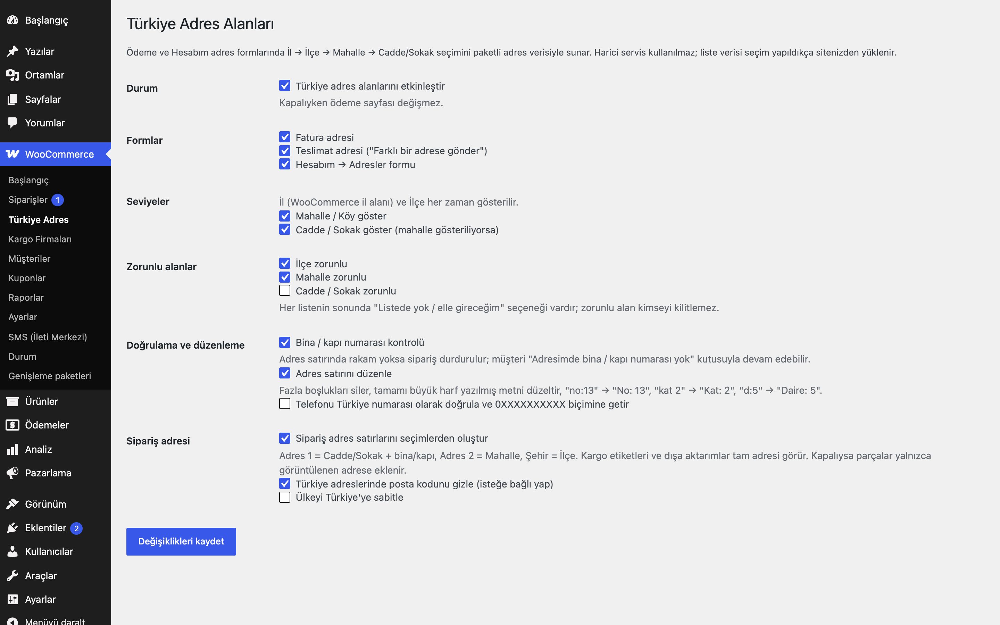
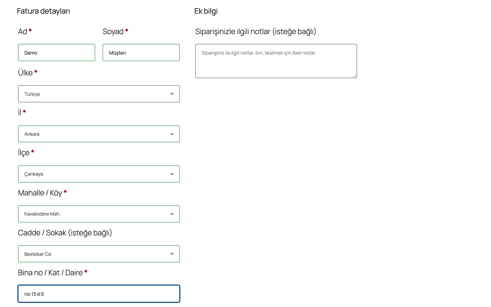
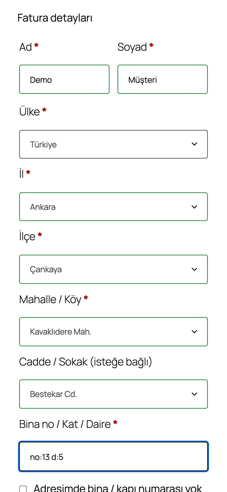

# Turkish Address Fields for WooCommerce

Klasik WooCommerce ödeme sayfasında ve Hesabım adres formunda İl → İlçe → Mahalle → Cadde/Sokak seçimi; paketli adres verisi, harici API yok. Kapı numarası kontrolü, adres satırı düzenleme ve seçimlerden oluşan sipariş adresi.

> **English:** Turkish address fields for the classic (shortcode) WooCommerce checkout and the My Account address form: province → district → neighbourhood → street pickers (searchable selects) fed by bundled public-sector address data (81 provinces, 970 districts, ~74,000 neighbourhoods, ~1.15 million streets) and lazy-loaded per district through a small read-only AJAX endpoint, with no external API. Every list ends with "not in the list / I'll type it". Server-side validation that the chosen district/neighbourhood/street exist, door-number check with a "my address has no number" escape, address line cleanup, optional Turkish phone validation, and order address lines built from the parts (address_1 = street + building, address_2 = neighbourhood, city = district). Off by default. Block checkout is not supported.

   

## Ne işe yarar

Müşteri adresini serbest metin yerine listeden seçer; kargo firmasına giden adres eksiksiz ve yazım hatasız olur. Listede olmayan bir yer için her seviyede "Listede yok / elle gireceğim" seçeneği vardır, kimse ödeme adımında kilitlenmez.

## Özellikler

- İl (WooCommerce il alanı) → İlçe → Mahalle/Köy → Cadde/Sokak zincirli, aranabilir seçim listeleri (selectWoo)
- Fatura ve teslimat adresi ("Farklı bir adrese gönder") ile Hesabım → Adresler formu
- Hangi seviyelerin gösterileceği ve hangilerinin zorunlu olacağı ayarlanır (varsayılan: ilçe ve mahalle zorunlu, sokak isteğe bağlı)
- Sunucuda doğrulama: seçilen ilçe ile ait mi, mahalle ilçede, sokak mahallede var mı
- **Kapı numarası kontrolü:** adres satırında rakam yoksa sipariş durur ("abc" reddedilir, "13A" kabul edilir); müşteri "Adresimde bina / kapı numarası yok" kutusuyla devam edebilir
- **Adres satırı düzenleme:** fazla boşluklar, tamamı büyük harf yazılmış metin (Türkçe İ/ı kurallarıyla), `no:13` → `No: 13`, `kat 2` → `Kat: 2`, `d:5` → `Daire: 5`
- **Sipariş adresi:** Adres 1 = Cadde/Sokak + bina/kapı, Adres 2 = Mahalle, Şehir = İlçe; teslimat adresi faturayla aynıysa parçalar teslimat adresine de yazılır. Kargo etiketleri, e-postalar ve dışa aktarımlar tam adresi görür
- Türkiye için şehir alanı ilçeden otomatik dolar (gizli); posta kodu isteğe bağlı gizlenebilir; ülke Türkiye'ye sabitlenebilir
- İsteğe bağlı Türkiye telefon doğrulaması ve `0XXXXXXXXXX` biçimine çevirme
- Ülke Türkiye değilse alanlar gizlenir ve zorunlu olmaz
- Yönetici sipariş ekranında "İlçe / Mahalle / Sokak" satırı

## Kurulum

1. Klasörü `wp-content/plugins/` altına kopyalayın ve etkinleştirin.
2. Ödeme sayfanız klasik `[woocommerce_checkout]` kısa kodunu kullanmalıdır (ayar ekranı blok ödemeyi algılarsa uyarır).
3. WooCommerce → **Türkiye Adres**: "Türkiye adres alanlarını etkinleştir" kutusunu işaretleyin, kaydedin.

## Nasıl kullanılır

1. Eklentiyi etkinleştirin ve WooCommerce → **Türkiye Adres** sayfasında "Türkiye adres alanlarını etkinleştir" kutusunu işaretleyip kaydedin.
2. Ödeme sayfanızın klasik `[woocommerce_checkout]` kısa koduyla çalıştığından emin olun.
3. Mağazaya "Demo Ürün" gibi bir ürün ekleyin ve sepetten ödeme sayfasına gidin.
4. Ülke Türkiye iken **İl**'i seçin; İlçe, ardından Mahalle ve Cadde/Sokak listeleri sırayla dolar (her listede yazarak arama yapılır).
5. Adres satırına bina ve kapı numarasını yazın (ör. `no:13`); eklenti bunu `No: 13` biçimine çevirir. Numara yoksa "Adresimde bina / kapı numarası yok" kutusunu işaretleyin.
6. Siparişi verin. Sipariş ekranında Adres 1 = Cadde/Sokak + bina, Adres 2 = Mahalle, Şehir = İlçe olarak görünür; "İlçe / Mahalle / Sokak" satırı da eklenir.

## Ayarlar

Tümü `eru_taf_settings` seçeneğinde:

| Ayar | Varsayılan |
|---|---|
| Etkin | kapalı |
| Fatura / teslimat / Hesabım formları | açık / açık / açık |
| Mahalle göster / Sokak göster | açık / açık |
| İlçe / Mahalle / Sokak zorunlu | açık / açık / kapalı |
| Kapı numarası kontrolü | açık |
| Adres satırını düzenle | açık |
| Sipariş adres satırlarını seçimlerden oluştur | açık |
| Posta kodunu gizle | kapalı |
| Ülkeyi Türkiye'ye sabitle | kapalı |
| Telefon doğrulama | kapalı |

Alan anahtarları (`billing_` / `shipping_`): `…_eru_taf_district`, `…_eru_taf_neighborhood`, `…_eru_taf_street`, `…_eru_taf_no_number`. WooCommerce bunları sipariş metası (`_billing_eru_taf_district` …) ve müşteri metası olarak saklar.

## Kısa kodlar, kancalar ve filtreler

| Ad | Tür | Açıklama |
|---|---|---|
| `admin-ajax.php?action=eru_taf_data&level=districts&il=34` | AJAX (GET) | İlin ilçeleri `[[id, ad], …]` |
| `…&level=neighborhoods&district=<id>` | AJAX (GET) | İlçenin mahalleleri `[[id, ad], …]` |
| `…&level=streets&district=<id>&neighborhood=<id>` | AJAX (GET) | Mahallenin cadde/sokakları `[ad, …]` |
| `eru_taf_data_dir` | filtre | Veri klasörü (güncel veriyi başka yerden okutmak için) |

AJAX ucu yalnızca okuma yapar, kişisel veri içermez ve önbelleğe alınabilir (`Cache-Control: public, max-age=604800`); önbellekli ödeme sayfalarında bozulmaması için nonce kullanmaz, girdiler yalnızca rakamdır.

## Adres verisi

- **Kaynak:** Nüfus ve Vatandaşlık İşleri Genel Müdürlüğü (NVİ) Adres Kayıt Sistemi'nin e-Devlet üzerinden kamuya açık idari adres verisi (il, ilçe, mahalle/köy, cadde/sokak; kapı numarası yoktur).
- **Veri tarihi:** Temmuz 2026 anlık görüntüsü. 81 il, 970 ilçe, 74.268 mahalle/köy, ~1,15 milyon cadde/sokak.
- **Filtre:** Adı, sokak türü eki çıkarıldığında ("Sk.", "Sokağı", "Köy Sokağı" …) yalnızca 7 veya daha fazla haneli bir sayı olan sokak kayıtları pakete alınmaz. Bunlar ad değil kayıt kodudur (bu anlık görüntüde 5 kayıt). Bu sokaklardaki müşteriler "Listede yok / elle gireceğim" seçeneğini kullanır. Aynı ilçede birebir aynı adı taşıyan mahalle kayıtları (8 çift) tek kayıtta birleştirilir, sokakları birleşir.
- **Biçim:** `data/il-ilce.json` (il → ilçe, 20 KB) ve ilçe başına `data/ilce/<ilçe id>.txt` (satır başına `mahalle id TAB mahalle adı TAB sokak|sokak|…`; yer kazanmak için sokak sonekleri kodlu: `~` " Sk.", `@` " Cd.", `=` " Küme Evler", `$` " Sokağı", `%` " Blv."). Toplam ~13,5 MB düz metin; tarayıcıya yalnızca seçilen ilçenin listesi gider (en büyük ilçe ~100 KB).
- **Üretim ve gizlilik kapısı:** Dosyalar repodaki `tools/build-taf-data.mjs <kaynak klasör>` betiğiyle üretilir (biçim ve filtre betikte belgelidir). Sokak adları sıradan sözcükler içerdiği için ilçe dosyaları `tools/scrub-data-manifest.json` içinde yol + sha256 ile sabitlenmiştir: içerik değişmedikçe gizlilik kapısının yalnızca müşteri terimi kuralı atlanır, kişisel veri desenleri (telefon, TCKN, e-posta, IBAN…) her zaman taranır. Veri bilerek güncellenince `node tools/pin-data.mjs 'plugins/turkish-address-fields-for-woocommerce/data/ilce/*.txt'` ile yeniden sabitlenir (bkz. `docs/CONTRIBUTING.md`).
- İdari değişiklikler (yeni ilçe/mahalle, sokak adı değişikliği) sonraki sürümlerde güncellenir. Listede olmayan yerler için "Listede yok / elle gireceğim" seçeneği kullanılır; elle girilen ilçe şehir alanına yazılır.

## Entegrasyonlar ve gereksinimler

WordPress 6.5+, PHP 8.0+, WooCommerce 9.0+, HPOS uyumlu. **Klasik ödeme sayfası** (`[woocommerce_checkout]`) gerekir. Turkish Shipping Carriers for WooCommerce ve diğer kargo eklentileri sipariş adres satırlarını okuduğu için "Sipariş adres satırlarını seçimlerden oluştur" açık kalmalıdır.

## Sınırlamalar

- **Blok tabanlı ödeme sayfası desteklenmez**; alanlar yalnızca klasik `[woocommerce_checkout]` kısa koduyla çalışır.
- Veri paketin içindedir ve otomatik güncellenmez; eklenti sürümüyle birlikte yenilenir.
- Posta kodu mahalleden otomatik doldurulmaz.
- Hesabım → Adresler formunda da kapı numarası kontrolü ve liste doğrulaması çalışır: hata varsa adres kaydedilmez, müşteri düzeltip yeniden kaydeder. Daha önce kaydedilmiş adresler kendiliğinden değiştirilmez.
- JavaScript kapalıyken listeler dolmaz; zorunlu ayarlıysa müşteri ilçe/mahalle seçemez (WooCommerce ödeme sayfası zaten JavaScript gerektirir).

## SSS

**Etkinleştirince ödeme sayfası değişir mi?** Hayır. Ayarlardan "Etkin" işaretlenene kadar hiçbir alan eklenmez.

**Yurt dışı müşteriler?** Ülke Türkiye değilse alanlar gizlenir ve zorunlu olmaz; WooCommerce'in normal adres alanları kullanılır.

**Kaldırınca ne silinir?** Eklenti silinirken yalnızca `eru_taf_settings` seçeneği silinir. Siparişlerdeki `_billing_eru_taf_*` / `_shipping_eru_taf_*` alanları ve müşteri metası korunur. Devre dışı bırakmak hiçbir veriyi silmez.

**Dış bir adres servisine bağlanır mı?** Hayır. Adres verisi eklentinin içindedir; tarayıcı yalnızca sitenizdeki `admin-ajax.php` ucundan seçilen ilçenin listesini alır.

**Büyük veri sitemi yavaşlatır mı?** Veri sayfa açılışında yüklenmez; ilçe başına ayrı dosya olarak, yalnızca müşteri o ilçeyi seçtiğinde okunur (en büyük ilçe yaklaşık 100 KB). AJAX yanıtı önbelleğe alınabilir.

**HPOS ve blok ödeme sayfası?** HPOS uyumluluğu bildirilir. Blok tabanlı Sepet/Ödeme bildirilmez ve desteklenmez; klasik `[woocommerce_checkout]` gerekir.

**Müşterinin adresi listede yoksa ne olur?** Her seviyede "Listede yok / elle gireceğim" seçeneği vardır; müşteri adresi elle yazar ve sipariş engellenmez.

## Hangisini seçmeliyim?

Bu ürün, daha önce ayrı geliştirilen sokak seçici ve paketli il/ilçe/mahalle seçicinin tek üründe birleşmiş hâlidir; ikisini birlikte kurmanız gerekmez.

## Değişiklik geçmişi

Bkz. [CHANGELOG.md](CHANGELOG.md).

## Destek

- Önce bu sayfadaki **SSS** ve **Sınırlamalar** bölümlerine göz atın; sık karşılaşılan durumlar orada.
- Hata mı buldunuz? [GitHub Issues](https://github.com/erayusta/erusoft-wp/issues) üzerinden bildirin. WordPress, WooCommerce, PHP ve eklenti sürümünü, adımları ve beklenen/gerçekleşen sonucu yazmanız işi hızlandırır.
- Kurulum, yapılandırma, özel geliştirme veya entegrasyon desteği için **[hello@erusoft.com](mailto:hello@erusoft.com)** adresine yazın. Erusoft hakkında: [erusoft.com](https://erusoft.com).
- Lütfen şifre, API anahtarı veya müşteri verisi (ad, telefon, TCKN, sipariş dökümü) göndermeyin; ekran görüntülerindeki kişisel verileri karartın.

## Lisans

GPL-2.0-or-later. Diğer Erusoft eklentileri: https://wordpress.erusoft.com/
