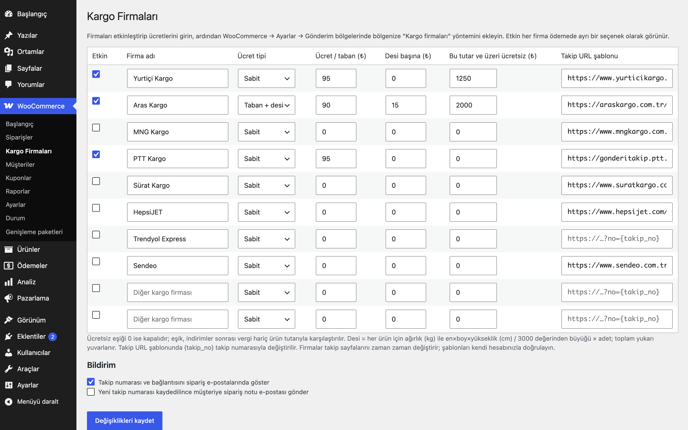
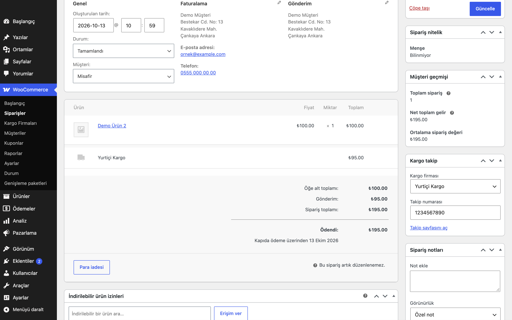
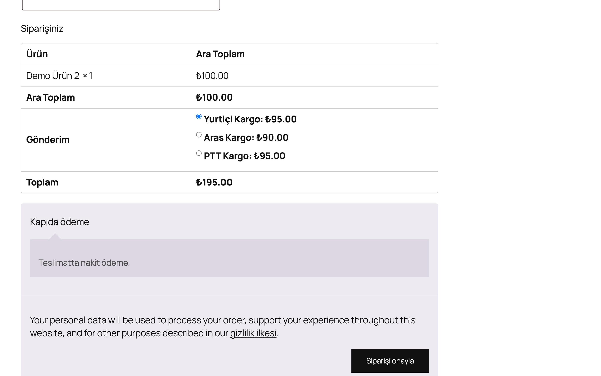
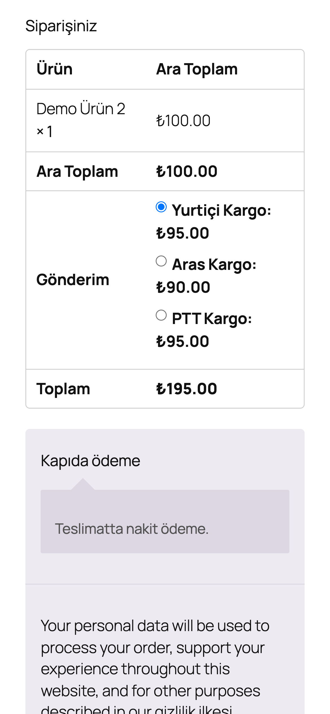

# Turkish Shipping Carriers for WooCommerce

Türkiye kargo firmalarını (Yurtiçi, Aras, MNG, PTT, Sürat, HepsiJET, Trendyol Express, Sendeo…) ödeme sayfasında ayrı seçenekler olarak sunar; firma bazında sabit, desi başına veya belirli tutarın üzerinde ücretsiz kargo; siparişe takip numarası ve e-postada / Hesabım'da "Kargonuzu takip edin" bağlantısı.

> **English:** Turkish cargo carriers as one zone-compatible WooCommerce shipping method: every enabled carrier is a separate rate with its own flat, base + per-desi or free-over-amount pricing. Staff enter the carrier and tracking number on the order; the tracking link (from an editable URL template with `{takip_no}`) appears in customer e-mails, the thank-you page and My Account, optionally with a customer note e-mail. No carrier API or credentials: label creation and automatic tracking are not included. Nothing is offered until a carrier is enabled.

   

## Ne işe yarar

Müşteri ödeme sayfasında çalıştığınız kargo firmalarından birini seçer; ücret firmaya göre hesaplanır. Sipariş kargoya verilince takip numarasını siparişe yazarsınız, müşteri e-postasında ve hesabında tek tıkla firmanın takip sayfasına gider.

## Özellikler

- Hazır firma listesi: Yurtiçi Kargo, Aras Kargo, MNG Kargo, PTT Kargo, Sürat Kargo, HepsiJET, Trendyol Express, Sendeo ve iki serbest satır ("Diğer kargo firması")
- Firma başına ücret tipi: **Sabit** veya **Taban + desi** (desi = ağırlık kg ile en×boy×yükseklik cm / 3000'den büyüğü × adet, toplam yukarı yuvarlanır)
- Firma başına "bu tutar ve üzeri ücretsiz" eşiği (indirimler sonrası, vergi hariç ürün tutarı)
- `WC_Shipping_Method` tabanlı tek yöntem: gönderim bölgeleriyle çalışır, bölge başına sunulacak firmalar seçilebilir, vergi durumu ayarlanır
- Seçilen firma sipariş kargo satırına kaydedilir; sipariş ekranında **Kargo takip** kutusu (firma + takip numarası)
- Takip URL şablonu (`{takip_no}`), firma başına düzenlenebilir
- Takip bağlantısı müşteri e-postalarında (HTML ve düz metin), teşekkür sayfasında ve Hesabım → Siparişler'de
- İsteğe bağlı: yeni takip numarası kaydedilince müşteriye sipariş notu e-postası (bağlantılı)
- `eru_tsc_tracking_saved` eylemi: başka eklentiler (ör. SMS) takip numarasına tepki verebilir

## Kurulum

1. Klasörü `wp-content/plugins/` altına kopyalayın ve etkinleştirin.
2. WooCommerce → **Kargo Firmaları**: firmaları işaretleyin, ücretleri ve gerekirse takip şablonlarını girin.
3. WooCommerce → Ayarlar → Gönderim → bölgenize **Kargo firmaları** yöntemini ekleyin.

## Ayarlar

| Ayar | Varsayılan |
|---|---|
| Firmalar (`eru_tsc_carriers`): etkin, ad, ücret tipi, ücret/taban, desi başına, ücretsiz eşiği, takip şablonu | hepsi kapalı, ücretler 0 |
| Takip bilgisini sipariş e-postalarında göster (`eru_tsc_settings[show_in_emails]`) | açık |
| Yeni takip numarasında müşteriye not e-postası (`eru_tsc_settings[notify_customer]`) | kapalı |
| Bölge başına sunulacak firmalar (yöntem ayarı) | boş = etkin tüm firmalar |

Sipariş metası: `_eru_tsc_carrier` (firma kimliği, ör. `yurtici`), `_eru_tsc_tracking_number`. Kargo satırında `_eru_tsc_carrier` gizli meta olarak durur.

Varsayılan takip şablonları firmaların herkese açık takip sayfalarını gösterir; firmalar bu adresleri zaman zaman değiştirir, kendi hesabınızla doğrulayın. Trendyol Express için şablon boş gelir.

## Kısa kodlar, kancalar ve filtreler

| Ad | Tür | Açıklama |
|---|---|---|
| `eru_tsc_get_tracking( $order )` | fonksiyon | `carrier`, `carrier_name`, `number`, `url` dizisi |
| `eru_tsc_tracking_saved` | eylem | Yeni takip numarası kaydedildi (`$order`, takip dizisi) |
| `eru_tsc_catalogue` | filtre | Firma listesi (kimlik → ad, varsayılan takip şablonu) |
| `eru_tsc_tracking_url` | filtre | Oluşan takip adresi |
| `eru_tsc_package_desi` | filtre | Paket desisi |
| `eru_tsc_free_shipping_amount` | filtre | Ücretsiz eşiğiyle karşılaştırılan tutar |
| `eru_tsc_rate_cost` | filtre | Firmanın hesaplanan ücreti |
| `woocommerce_shipping_eru_tsc_is_available` | filtre | Yöntemin uygunluğu |

## Entegrasyonlar ve gereksinimler

WordPress 6.5+, PHP 8.0+, WooCommerce 9.0+, HPOS uyumlu. Klasik ve blok ödeme sayfasıyla çalışır (kargo seçenekleri WooCommerce'in standart yöntem listesidir). Firma adları entegrasyon adı olarak kullanılır; eklenti firmalarla bağlantılı değildir. Order SMS & Delivery Codes for İleti Merkezi etkinse SMS şablonlarındaki `{kargo_firmasi}`, `{kargo_takip}`, `{takip_linki}` bu eklentiden dolar.

## Sınırlamalar

- **Kargo firması API'si yoktur:** gönderi/etiket oluşturma, barkod basımı, otomatik durum takibi, iade kodları ve toplu gönderim bu sürümde yoktur (müşteriye özel API kimlik bilgisi gerektirdikleri ve gerçek hesaplarla doğrulanamadıkları için çıkarıldı). Takip numarası elle veya `eru_tsc` metaları üzerinden kodla girilir.
- Ücret kuralları firma başınadır; bölgeye/ile göre farklı tarife yoktur (gerekirse farklı bölgelere yöntemi ayrı ayrı ekleyip firmaları bölge başına seçin; ücretler ortak kalır).
- Desi hesabı ürün ağırlık ve ölçüleri girilmişse anlamlıdır; eksik ürünler 0 desi sayılır.
- Siparişe tek takip numarası girilir (çok paketli gönderi yok).

## SSS

**Etkinleştirince ödeme sayfası değişir mi?** Hayır. Hiçbir firma etkin değilken yöntem sunulmaz.

**Takip bağlantısı hangi e-postalarda görünür?** Takip numarası girildikten sonra gönderilen tüm sipariş e-postalarında (ör. Tamamlandı). İsterseniz "müşteriye not e-postası" seçeneğiyle numara kaydedildiği an bildirim gider.

**Kaldırınca ne silinir?** `eru_tsc_carriers` ve `eru_tsc_settings`. Sipariş metası korunur.

## Değişiklik geçmişi

Bkz. [CHANGELOG.md](CHANGELOG.md).

## Lisans

GPL-2.0-or-later. Diğer Erusoft eklentileri: https://wordpress.erusoft.com/
