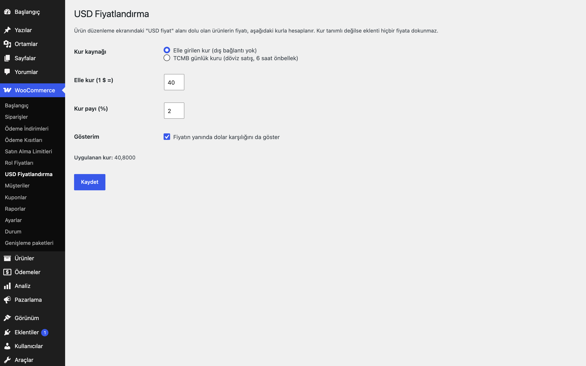
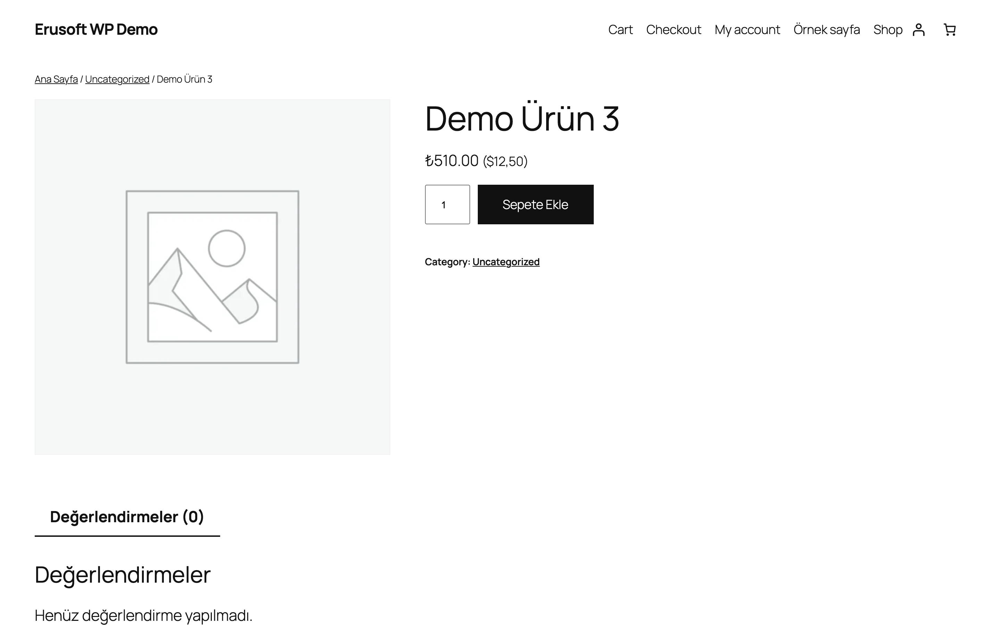
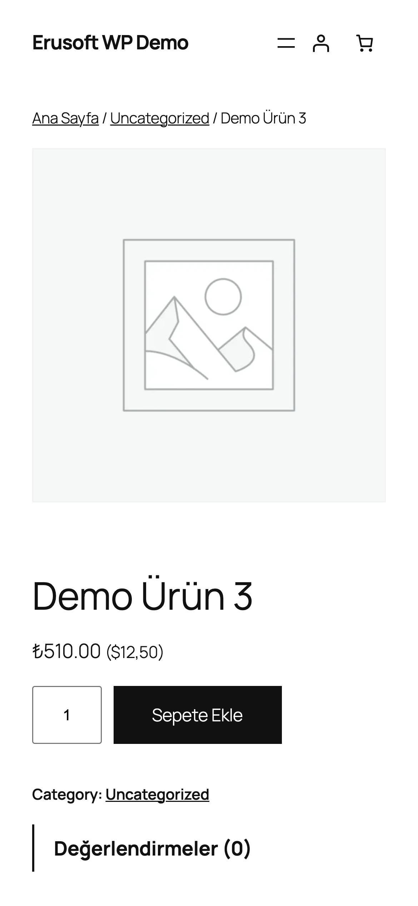

# USD Pricing for WooCommerce

Ürünleri dolar fiyatlandırın; satış fiyatı elle girilen veya TCMB günlük kuruyla otomatik hesaplansın.

> **English:** Price products in US dollars and charge in the store currency. The price is calculated from a manual exchange rate (default, no outbound requests) or the daily TCMB rate (opt-in, cached 6 hours), with an optional markup. Inert until a rate is set.

   

## Ne işe yarar

Fiyatını dolarla belirlediğiniz ürünler için ürün düzenleme ekranına "USD fiyat" alanı ekler. Mağaza para birimindeki fiyat, ayarlardaki kurdan hesaplanır; müşteri ödemeyi mağaza para biriminde yapar. Kur değiştiğinde fiyatlar kendiliğinden güncellenir.

## Özellikler

- Ürün ve varyasyon bazında USD fiyat ve USD indirimli fiyat
- Kur kaynağı: elle kur (varsayılan, dış bağlantı yok) veya TCMB günlük döviz satış kuru (isteğe bağlı, 6 saat önbellek, hata durumunda son geçerli kur)
- İsteğe bağlı kur payı (%)
- Fiyatın yanında dolar karşılığını gösterme seçeneği
- Fiyatlar çalışma anında hesaplanır; ek olarak sıralama/filtre için kayıtlı fiyatlar kur değişince arka planda 50'şer ürün güncellenir
- Kur tanımlı değilse eklenti hiçbir fiyata dokunmaz
- Varyasyonlu ürünlerde fiyat aralığı kura göre önbelleklenir

## Kurulum

1. `usd-pricing-for-woocommerce` klasörünü `wp-content/plugins/` altına kopyalayın (veya zip olarak yükleyin).
2. Eklentiler ekranından etkinleştirin (WooCommerce gereklidir).
3. Aşağıdaki ayar ekranından yapılandırın. Yapılandırma yapılana kadar mağazanızda hiçbir değişiklik olmaz.

## Nasıl kullanılır

1. Eklentiyi etkinleştirin; WooCommerce → **USD Fiyatlandırma** ekranını açın.
2. **Kur kaynağı** olarak "Elle girilen kur"u seçin, **Elle kur (1 $ =)** alanına `30` yazın, **Kur payı** `0` kalsın ve kaydedin. Ekranda "Uygulanan kur: 30,0000" görünmelidir.
3. "Demo Ürün"ü düzenleyin; fiyat alanlarının yanındaki **USD fiyat ($)** alanına `10` yazıp güncelleyin.
4. Mağazada ürün 300 TL (10 $ x 30) olarak görünür; sepet ve ödeme de aynı mağaza para birimi tutarını kullanır.
5. Kuru `32` yapıp kaydederseniz fiyat 320 TL olur; kayıtlı fiyatlar arka planda 50'şer ürünle güncellenir.
6. **Gösterim** kutusunu işaretlerseniz fiyatın yanında dolar karşılığı da yazılır.

## Ayarlar

WooCommerce → **USD Fiyatlandırma**:

- **Kur kaynağı**: elle girilen kur (dış bağlantı yok) veya TCMB günlük kuru (döviz satış, 6 saat önbellek).
- **Elle kur (1 $ =)**: kaynak "elle" iken kullanılan kur.
- **Kur payı (%)**: uygulanan kur `kur x (1 + pay/100)` olarak hesaplanır.
- **Gösterim**: fiyatın yanında dolar karşılığını da göster.
- **TCMB kurunu şimdi güncelle**: TCMB seçiliyken kuru anında indirir.
- Ekranda "Uygulanan kur" gösterilir; kur tanımsızsa eklenti pasiftir.

Ürün ve varyasyon başına USD fiyat ve USD indirimli fiyat, düzenleme ekranındaki fiyat alanlarının yanındadır.

## Kancalar, filtreler ve veri alanları

| Ad | Tür | Açıklama |
|---|---|---|
| `eru_usd_source` | seçenek | `manual` (varsayılan) veya `tcmb` |
| `eru_usd_manual_rate` | seçenek | Elle kur (1 $ = ? mağaza para birimi), varsayılan boş |
| `eru_usd_markup` | seçenek | Kur payı yüzdesi, varsayılan 0 |
| `eru_usd_show_usd` | seçenek | Dolar karşılığını göster, varsayılan kapalı |
| `_eru_usd_price / _eru_usd_sale_price` | meta | Ürün/varyasyon USD fiyatları |
| `eru_usd_try_price` | filtre | Hesaplanan fiyatı değiştirin (`$try`, `$usd`, `$rate`, `$product`), örn. yuvarlama |
| `eru_usd_rate_changed` | eylem | Etkin kur değiştiğinde |
| `eru_usd_refresh_rate` | WP-Cron eylemi | TCMB kurunu arka planda yeniler (önbellek 6 saat; fiyat filtresi içinde HTTP isteği yapılmaz, yenilenene kadar son bilinen kur kullanılır) |
| `_eru_usd_orig_regular / _eru_usd_orig_sale` | meta | İlk eşitlemeden önceki TL fiyatlar; USD fiyatı silinince geri yüklenir |

## Entegrasyonlar ve gereksinimler

WordPress 6.5+, PHP 8.0+, WooCommerce 9.0+. HPOS (özel sipariş tabloları) ile uyumludur. WooCommerce yoksa eklenti bir uyarı gösterir ve hiçbir şey yapmaz. TCMB günlük kur XML'i (`https://www.tcmb.gov.tr/kurlar/today.xml`) yalnızca kaynak "TCMB" seçildiğinde çağrılır; başka dış istek yapılmaz.

## Sınırlamalar

- Fiyat filtreleri 998 önceliğiyle çalışır: önce USD çevrilir, ardından Role-Based Prices (999), Price Lists (1000) ve B2B Customer Pricing (1001) kendi kullanıcıları için fiyatı değiştirir. Çalışma anında `set_price()` ile konan fiyatlara (ör. hediye satırı) dokunulmaz.
- USD fiyatını silip ürünü kaydettiğinizde ilk eşitlemeden önceki TL fiyatı geri gelir; aynı kayıtta TL fiyatı elle değiştirdiyseniz sizin girdiğiniz değer korunur.
- TCMB kuru WP-Cron ile yenilenir; sitenizde WP-Cron çalışmıyorsa kur, son başarılı indirmedeki değerde kalır (ayar ekranındaki "TCMB kurunu şimdi güncelle" düğmesi anında indirir).

- Hesaplanan fiyat mağaza para biriminde yuvarlanır (ondalık ayarı); özel yuvarlama için `eru_usd_try_price` filtresini kullanın.
- Yalnızca USD desteklenir.
- Kur kaynağına ulaşılamazsa son geçerli kur kullanılır; hiç kur yoksa fiyatlar değişmez.
- Sipariş verildikten sonra sipariş tutarları değişmez.
- Eklenti silindiğinde (Eklentiler → Sil) yalnızca kendi ayarları (`eru_usd_*` seçenekleri) silinir; ürünlere yazılmış meta alanları korunur.

## SSS

**TCMB seçmezsem dış istek olur mu?** Hayır, elle kur seçiliyken hiçbir dış istek yapılmaz.

**Kur payı ne işe yarar?** Kura yüzde olarak eklenir (örn. %2 kur farkı koruması).

**Eklentiyi silersem fiyatlar ne olur?** Eklentiler → Sil yalnızca `eru_usd_*` seçeneklerini, TCMB önbelleğini ve zamanlanmış işleri siler. Ürünlerdeki `_eru_usd_*` meta alanları ve kayıtlı fiyatlar korunur. Devre dışı bırakmak veri silmez.

**HPOS ile uyumlu mu?** Evet, eklenti `custom_order_tables` uyumluluğunu bildirir.

**Cart/Checkout blokları?** Blok uyumluluğu için ayrı bir beyan ya da test yoktur.

**Sipariş verildikten sonra kur değişirse?** Verilmiş siparişlerin tutarları değişmez.

## Değişiklik geçmişi

Bkz. [CHANGELOG.md](CHANGELOG.md).

## Destek

- Önce bu sayfadaki **SSS** ve **Sınırlamalar** bölümlerine göz atın; sık karşılaşılan durumlar orada.
- Hata mı buldunuz? [GitHub Issues](https://github.com/erayusta/erusoft-wp/issues) üzerinden bildirin. WordPress, WooCommerce, PHP ve eklenti sürümünü, adımları ve beklenen/gerçekleşen sonucu yazmanız işi hızlandırır.
- Kurulum, yapılandırma, özel geliştirme veya entegrasyon desteği için **[hello@erusoft.com](mailto:hello@erusoft.com)** adresine yazın. Erusoft hakkında: [erusoft.com](https://erusoft.com).
- Lütfen şifre, API anahtarı veya müşteri verisi (ad, telefon, TCKN, sipariş dökümü) göndermeyin; ekran görüntülerindeki kişisel verileri karartın.

## Lisans

GPL-2.0-or-later.

Diğer Erusoft eklentileri: https://wordpress.erusoft.com/
