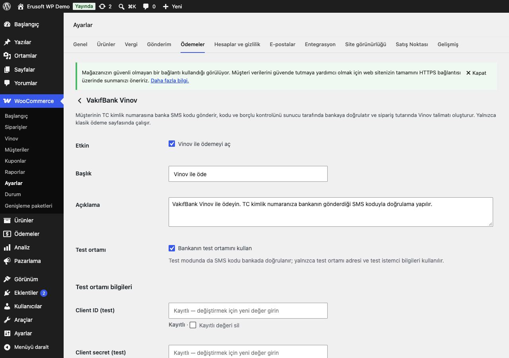
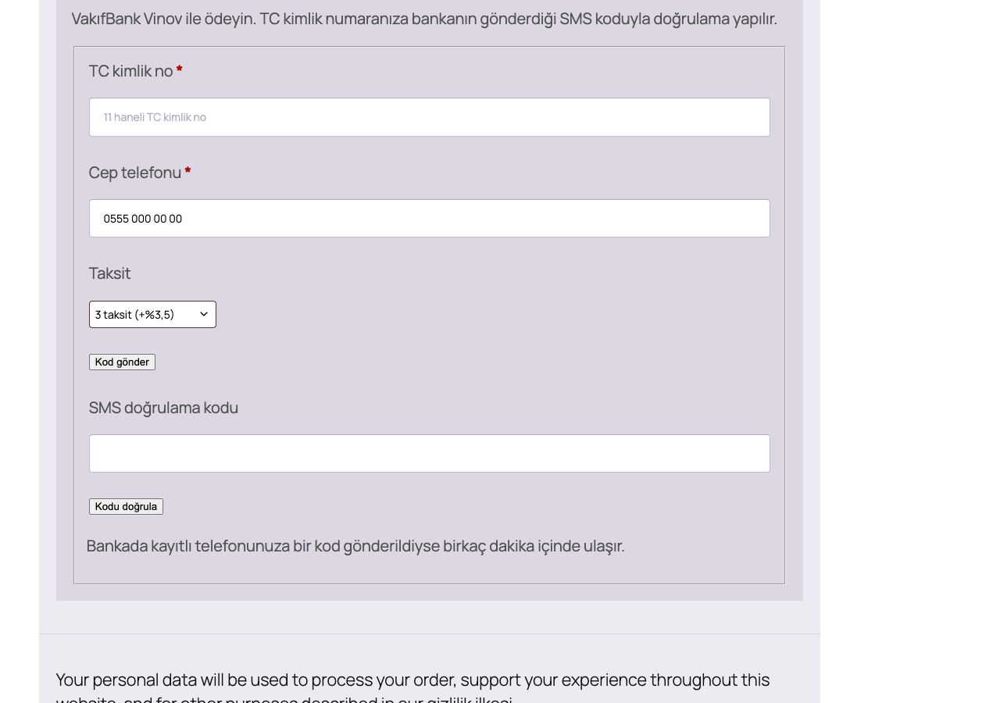
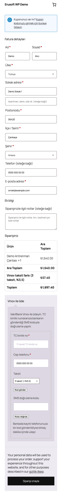
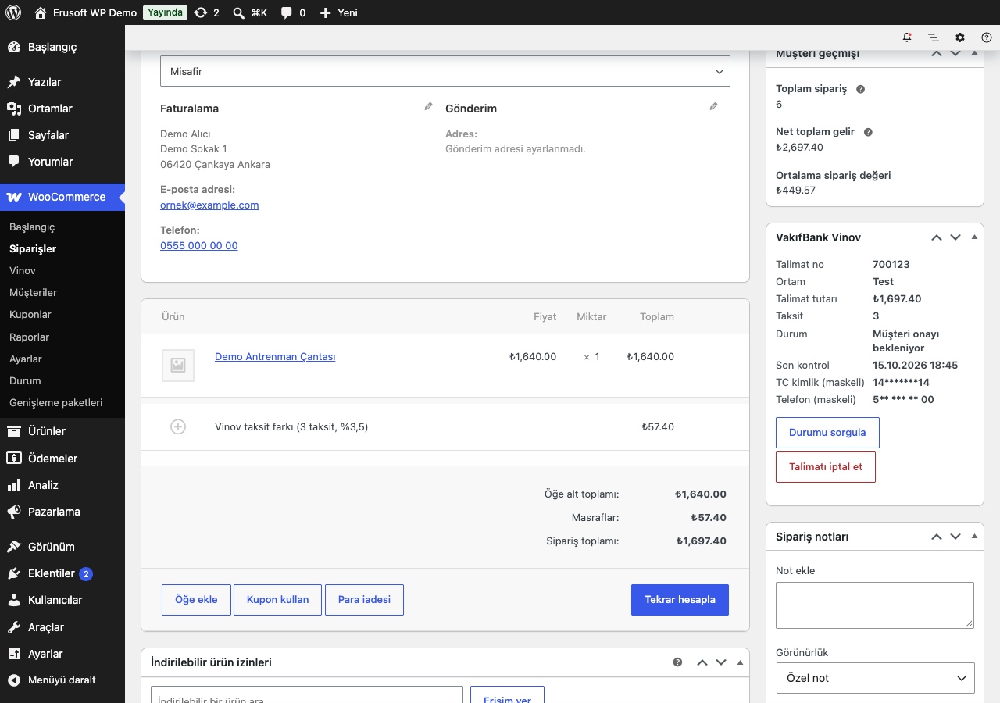
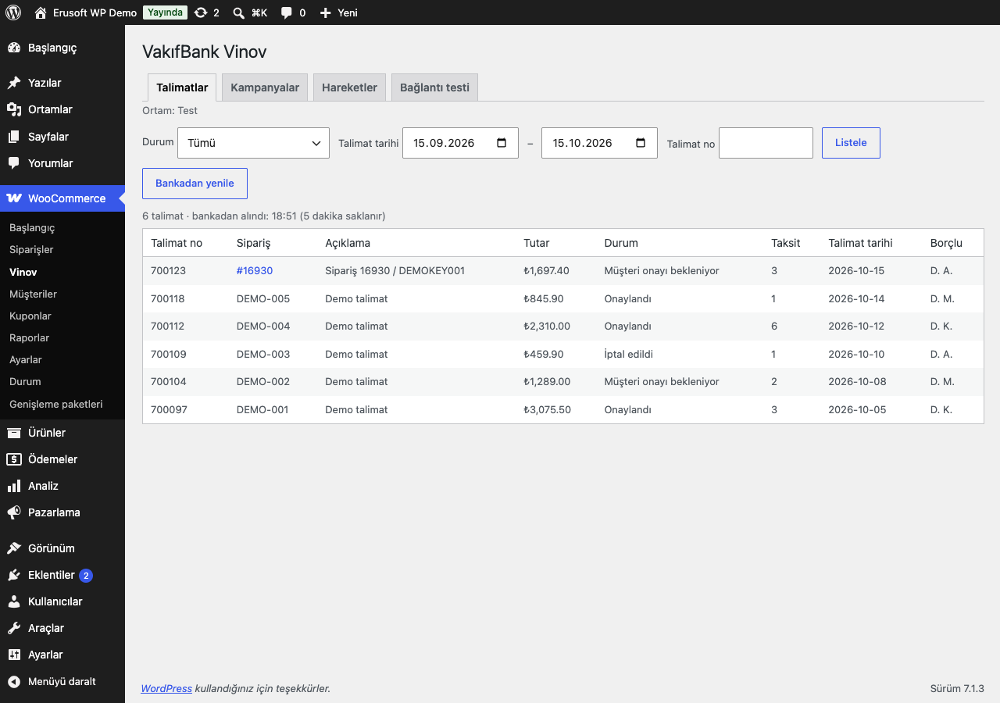

# VakıfBank Vinov Integration for WooCommerce

> **English:** A VakıfBank Vinov payment method for the classic WooCommerce checkout. The customer's identity number (TCKN) and the SMS code are verified by the bank on the server, the debtor check uses the cart total the server calculated, and `process_payment` re-checks the bank's verification (identity HMAC, phone, installment count, total and cart hash, 10 minutes, single use) before it creates the instruction. An installment commission is a visible fee line, so the instruction amount equals the order total. An ambiguous create is looked up before any retry. A scheduled status sync (Action Scheduler, 50 rows per run, least recently checked first) marks approved instructions paid, cancels cancelled ones and stops after 30 days with an order note. The order screen queries and cancels instructions; read-only instruction, campaign and movement views; WP-CLI. The identity number is never stored: the session holds an HMAC, the order a mask. Inert until you enable it and enter the bank-issued details.

[](https://www.gnu.org/licenses/gpl-2.0.html)   

> **Beta:** canlı API ile kendi hesabınızla doğrulayın.

Müşteri ödeme sayfasında TC kimlik numarasını ve cep telefonunu girer, bankanın gönderdiği SMS koduyla doğrular ve siparişi verir; mağaza müşteri adına VakıfBank Vinov'da bir ödeme talimatı oluşturur. Müşteri talimatı bankada onaylayınca sipariş kendiliğinden "Hazırlanıyor" olur. Doğrulamayı tarayıcı değil banka yapar; TC kimlik numarası sitede saklanmaz.



## Özellikler

- TC kimlik + SMS doğrulamalı Vinov ödeme yöntemi; kod ve borçlu kontrolü bankada, sunucu tarafında doğrulanır, sipariş verilirken yeniden kontrol edilir
- Taksit farkı siparişte ayrı bir "Vinov taksit farkı" satırıdır; talimat tutarı sipariş toplamına eşittir
- Talimat listeleme, detay ve iptal (sipariş ekranından, onay adımıyla)
- Zamanlanmış talimat durumu takibi: onaylanan talimat siparişi ödendi yapar, iptal edilen talimat siparişi iptal eder
- Kampanya ve hareket sorguları (salt okunur), kişisel veri saklamadan; WP-CLI

## Kurulum

1. `vakifbank-vinov-integration-for-woocommerce` klasörünü `wp-content/plugins/` altına kopyalayın (veya zip olarak yükleyin) ve etkinleştirin. WooCommerce gereklidir.
2. Ödeme sayfanız **klasik** olmalı: sayfa içeriği `[woocommerce_checkout]` kısa kodu. Blok tabanlı ödeme sayfasında yöntem gösterilmez; ayarlar ekranı bunu uyarır.
3. WooCommerce → Ayarlar → Ödemeler → **VakıfBank Vinov**:
   - **Test ortamı** açık kalsın.
   - **API adresi (test)** ve **(canlı)**: bankanın size verdiği adres (yalnızca `https`). Eklenti hiçbir varsayılan adresle gelmez; adres girilmeden yöntem gösterilmez.
   - Her ortam için **Client ID** ve **Client secret**; **WorkPlace ID**, **Consent ID**, **Ödeme amacı kodu** ve **OTP işlem kodu**. Bu değerlerin hepsini bankanız verir; hiçbirinin varsayılanı yoktur.
   - **Taksit ve taksit farkı**: en fazla taksit ve sunulan her taksit sayısının oranı.
   - İsteğe bağlı: izin verilen kategoriler/ürünler, talimat sonrası sipariş durumu (varsayılan **Beklemede**), günlük düzeyi, durum sorgulama aralığı, takibi bırakma ve kişisel veri saklama süreleri.
4. WooCommerce → **Vinov** → **Bağlantı testi** ile iki yetkinin (OTP ve Vinov) alınabildiğini kontrol edin.
5. Test ortamında bir sipariş deneyin; sonra test modunu kapatıp canlı bilgileri girin.

Etkinleştirme sonrası eklenti pasiftir: ödeme yöntemi açılıp bilgiler girilene kadar ön yüz değişmez, bankaya istek gitmez ve zamanlanmış iş oluşmaz. Client secret ve client ID alanları yalnızca yazılabilir (ekrana geri yazılmaz, "Kayıtlı" görünür, boş bırakılırsa korunur); ayarlar `autoload=no` saklanır.

## Ödeme akışı

Kodu ve borçlu kontrolünü banka doğrular; tarayıcıdan gelen "doğrulandı" bilgisi hiçbir yerde okunmaz.

```
Müşteri (ödeme sayfası)        Mağaza (sunucu)                              VakıfBank
-----------------------        ---------------                              ---------
TC + telefon, "Kod gönder" →   nonce, bal küpü, hız sınırı, TC sağlaması
                               sendOTP ─────────────────────────────────→   kayıtlı telefona SMS
                               oturum: TC'nin HMAC'i, telefon özeti, işlem no (tarayıcıya gitmez)
SMS kodu, "Kodu doğrula"   →   verifyOTP (oturumdaki işlem no ile) ─────→   kod doğru mu?
                               checkDebtor (sunucunun hesapladığı toplam) →  borçlu bu tutarı ödeyebilir mi?
                               oturum: doğrulandı {toplam, taksit, sepet özeti, 10 dk}
"Siparişi ver"             →   process_payment: oturum ↔ TC, telefon, taksit, toplam, sepet
                               sipariş kilidi + tek kullanımlık doğrulama
                               createInstruction ───────────────────────→   talimat no
                               sipariş "Beklemede", stok düşer, sepet boşalır
Müşteri bankada onaylar        durum takibi (15/30/60 dk) listInstruction →  1 bekliyor · 2 onaylandı · 3 iptal
                               2 → "Hazırlanıyor" (payment_complete), 3 → "İptal edildi"
```

- Gönderme yanıtı, banka numarayı kabul etse de etmese de aynıdır ("Bankada kayıtlı telefonunuza bir kod gönderildiyse…"); doğrulama yanıtı da kod yanlışken ve hiç kod gönderilmemişken aynıdır. Böylece uç noktalar hangi TC'nin bankada telefonu olduğunu söylemez.
- Hız sınırı: 10 dakikada istemci başına ve TC başına 5 gönderim, 10 doğrulama.
- **Test modunda da** kod bankada doğrulanır; yerel bir atlama yoktur. Test modu yalnızca test adresini ve test istemci bilgilerini seçer.
- Doğrulama 10 dakika geçerlidir ve tek kullanımlıktır: sepet, toplam, taksit, TC veya telefon değişirse yeniden doğrulama istenir.
- **Belirsiz yanıt:** talimat oluşturma isteği zaman aşımına uğrar, 5xx ya da çözümlenemeyen bir yanıt dönerse banka talimatı oluşturmuş olabilir. Önce talimat listesinde bu siparişin numarası ve deneme anahtarı aranır; bulunursa talimat siparişe bağlanır, bulunamazsa aynı anahtarla **bir kez** yeniden denenir, liste okunamazsa sipariş "belirsiz" kalır ve müşteriye birkaç dakika sonra yeniden denemesi söylenir. Bir sonraki denemede yine önce liste aranır. Belirsiz denemeleri durum takibi de çözmeye çalışır (aşağıda).





## Taksit farkı siparişe nasıl yansır?

Müşteri taksit seçtiğinde ve o taksit için oran tanımlıysa sepete **"Vinov taksit farkı (N taksit, %x)"** adlı bir ücret satırı eklenir. Böylece talimat tutarı her zaman sipariş toplamına eşittir; muhasebe ve iade hesapları tek bir rakam üzerinden yürür.

- Oran, indirimler düşülmüş ürünler + kargo toplamına (vergiler dahil) uygulanır; satır vergiye tabi değildir. Başka eklentilerin eklediği ücretler tabana girmez.
- Tutar kuruş cinsinden bir kez yuvarlanır. Taksit planı eşit parçalara bölünür; kalan kuruşlar son taksitlere dağıtılır ve parçaların toplamı sipariş toplamına tam eşittir. Vadeler her ay aynı gündür (ay sonuna kırpılır).
- Yalnızca ayarlarda işaretli taksit sayıları sunulur; başka bir sayı gönderilirse sipariş reddedilir. Tek çekimde talimatın son günü **Tek çekim vadesi** (varsayılan 30 gün) kadar sonradır.

Örnek (uydurma tutarlar): sepet 2.250,00 TL, 3 taksit, oran %4 → taksit farkı 90,00 TL, sipariş ve talimat tutarı 2.340,00 TL, plan 3 × 780,00 TL.

## KVKK: TC kimlik no saklanmaz

- **Oturum:** yalnızca TC'nin site anahtarıyla üretilmiş HMAC'i ve telefonun özeti tutulur; numaranın kendisi tutulmaz.
- **Sipariş:** yalnızca maske (`12*******34`, ilk iki ve son iki hane) ve destek için cep telefonu (`_eru_vnv_tckn_mask`, `_eru_vnv_phone`) yazılır. Sipariş notlarında TC yoktur.
- **Banka:** TC yalnızca doğrulama ve talimat oluşturma çağrılarında, aynı istekte gönderilir.
- **Günlük:** WooCommerce günlüğü (kaynak `eru-vnv`) TC'yi, kodu, client secret'ı, token'ı ve 11 haneli her sayıyı karartır; liste ve hareket çağrılarının gövdeleri hiç yazılmaz.
- **Hız sınırı:** sayaçlar TC'nin HMAC'inin özetiyle tutulur.
- **Borçlu hareketleri sorgusu (yönetim):** TC yönetim formundan POST ile alınır (nonce + `manage_woocommerce`), bankaya bir kez gönderilir; seçeneklere, geçici verilere, günlüğe, adres satırına veya önbelleğe yazılmaz, sonuç sayfası önbelleğe alınmaz ve form yeniden boş gelir.
- **Silme ve saklama:** maske ve telefon WordPress kişisel veri dışa aktarma/silme araçlarına bağlıdır (sipariş e-postasıyla bulunur) ve **Kişisel veri saklama süresi** (varsayılan 365 gün) dolan siparişlerden günlük bir işle silinir.

## Talimat takibi

Her Vinov siparişi `{önek}eru_vnv_instructions` tablosunda bir satırdır: sipariş no, talimat no (benzersiz), ortam, tutar, taksit, durum (0 belirsiz deneme, 1 müşteri onayı bekleniyor, 2 onaylandı, 3 iptal), son kontrol ve oluşturma zamanı. Tabloda TC, telefon, ad veya ham banka yanıtı yoktur. Tablo sürüm kontrolüyle kurulur ve güncellenir.

- **Zamanlama:** Action Scheduler (grup `eru-vnv`) açık satır varken **Durum sorgulama aralığı** (15, 30 veya 60 dakika; varsayılan 30) ile çalışır. İş kendini yeniden kurar; "zaten kurulu mu" kontrolü yalnızca **bekleyen** işlere bakar (çalışan iş sayılmaz). Kilitli bulan ya da hata veren bir çalışma da işi yeniden kurar; günlük temizlik işi de açık satır varken zinciri yeniden kurar, yani takip kendiliğinden durmaz. Açık satır kalmayınca zincir durur, yeni bir talimat onu yeniden kurar.
- **Sıra:** her çalışmada en fazla **50** açık satır, **en uzun süredir kontrol edilmeyen önce** (`last_checked_at ASC`) alınır; 50'den fazla açık talimat olsa da hiçbiri sırada beklemez. Bir çalışma 240 saniyeden sonra yeni banka çağrısı başlatmaz; aynı anda ikinci bir çalışma başlamaz (çalışma kilidi).
- **Durum 2 (onaylandı):** sipariş kilidi altında sipariş yeniden okunur ve `payment_complete()` ile ödendi yapılır (varsayılan "Hazırlanıyor"; ayarlarda başka bir "talimat sonrası" durumu, örneğin bir durum eklentisinin durumu seçildiyse o durumdan da); not düşülür. İş iki kez çalışsa da sipariş bir kez ödenir (`_eru_vnv_paid_at`). Talimat tutarı sipariş toplamından farklıysa (sipariş sonradan düzenlendiyse) ödeme yine işlenir, ama siparişe uyarı notu düşülür ve talimat **İncelenmeli** olarak işaretlenir.
- **Durum 3 (iptal ya da reddedildi):** sipariş "İptal edildi" olur (WooCommerce stoğu geri ekler), not düşülür. Ödenmiş bir siparişte durum değiştirilmez, kontrol notu düşülür ve talimat **İncelenmeli** olarak işaretlenir.
- **Takibi bırakma:** **Takibi bırakma süresi** (varsayılan 30 gün; ama en az **Tek çekim vadesi + 1 gün**, varsayılanlarla 31 gün, daha kısa bir değer bu alt sınıra yükseltilir) içinde onaylanmayan talimatın satırı kapanır ve siparişe "otomatik durum takibi durduruldu, lütfen banka panelinden kontrol edin" notu düşülür; sipariş durumu değişmez, artık sorgulanmaz.
- **Belirsiz denemeler:** yanıtı alınamamış bir talimat denemesi de tabloya girer (durum 0). Takip, ödeme akışıyla **aynı eşleştirme kurallarıyla** (sipariş no + açıklamadaki deneme anahtarı, iptal edilmiş talimatlar hiç benimsenmez) talimat listesini arar: bulunursa talimat siparişe bağlanır ve sipariş "Beklemede" olur; **ödendi yapılmaz**, ödeme ancak sonraki bir sorguda durum 2 görülünce işlenir. Bulunamazsa takibi bırakma süresince yeniden aranır, sonra siparişe "banka panelinden kontrol edin" notu düşülür. Banka reddettiyse satır çağrısız kapanır; hâlâ süren bir istek (10 dakikadan yeni) aranmaz.
- **Çöpe atılan ya da kalıcı olarak silinen sipariş** iptal edilmiş sayılır: bekleyen talimat aşağıdaki gibi bankada iptal edilir (silinen siparişte talimat no ve ortam satırdan okunur; satır, iptal bitene kadar silinmez). Çöpteki siparişin durumu değiştirilmez, çöpten çıkarılmaz. Silinen siparişte sonucu belirsiz kalmış bir deneme artık aranamaz; satır **İncelenmeli** (silinen siparişte belirsiz deneme) olarak işaretlenir. Kapanmış ve işaretsiz satırlar sipariş silinince silinir.

### İptal edilen sipariş tahsil edilmez

İptal edilmiş bir sipariş için bankada ödenebilir bir talimat bırakılmaz:

- **WooCommerce'in ödenmemiş sipariş iptali:** stok tutma süresi dolunca WooCommerce "Ödeme bekleniyor" siparişleri iptal eder. Ödeme yöntemi hâlâ Vinov olan ve sonucu belirsiz bir denemesi (gönderiliyor/belirsiz) ya da açık talimat satırı bulunan siparişler bu iptalden çıkarılır (`woocommerce_cancel_unpaid_order`). Bu iptali durdurmak stoğu tutmaz: **WooCommerce'in stok tutma süresi dolunca stok serbest kalır; deneme sonradan bulunursa stok o anda düşülür (yetersizse eksiye düşebilir)** ve sipariş **İncelenmeli** (stok tutma süresi dolduktan sonra talimat bulundu) olarak işaretlenip not düşülür.
- **Sipariş başka bir yoldan iptal ya da iade edilir, çöpe atılır ya da kalıcı olarak silinirse** (durum seçimi, toplu işlem, REST, başka bir eklenti), bekleyen talimat Action Scheduler ile **talimat no ile bankada iptal edilir** (`eru_vnv_bank_cancel`). İş önce talimatın bankadaki durumunu okur:
  - **1 (bekliyor):** talimat iptal edilir; siparişin durumu değiştirilmez (iade edilmiş sipariş iade durumunda kalır), not düşülür.
  - **2 (onaylandı):** iptal isteği gönderilmez; aşağıdaki "onaylandı" uyarısı (bir kez) verilir.
  - **3 (zaten iptal):** iptal isteği gönderilmez; satır kapanır, eski bir "iptal edilemedi" işareti varsa kaldırılır.
  - **Okunamadı:** iş artan aralıklarla 5 kez denenir.

  İş tekrar çalışsa da ikinci istek gitmez; sipariş o arada yeniden açıldıysa (kilit altında yeniden okunarak) iptal yapılmaz. Banka reddederse ya da denemeler biterse sipariş **İncelenmeli** olarak işaretlenir ve not düşülür. Takip daha sonra talimatı iptal edilmiş görürse bu işaret kaldırılır.
- **Ödenmiş bir Vinov siparişi iptal ya da iade edilirse** bankaya istek gönderilmez; siparişe bir kez "Vinov talimatı ödenmiş; banka çağrılmadı. İade gerekiyorsa banka panelinden yapın." notu düşülür.
- **Belirsiz bir deneme iptal edilmiş bir siparişte bulunursa** talimat siparişe yazılır ve aynı yolla bankada iptal edilir.
- **Başka bir ödeme yöntemiyle ödenmiş bir siparişte talimat elle iptal edilirse** (`wp eru-vnv cancel` ya da sipariş kutusu), siparişin durumu, stoğu ve e-postaları değişmez; siparişe tek bir not düşülür ve talimat aynı durum-okuyan iş ile bankada iptal edilir.
- **Belirsiz deneme, başka bir ödeme yöntemiyle ödenmiş bir siparişte bulunursa** (müşteri "Siparişlerim → Öde" ile başka yöntemle ödediyse), talimat aynı yolla bankada iptal edilir.
- **Banka yine de "onaylandı" derse** (müşteri iptalden önce onayladıysa; sipariş iptal, iade, çöpte, silinmiş ya da başka yöntemle ödenmişse): `payment_complete()` çağrılmaz, sipariş **yeniden açılmaz**; talimat **İncelenmeli** olarak işaretlenir, siparişe uyarı notu düşülür, site yöneticisine e-posta gider, yönetim ekranlarında sipariş başına gizlenebilen kalıcı bir uyarı görünür ve `eru_vnv_paid_while_cancelled` eylemi çalışır. Bunların hepsi **talimat başına bir kez** olur; sonraki sorgular ("Durumu sorgula" dahil) yeni not, e-posta veya eylem üretmez ve gizlenmiş uyarıyı geri getirmez. Parayı gerekiyorsa banka panelinden iade edin.
- **Takibi kapanmış bir talimatta "Durumu sorgula"** yalnızca bankadaki güncel durumu gösterir; siparişte hiçbir şey değiştirmez.
- Eklenti devre dışı bırakılınca eklentinin bütün zamanlanmış işleri silinir; yeniden etkinleştirilince açık satır varsa takip yeniden kurulur.

## Sipariş ekranı

Vinov siparişlerinde yan sütunda **VakıfBank Vinov** kutusu: talimat no, ortam, tutar, taksit, durum, son kontrol, maskeli TC ve maskeli telefon. Kutuyu açmak bankaya istek göndermez.

- **Durumu sorgula:** talimatın durumunu bankadan alır ve takipteki gibi uygular (onaylandıysa sipariş ödendi olur), ardından taksit/borç ayrıntısını (tutar, vade, durum) gösterir. Yanıtta ad ve TC yoktur.
- **Talimatı iptal et:** önce bir onay kutusu açılır ("Evet, talimatı iptal et"); sunucu da onay olmadan iptal etmez. İptal yalnızca **talimat no** ile yapılır; başarıyla sonuçlanırsa sipariş "İptal edildi" olur ve not düşülür. Zaten iptal edilmiş talimat için bankaya yeniden istek gitmez; **onaylanmış (ödenmiş) talimat buradan iptal edilmez**.
- Her iki düğme `edit_shop_orders` yetkisi ve sipariş başına bir nonce ister.

**İade:** 1.0.0 bankaya iade göndermez (ödeme yöntemi yalnızca `products` destekler). WooCommerce'te yapılan iade yalnızca kayıttır; parayı banka panelinden ya da mağaza dışında iade edin.



## Yönetim ekranı

WooCommerce → **Vinov** (`manage_woocommerce`). API gezgini yoktur; hiçbir sekme bankada bir şey oluşturmaz veya değiştirmez.

- **Talimatlar:** bankanın talimat listesi; durum (ve **İncelenmeli**: bu mağazanın işaretli talimatları, yerel kayıtlardan, bankaya istek göndermeden), talimat tarihi aralığı (en fazla 92 gün) ve talimat no filtreleri; 20'şerli sayfalar. Liste **5 dakika** önbellekte tutulur (tek bir geçici veri; yalnızca talimat no, fatura no, açıklama, tutar, durum, taksit, tarihler ve borçlunun baş harfleri; açıklamadaki 11 haneli sayılar karartılır). "Bankadan yenile" önbelleği temizler. Bu mağazanın talimatları siparişe bağlantılıdır.
- **Kampanyalar:** işyerinize tanımlı kampanyalar, salt okunur, 5 dakika önbellekte.
- **Hareketler:** alıcı hareketleri (vade aralığı, talimat no; form nonce taşır, başka bir siteden gelen bağlantı bankaya istek göndermez) ve borçlu hareketleri (TC ile, yukarıda anlatıldığı gibi). Hareket sonuçları önbelleğe alınmaz; kişisel alanlar maskelenir (TC → maske, ad → baş harfler, telefon/IBAN → son haneler).
- **Bağlantı testi:** kuyruğa alınır; seçili ortamda OTP ve Vinov yetkileri alınır ve kampanya listesi sorgulanır. SMS gönderilmez, talimat oluşturulmaz. Sonuç (gizli bilgi içermeden) sekmede görünür.



## WP-CLI

```
wp eru-vnv sync [--order=<id>]
wp eru-vnv instruction <id> [--format=table|csv|json]
wp eru-vnv cancel <id> [--yes]
```

`sync` takibi hemen bir kez çalıştırır (aynı çalışma kilidi). `instruction` talimatın durumunu ve taksit ayrıntısını gösterir (ad ve TC yok). `cancel` bu mağazada kayıtlı, onaylanmamış bir talimatı talimat no ile iptal eder; `--yes` olmadan onay sorar.

## Kancalar ve filtreler

| Ad | Açıklama |
|---|---|
| `eru_vnv_api_base` | Filtre: ortamın API adresi (`$url`, `$env`); sonuç yine yalnızca `https` olarak doğrulanır |
| `eru_vnv_fingerprint` | Filtre: hız sınırı için istemci parmak izi (varsayılan `REMOTE_ADDR`'ın anahtarlı özeti) |
| `eru_vnv_checkout_uses_blocks` | Filtre: ödeme sayfası blok tabanlı mı (öyleyse yöntem gizlenir) |
| `eru_vnv_otp_sent` | Eylem: kod gönderme isteği bankaya iletildi |
| `eru_vnv_otp_verified` | Eylem: kod ve borçlu kontrolü bankada doğrulandı (`$total_minor`, `$n`) |
| `eru_vnv_attempt_started` | Eylem: talimat oluşturma isteğinden hemen önce (`$order`) |
| `eru_vnv_attempt_failed` | Eylem: banka talimatı kesin olarak reddetti (`$order`) |
| `eru_vnv_instruction_created` | Eylem: talimat oluşturuldu ya da belirsiz yanıttan sonra bulundu (`$order`, `$id`, `$n`) |
| `eru_vnv_instruction_paid` | Eylem: onaylanan talimat siparişi ödendi yaptı (`$order`, `$id`) |
| `eru_vnv_instruction_cancelled` | Eylem: talimat mağazadan iptal edildi (`$order`, `$id`) |
| `eru_vnv_paid_while_cancelled` | Eylem: bu talimatla ödenmeyecek bir siparişin (iptal, iade, çöp, silinmiş, başka yöntemle ödenmiş) talimatı bankada onaylandı; talimat başına bir kez (`$order` — silinmişse `null`, `$id`, `$order_id`) |
| `eru_vnv_payment_refused` | Eylem: `process_payment` reddetti (`$order_id`, `$reason`) |

Ters vekil sunucu (reverse proxy) veya CDN arkasındaysanız bütün müşteriler aynı `REMOTE_ADDR`'ı paylaşır ve hız sınırı site genelinde işler. Güvendiğiniz vekilin başlığını kullanın:

```php
add_filter( 'eru_vnv_fingerprint', function ( $fp, $ip ) {
	// Yalnızca kendi vekilinizin adresinden gelen istekte başlığa güvenin (MAGAZA_VEKIL_IP: wp-config.php).
	if ( defined( 'MAGAZA_VEKIL_IP' ) && MAGAZA_VEKIL_IP === $ip && ! empty( $_SERVER['HTTP_X_FORWARDED_FOR'] ) ) {
		return hash( 'sha256', trim( explode( ',', $_SERVER['HTTP_X_FORWARDED_FOR'] )[0] ) );
	}
	return $fp;
}, 10, 2 );
```

## Test ortamı

- **Test ortamı** ayarı açıkken test API adresi ve test istemci bilgileri kullanılır; token'lar ortama göre ayrı saklanır. SMS kodu test ortamında da bankada doğrulanır.
- Eklenti banka test verisi (test TC'leri, kodlar, işyeri bilgileri) içermez. Test bilgilerini bankanızdan isteyin.
- Eklentinin kendi testleri (`tests/php/vnv-*.php`) bankayı uydurma yanıtlarla taklit eder; gerçek bir çağrı yapmaz.
- Talimatlar ve takip, siparişin oluşturulduğu ortamda (`_eru_vnv_env`) sorgulanır; test modunu kapatmak açık test talimatlarının takibini bozmaz (test bilgileri kayıtlı kaldığı sürece).

## Gereksinimler

WordPress 6.5+, PHP 8.0+, WooCommerce 9.0+ (Action Scheduler WooCommerce ile gelir), mağaza para birimi TRY, klasik ödeme sayfası. HPOS ile uyumludur; sipariş verisi `WC_Order` üzerinden okunur ve yazılır. Sipariş meta alanları: `_eru_vnv_instruction_id`, `_eru_vnv_installments`, `_eru_vnv_amount`, `_eru_vnv_env`, `_eru_vnv_tckn_mask`, `_eru_vnv_phone`, `_eru_vnv_attempt`, `_eru_vnv_attempt_at`, `_eru_vnv_attempt_state`, `_eru_vnv_paid_at`, `_eru_vnv_cancelled_at`, `_eru_vnv_paid_close_note`, `_eru_vnv_cancel_requested`.

## Sınırlamalar

- **Beta, yalnızca uydurma yanıtlarla sınandı.** OTP, borçlu kontrolü, talimat oluşturma, listeleme, detay, iptal, kampanya ve hareket çağrıları bankanın belgelediği biçimdeki uydurma (mock) yanıtlarla doğrulandı; canlı API ile denenmedi. Kendi hesabınızla önce test ortamında deneyin.
- **Yalnızca klasik ödeme sayfası.** Blok ödeme sayfası, "siparişi öde" sayfası ve Store API (düz kalıcı bağlantılardaki `?rest_route=` dahil) desteklenmez; yöntem bunlarda gösterilmez.
- **Kurumsal (B2B) ödeme işlemleri yoktur:** createPayment, assign, reduce, update ve cancelPayment uygulanmadı. Kısmi iptal ve bankaya iade de yoktur.
- **API adresi ve kodlar sizden.** Varsayılan bir adres yoktur; her ortamın adresini, OTP işlem kodunu ve ödeme amacı kodunu bankanızdan alın. Bankanın `ExpiryDate`/`MaturityDate` biçimi (`Y-m-d\TH:i:sP`, İstanbul saati) ve tutar ondalıkları (2 hane) doğrulanmadı.
- **Belirsiz yanıt eşleştirmesi** bankanın talimat listesinde `InvoiceNumber` (sipariş no) ve deneme anahtarını taşıyan `InstructionDescription` alanlarını geri vermesine dayanır. Bu alanlar yalnızca uydurma yanıtlarla sınandı; liste için sayfalama belgelenmediğinden tek yanıt okunur. İptal edilmiş talimatlar hiç benimsenmez. Açıklaması boş bir talimat bu siparişe ait olsa da ayırt edilemez: sipariş belirsiz kalır, takip onu takibi bırakma süresince arar ve sonra **banka panelinden kontrol edilmesi** için not düşer. Banka açıklamayı hiç geri vermiyorsa her belirsiz sipariş bu yoldan gider.
- **Gecikmeli liste:** belirsiz bir yanıttan hemen sonra yapılan aramada banka listesi henüz güncellenmemişse "bulunamadı" sonucu üzerine yapılan tek yeniden deneme ikinci bir talimat oluşturabilir. İkinci bir belirsiz yanıt işlemi durdurur ve sonraki deneme önce yine arar; bu risk beta için kabul edildi.
- **Ödeme bekleyen siparişler:** belirsiz kalan bir Vinov siparişi "Ödeme bekleniyor" durumunda kalır ve WooCommerce'in ödenmemiş sipariş iptalinden çıkarılır; ancak **WooCommerce'in stok tutma süresi dolunca stok serbest kalır; deneme sonradan bulunursa stok o anda düşülür (yetersizse eksiye düşebilir)** ve sipariş incelenmek üzere işaretlenir. Takibi bırakma süresinden sonra karar sizindir (banka panelinden kontrol edip siparişi elle iptal edin; açık bir talimat varsa bankada iptal edilir).
- **İptal ile onay yarışı:** müşteri talimatı, sipariş iptal edildikten sonra ama bankadaki iptal işlenmeden önce onaylarsa para tahsil edilebilir. Eklenti bunu engelleyemez, yalnızca yüksek sesle bildirir (yukarıda "İptal edilen sipariş tahsil edilmez").
- **Takip sorgusu** her açık talimat için talimat no filtresiyle bir liste çağrısı yapar (çalışma başına en fazla 50). Bankanın bu filtreyle tek talimatı döndürdüğü varsayılır; listede görünmeyen talimat "bekliyor" sayılır.
- **Hız sınırı deposu:** kalıcı nesne önbelleği yoksa istemci sayaçları tek bir seçenekte (en fazla 500 anahtar, MySQL kilidi altında), TC sayaçları kendi geçici verilerinde tutulur. Vekil sunucu arkasında `eru_vnv_fingerprint` filtresini kullanın (yukarıda).
- **Zamanlama farkı:** doğrulama ucunda yanlış kod bir banka çağrısına mal olur, hiç kod gönderilmemiş bir oturum olmaz; yanıtlar aynı olsa da süre farkı kalır. Kabul edildi.
- **Liste görünümleri:** kampanya ve hareket alanları bankanın döndürdüğü adlarla, maskelenerek gösterilir; alan adları belgelenen biçime göredir ve doğrulanmadı.
- Tek işyeri (WorkPlace ID) ve TRY desteklenir.
- **Kaldırma:** eklenti silindiğinde (Eklentiler → Sil) ayarlar, bayraklar, saklanan token'lar, liste önbellekleri, hız sınırı sayaçları, kilit ve doğrulama satırları ve zamanlanmış işler silinir. **Talimat tablosu korunur**; tabloyu da silmek için `wp-config.php` içinde `define( 'ERU_VNV_REMOVE_DATA', true );` tanımlayın. **Siparişlerdeki `_eru_vnv_*` meta alanları ve sipariş notları her durumda korunur** (sabit tanımlı olsa da); maskeli TC ve telefon kişisel veri saklama süresi ya da silme aracıyla temizlenir.

## SSS

**Eklentiyi silersem veriler ne olur?** Ayarlar, token'lar, önbellekler, hız sınırı sayaçları ve zamanlanmış işler silinir. Talimat tablosu varsayılan olarak korunur; silmek için `wp-config.php` içinde `define( 'ERU_VNV_REMOVE_DATA', true );` tanımlayın. Siparişlerdeki `_eru_vnv_*` meta alanları ve sipariş notları her durumda kalır. Devre dışı bırakmak veri silmez.

**Blok tabanlı ödeme sayfasıyla çalışır mı?** Hayır. Yöntem yalnızca `[woocommerce_checkout]` kısa kodlu klasik ödeme sayfasında gösterilir; ayarlar ekranı blok sayfada uyarı verir.

**HPOS ile uyumlu mu?** Evet. Eklenti `custom_order_tables` uyumluluğunu bildirir ve sipariş verisini `WC_Order` üzerinden okuyup yazar.

**Dışarıya istek yapıyor mu?** Evet, yalnızca ayarlarda girdiğiniz banka API adresine (SMS gönderme, kod doğrulama, borçlu kontrolü, talimat oluşturma ve sorgulama). Başka bir hizmete istek gitmez. Ödeme yöntemi etkinleştirilip bilgiler girilene kadar hiçbir istek yapılmaz.

**Sayfa önbelleği ödeme sayfasını bozar mı?** Ödeme sayfası WooCommerce'in kendisi gibi önbelleğe alınmamalıdır; doğrulama oturuma ve nonce'a bağlıdır. Önbellek eklentinizde ödeme ve sepet sayfalarını hariç tutun.

**Çoklu site (multisite) desteği var mı?** Çoklu site için özel bir destek veya test yoktur.

## English summary

Classic-checkout VakıfBank Vinov gateway. The OTP is sent and verified by the bank (no local bypass, also in test mode), the debtor check uses the server-computed total, and `process_payment` re-checks a 10-minute, single-use session verification bound to the identity HMAC, phone, installment count, total and cart hash before an idempotent createInstruction (ambiguous answers are looked up before one retry). The installment commission is a non-taxable fee line, so the instruction amount equals the order total. Instructions are tracked in `{prefix}eru_vnv_instructions` (no identity data); an Action Scheduler job that re-arms itself while open rows exist (pending-only check) polls at most 50 rows per run, least recently checked first, under a run lock: status 2 → `payment_complete()` once, status 3 → cancelled, still waiting after 30 days → note and stop; ambiguous attempts are resolved with the payment's matching rules and never marked paid without a status-2 poll. Order box with query and confirmed cancel (by instruction id, `edit_shop_orders` + nonce); read-only instruction (5-minute cache), campaign and movement views; the debtor query sends the identity number once and never stores, caches or logs it. Privacy exporter/eraser and retention for the masked identity number and phone, daily batched clean-up, WP-CLI `wp eru-vnv sync|instruction|cancel`. A cancelled order is never charged silently: Vinov orders that may have an instruction are excluded from WooCommerce's unpaid-order auto-cancel, cancelling or refunding an unpaid order with a waiting instruction (any path) queues a bank cancel by instruction id that reads the instruction's status first (idempotent, retried, never changes the order status), and an approval that still lands on a cancelled order is flagged for review, mailed to the admin, shown as a dismissible persistent notice and fired as `eru_vnv_paid_while_cancelled`, once per instruction; the order is never reopened. Uninstall keeps the instruction table unless `ERU_VNV_REMOVE_DATA` is true; order meta and notes are always kept. Beta: verified against mocked HTTP only.

## Sürüm notları

Bkz. [CHANGELOG.md](CHANGELOG.md).

## Destek

- Önce bu sayfadaki **SSS** ve **Sınırlamalar** bölümlerine göz atın; sık karşılaşılan durumlar orada.
- Hata mı buldunuz? [GitHub Issues](https://github.com/erayusta/erusoft-wp/issues) üzerinden bildirin. WordPress, WooCommerce, PHP ve eklenti sürümünü, adımları ve beklenen/gerçekleşen sonucu yazmanız işi hızlandırır.
- Kurulum, yapılandırma, özel geliştirme veya entegrasyon desteği için **[hello@erusoft.com](mailto:hello@erusoft.com)** adresine yazın. Erusoft hakkında: [erusoft.com](https://erusoft.com).
- Lütfen şifre, API anahtarı veya müşteri verisi (ad, telefon, TCKN, sipariş dökümü) göndermeyin; ekran görüntülerindeki kişisel verileri karartın.

## Lisans

GPL-2.0-or-later. Diğer Erusoft eklentileri: https://wordpress.erusoft.com
