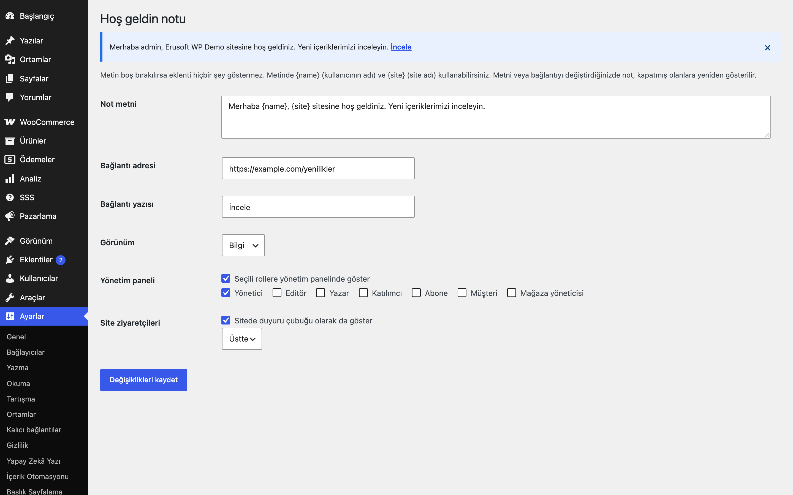
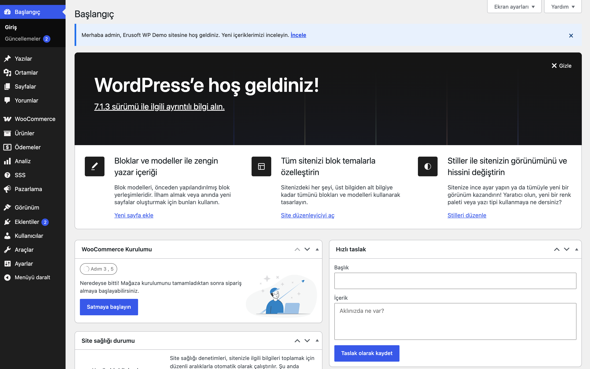
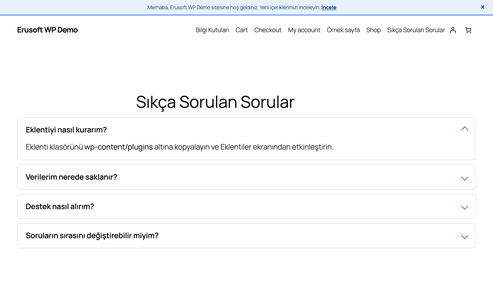
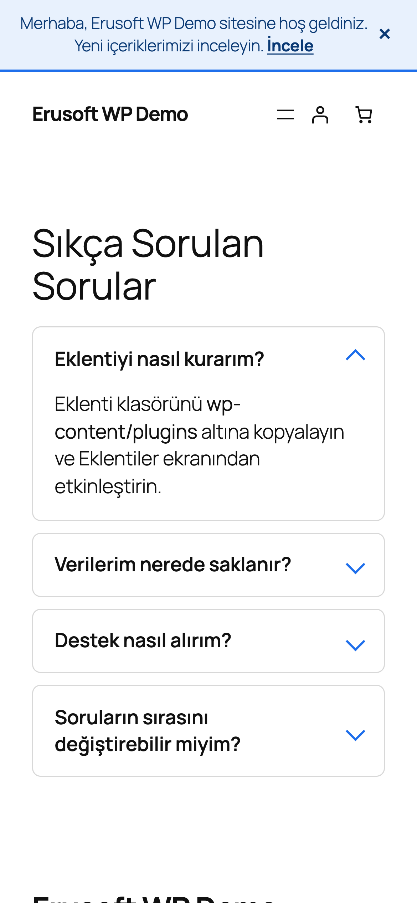

# Welcome Note for WordPress

Seçtiğiniz rollere yönetim panelinde kapatılabilir bir not, isterseniz sitede duyuru çubuğu gösterir.

> **English:** A dismissible welcome note for chosen roles in the admin area and an optional front-end announcement bar. Dismissal is remembered per user (user meta + nonce'd AJAX); changing the text shows it again.

  

## Ne işe yarar

Ekibinize ya da ziyaretçilere kısa bir not göstermenin sade yolu: metin ve bağlantıyı ayarlardan yazarsınız, hangi rollerin göreceğini seçersiniz. Kullanıcı notu kapatınca bir daha görmez; metni değiştirirseniz yeniden görünür.

## Özellikler

- Yönetim panelinde seçili rollere bilgi/başarı/uyarı görünümlü not
- İsteğe bağlı site duyuru çubuğu (üstte veya altta)
- `{name}` ve `{site}` yer tutucuları
- Kapatma kullanıcı bazlıdır (kullanıcı meta + nonce'lu AJAX); misafirlerde tarayıcıda hatırlanır
- Metin boşsa eklenti hiçbir çıktı üretmez

## Kurulum

1. `welcome-note-for-wordpress` klasörünü `wp-content/plugins/` altına kopyalayın (veya zip olarak yükleyin).
2. Eklentiler ekranından etkinleştirin.
3. Ayarları yapın (aşağıya bakın).

## Nasıl kullanılır

1. Eklentiyi etkinleştirin ve Ayarlar → **Hoş geldin notu** ekranını açın.
2. **Not metni** alanına "Merhaba {name}, {site} paneline hoş geldiniz." yazın.
3. İsterseniz **Bağlantı adresi** olarak `https://example.com/yardim` ve **Bağlantı yazısı** olarak "Yardım sayfası" girin; **Görünüm** olarak Bilgi'yi seçin.
4. **Yönetim paneli** için notu görecek rolleri işaretleyip kaydedin; o roldeki bir kullanıcıyla panele girince not görünür ve kapatılabilir.
5. Ziyaretçilere de göstermek için "Site ziyaretçileri" kutusunu işaretleyin ve konumu (Üstte/Altta) seçin.
6. Notu kapatın ve sayfayı yenileyin: not geri gelmez. Metni değiştirip kaydederseniz yeniden görünür.

## Ayarlar

Ayarlar → **Hoş geldin notu**: metin, bağlantı adresi ve yazısı, görünüm, roller, ön yüzde gösterim ve konum. Seçenek: `eru_wn_settings`; kapatma kaydı kullanıcı metası `eru_wn_dismissed`.

## Kısa kodlar, kancalar, filtreler

| Ad | Tür | Açıklama |
|---|---|---|
| `eru_wn_settings` | seçenek | Eklenti ayarları |
| `eru_wn_dismissed` | kullanıcı meta | Kapatılan notun anahtarı |
| `wp_ajax_eru_wn_dismiss` | AJAX | Nonce'lu kapatma isteği |

## Entegrasyonlar ve gereksinimler

WordPress 6.5+, PHP 8.0+. Harici servis kullanmaz.

## Sınırlamalar

- Tek bir not vardır; çoklu not ya da zamanlama yoktur.
- Ön yüz çubuğu rol bazlı değil, tüm ziyaretçiler içindir; rol seçimi yalnızca yönetim paneli notunu etkiler.

## SSS

**Notu herkes için yeniden gösterebilir miyim?** Evet: not metnini, bağlantı adresini ya da bağlantı yazısını değiştirmeniz yeterlidir; kapatma bu üçünden türetilen bir anahtara bağlıdır.

**Eklentiyi silersem ne olur?** Eklenti silindiğinde `eru_wn_settings` seçeneği ve tüm kullanıcılardaki `eru_wn_dismissed` kullanıcı metası silinir. Devre dışı bırakınca not görünmez, ayarlar saklanır.

**Giriş yapmamış ziyaretçiler için kapatma nasıl hatırlanır?** Tarayıcının `localStorage` alanında; sunucuda kayıt tutulmaz. Tarayıcı verisi silinirse çubuk yeniden görünür.

**Önbellek eklentisiyle çalışır mı?** Misafirler için kapatma durumu tarayıcıda uygulanır. Metni değiştirdikten sonra sayfa önbelleğini temizlemeniz gerekebilir.

**Dış servis kullanıyor mu?** Hayır.

## Değişiklik geçmişi

Bkz. [CHANGELOG.md](CHANGELOG.md).

## Destek

- Önce bu sayfadaki **SSS** ve **Sınırlamalar** bölümlerine göz atın; sık karşılaşılan durumlar orada.
- Hata mı buldunuz? [GitHub Issues](https://github.com/erayusta/erusoft-wp/issues) üzerinden bildirin. WordPress, PHP ve eklenti sürümünü, adımları ve beklenen/gerçekleşen sonucu yazmanız işi hızlandırır.
- Kurulum, yapılandırma, özel geliştirme veya entegrasyon desteği için **[hello@erusoft.com](mailto:hello@erusoft.com)** adresine yazın. Erusoft hakkında: [erusoft.com](https://erusoft.com).
- Lütfen şifre, API anahtarı veya müşteri verisi (ad, telefon, TCKN, sipariş dökümü) göndermeyin; ekran görüntülerindeki kişisel verileri karartın.

## Lisans

GPL-2.0-or-later.

Diğer Erusoft eklentileri: https://wordpress.erusoft.com/
