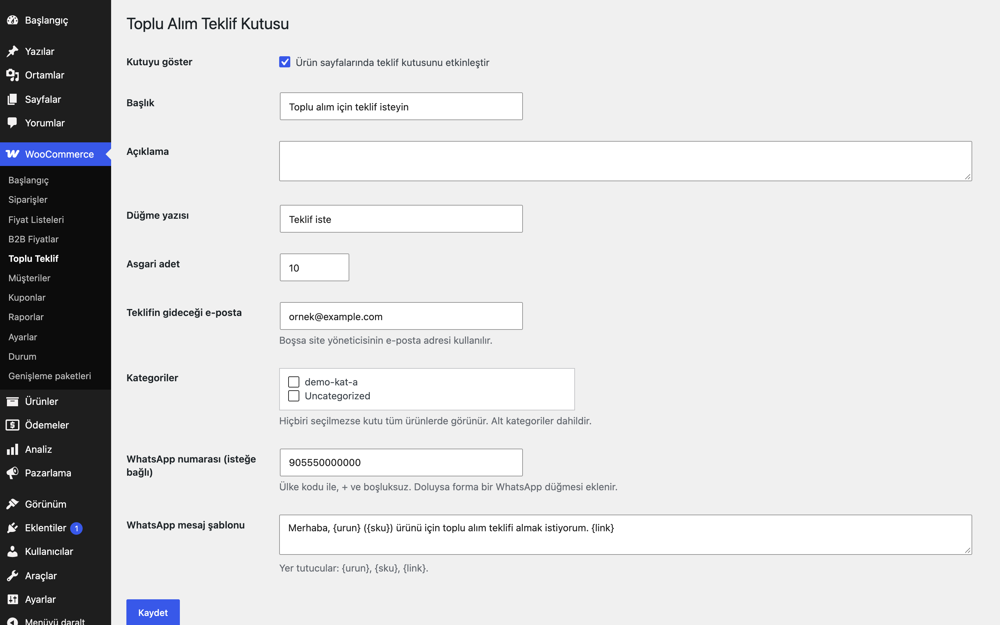
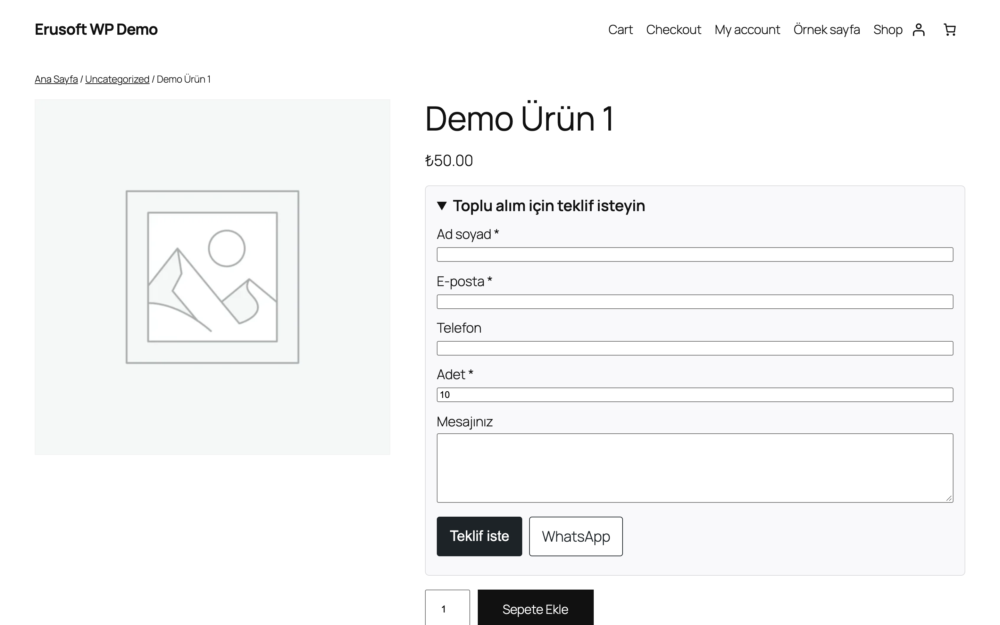
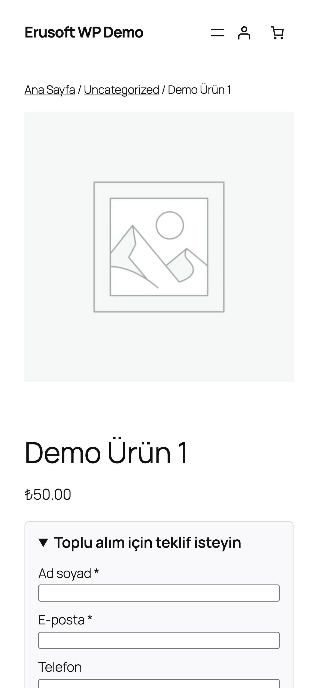

# Wholesale Inquiry Box for WooCommerce

Ürün sayfasına "Toplu alım için teklif isteyin" formu ekler; talepler e-posta ile size ulaşır.

> **English:** Adds a bulk-quote request box to product pages: a short form (name, e-mail, phone, quantity, message) that e-mails the store owner, with an optional WhatsApp button. Nonce and honeypot protected. Disabled until you turn it on.

   

## Ne işe yarar

Yüksek adetli alım yapmak isteyen ziyaretçiler ürün sayfasındaki katlanır kutuyu açıp ad, e-posta, adet ve mesajlarını gönderir; talep belirlediğiniz e-posta adresine (boşsa site yöneticisine) düşer. Yanıtlarken doğrudan "Yanıtla" yeterlidir (Reply-To müşteridir).

## Özellikler

- Katlanır teklif kutusu (başlık, açıklama, düğme yazısı ayarlanır)
- Asgari adet ayarı (varsayılan 10); altındaki talepler reddedilir
- Hedef e-posta ayarı; boşsa site yöneticisinin e-postası
- Kategoriye göre gösterim (alt kategoriler dahil); kategori seçilmezse tüm ürünler
- İsteğe bağlı WhatsApp düğmesi: `{urun}`, `{sku}`, `{link}` yer tutuculu şablon
- Nonce, honeypot (gizli tuzak alan) ve IP başına bekleme süresi ile spam koruması
- Mobil uyumlu, JavaScript gerektirmez

## Kurulum

1. `wholesale-inquiry-box-for-woocommerce` klasörünü `wp-content/plugins/` altına kopyalayın (veya zip olarak yükleyin).
2. Eklentiler ekranından etkinleştirin (WooCommerce gereklidir).
3. WooCommerce → **Toplu Teklif** ekranından kutuyu etkinleştirin. Etkinleştirene kadar mağazanızda hiçbir değişiklik olmaz.

## Nasıl kullanılır

1. Eklentiyi etkinleştirin ve WooCommerce → **Toplu Teklif** sayfasını açın.
2. Kutuyu göstermeyi açın, hedef e-posta olarak `ornek@example.com` yazın, asgari adedi `10` bırakın ve kaydedin. Yalnızca belirli ürünlerde göstermek için bir kategori seçin.
3. Mağazada "Demo Ürün"ün sayfasını açın: ürün özeti alanında (varsayılan temalarda sepete ekle düğmesinin altında) katlanır teklif kutusu görünür.
4. Kutuyu açıp ad, e-posta, telefon, adet (en az 10) ve kısa bir mesaj yazın, gönderin.
5. Hedef adrese "Toplu alım teklif talebi: Demo Ürün" konulu bir e-posta düşer; ürün adı, SKU, bağlantı, adet ve müşteri bilgileri içindedir. "Yanıtla" dediğinizde yanıt doğrudan müşteriye gider.
6. Aynı ziyaretçi 30 saniye içinde yeniden gönderirse "Çok sık istek gönderdiniz" uyarısı görür.

## Ayarlar

WooCommerce → **Toplu Teklif**: kutuyu göster, başlık, açıklama, düğme yazısı, asgari adet, hedef e-posta, kategoriler, WhatsApp numarası ve şablonu. Veriler `eru_wib_settings` seçeneğinde tutulur.

## Kancalar, filtreler ve veri alanları

| Ad | Tür | Açıklama |
|---|---|---|
| `eru_wib_settings` | seçenek | Tüm ayarlar |
| `eru_wib_rate_limit` | filtre | İki talep arası bekleme saniyesi (varsayılan 30, 0 = kapalı) |
| `eru_wib_client_ip` | filtre | Bekleme süresi için ziyaretçi IP'si (varsayılan `REMOTE_ADDR`); proxy/CDN arkasında gerçek adresi döndürün |
| `eru_wib_submit` | admin-post eylemi | Form gönderimi |

## Entegrasyonlar ve gereksinimler

WordPress 6.5+, PHP 8.0+, WooCommerce 9.0+. HPOS ile uyumludur. E-posta WordPress'in `wp_mail` işleviyle gider (SMTP eklentinizle çalışır). WhatsApp düğmesi yalnızca `wa.me` bağlantısı açar; eklenti WhatsApp'a istek göndermez. Başka dış HTTP isteği yoktur.

## Sınırlamalar

- Talepler yalnızca e-postayla iletilir; yönetim ekranında talep listesi tutulmaz.
- Sayfa önbelleği kullanıyorsanız formdaki nonce önbellekte eskiyebilir (WordPress nonce'ları 12–24 saat geçerlidir): ürün sayfalarının önbellek süresini 12 saatin altında tutun ya da bu sayfaları önbellekten hariç tutun (süresi dolan nonce'ta ziyaretçiye "sayfayı yenileyin" uyarısı gösterilir).
- Bekleme süresi ziyaretçi IP'sine göre işler (varsayılan `REMOTE_ADDR`). Proxy/CDN arkasındaysanız `eru_wib_client_ip` filtresiyle gerçek adresi döndürün; aksi halde tüm ziyaretçiler tek IP sayılır. Her gönderim denemesi (e-posta gönderilemese bile) bekleme süresini başlatır.
- Kutu ürün başına tekil açılıp kapanmaz; ürün bazında kapatma yoktur, yalnızca kategori filtresi vardır.

## SSS

**E-posta gelmiyor.** WordPress'in e-postası barındırmanızda engelli olabilir; bir SMTP eklentisi kurun ve hedef adresi kontrol edin.

**Spam geliyor.** `eru_wib_rate_limit` filtresiyle bekleme süresini artırın.

**Gelen talepler sitede saklanır mı?** Hayır. Talep yalnızca e-postayla iletilir; veritabanına yazılmaz. Bekleme süresi için ziyaretçi IP'sinin özeti (md5) kısa ömürlü bir geçici kayıtta (`transient`) tutulur ve süre dolunca silinir.

**Eklentiyi devre dışı bırakırsam veya silersem ne olur?** Devre dışı bırakınca kutu ürün sayfalarından kalkar, ayarlar yerinde kalır. Eklenti silinirken yalnızca `eru_wib_settings` seçeneği silinir; başka tablo ya da meta oluşturmadığı için geride veri kalmaz.

**HPOS ve blok tabanlı Sepet/Ödeme ile ilgisi var mı?** HPOS uyumluluğu bildirilir, ancak eklenti siparişlere dokunmaz; kutu ürün sayfasında çalışır. Sepet/Ödeme blokları için ayrı bir uyumluluk bildirimi yoktur ve gerekmez.

**Hangi telefon numarası WhatsApp düğmesine yazılır?** Ayarlardaki WhatsApp numarası kullanılır; düğme `wa.me` bağlantısını yeni sekmede açar ve mesaj şablonundaki `{urun}`, `{sku}`, `{link}` değerlerini ürünle doldurur. Numara boşsa düğme görünmez.

## Değişiklik geçmişi

Bkz. [CHANGELOG.md](CHANGELOG.md).

## Destek

- Önce bu sayfadaki **SSS** ve **Sınırlamalar** bölümlerine göz atın; sık karşılaşılan durumlar orada.
- Hata mı buldunuz? [GitHub Issues](https://github.com/erayusta/erusoft-wp/issues) üzerinden bildirin. WordPress, WooCommerce, PHP ve eklenti sürümünü, adımları ve beklenen/gerçekleşen sonucu yazmanız işi hızlandırır.
- Kurulum, yapılandırma, özel geliştirme veya entegrasyon desteği için **[hello@erusoft.com](mailto:hello@erusoft.com)** adresine yazın. Erusoft hakkında: [erusoft.com](https://erusoft.com).
- Lütfen şifre, API anahtarı veya müşteri verisi (ad, telefon, TCKN, sipariş dökümü) göndermeyin; ekran görüntülerindeki kişisel verileri karartın.

## Lisans

GPL-2.0-or-later.

Diğer Erusoft eklentileri: https://wordpress.erusoft.com/
