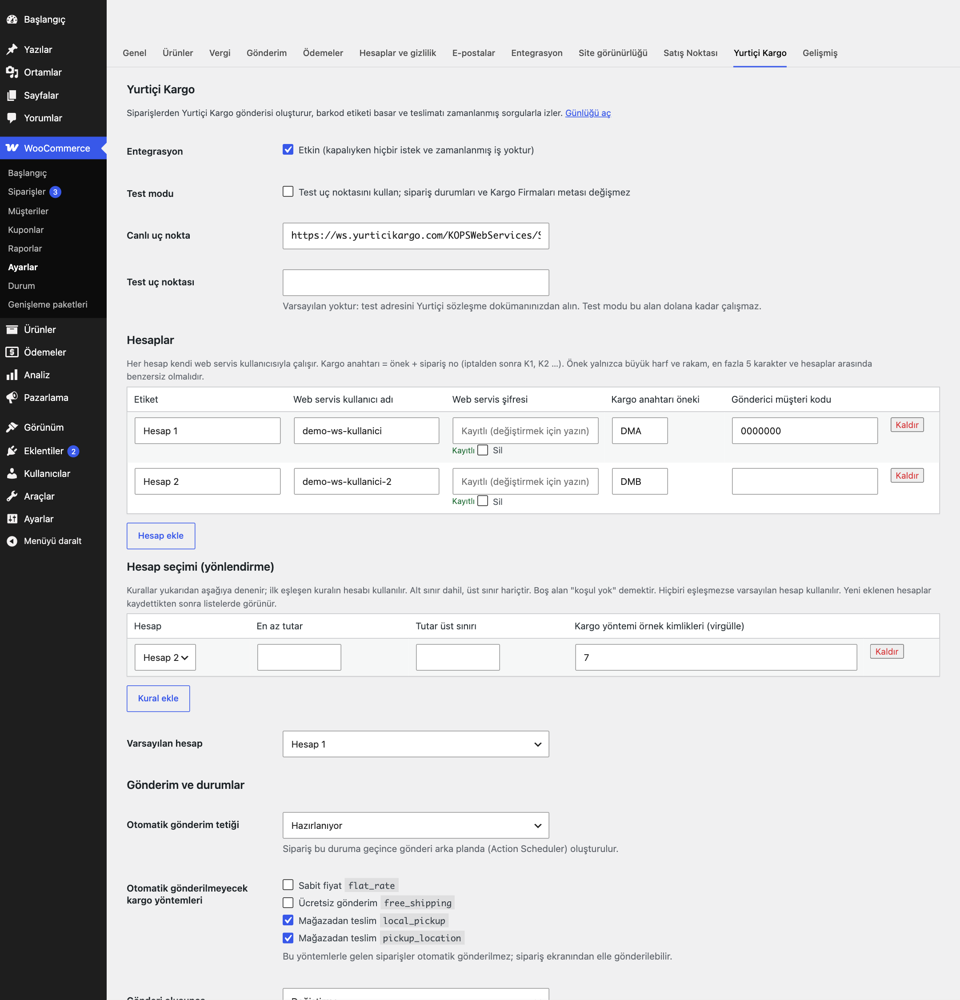
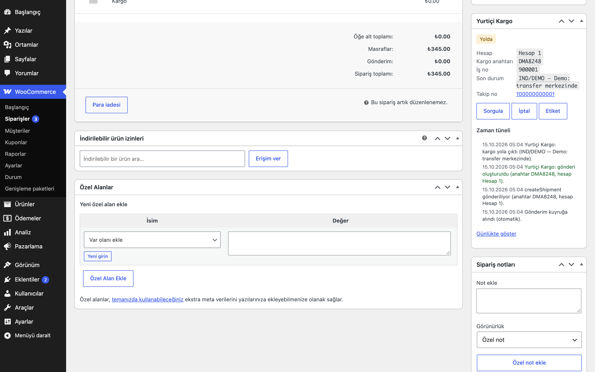
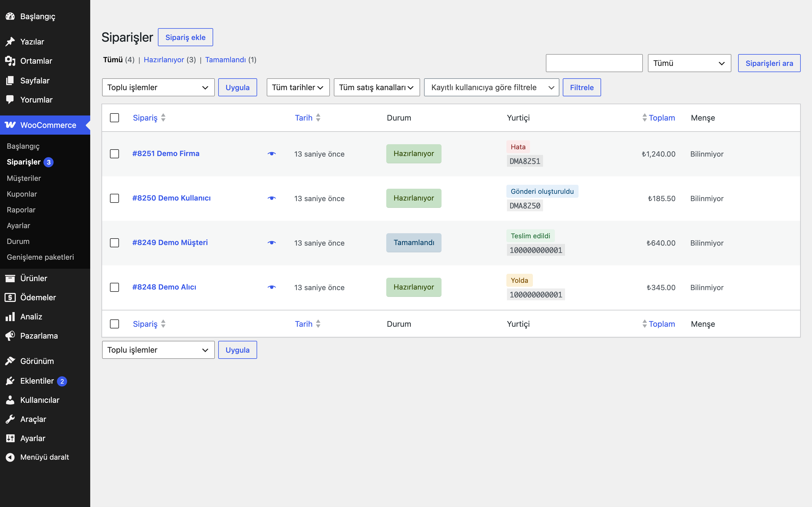
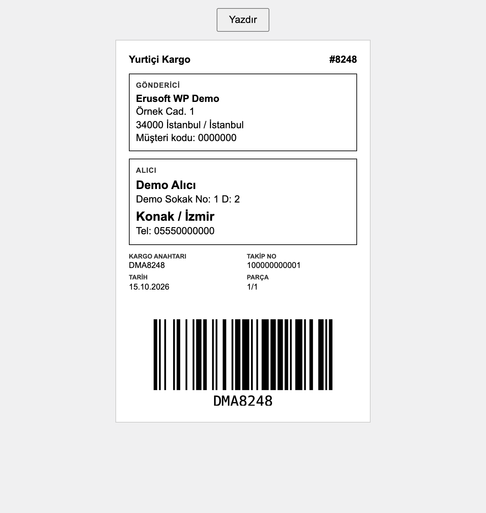
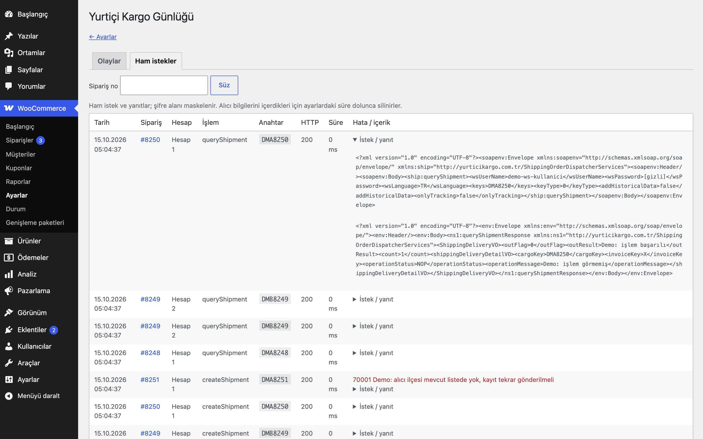

# Yurtiçi Kargo Integration for WooCommerce

> **English:** Creates Yurtiçi Kargo shipments from WooCommerce orders over the legacy `ShippingOrderDispatcherServices` XML (SOAP) service. Supports several sender accounts with first-match routing rules (order total, shipping method), a status-triggered auto-dispatch through Action Scheduler, printable 100×150 mm / A6 barcode labels (bundled JsBarcode), scheduled delivery tracking with per-phase intervals and back-off, cancel and re-dispatch with a new cargo key, an order timeline and a request log with the password redacted. One shipment per order and cargo key: ambiguous failures are looked up before anything is re-sent. Inert until you enable it and save an account.

[](https://www.gnu.org/licenses/gpl-2.0.html)   

> **Beta:** canlı API ile kendi hesabınızla doğrulayın.

WooCommerce siparişlerinden Yurtiçi Kargo gönderisi oluşturur, barkod etiketi basar, teslimatı zamanlanmış sorgularla izler ve sipariş durumunu (isterseniz) ilerletir.



## Özellikler

- Sipariş belirli bir duruma geçince otomatik gönderi (arka planda, Action Scheduler) ya da sipariş ekranından, toplu işlemden veya WP-CLI'dan elle gönderim
- Birden fazla Yurtiçi hesabı; tutar ve kargo yöntemine göre ilk eşleşen kuralla hesap seçimi
- 100×150 mm veya A6 yazdırılabilir etiket, kargo anahtarının CODE128 barkoduyla (JsBarcode eklentiyle birlikte gelir, CDN kullanılmaz)
- 5 dakikada bir takip; "gönderi oluşturuldu" ve "yolda" için ayrı sorgu aralığı, kayıt bulunamayan gönderilerde geri çekilme
- İptal ve yeniden gönderim (yeni kargo anahtarı), sipariş zaman tüneli, ham istek günlüğü
- Kargo Firmaları eklentisi etkinse takip numarası onun alanlarına yazılır

## Kurulum

1. `yurtici-kargo-integration-for-woocommerce` klasörünü `wp-content/plugins/` altına kopyalayın (veya zip olarak yükleyin).
2. Eklentiler ekranından etkinleştirin. WooCommerce gereklidir.
3. WooCommerce → Ayarlar → **Yurtiçi Kargo**: en az bir hesap ekleyin (web servis kullanıcı adı ve şifresi Yurtiçi'den alınır). Test uç noktasını sözleşme dokümanınızdan girip önce **Test modu** açıkken **Entegrasyon**'u etkinleştirin ve kaydedin.
4. Bir siparişte **Yurtiçi'ne gönder** düğmesiyle deneyin; sonucu sipariş kutusundaki zaman tünelinde ve günlükte görün.

Etkinleştirme sonrası eklenti pasiftir: ana anahtar açılıp kullanıcı adı ve şifresi olan bir hesap kaydedilene kadar dış istek, zamanlanmış iş veya ön yüz çıktısı yoktur.

## Bağlantı ve güvenlik

| Ayar | Açıklama |
|---|---|
| Canlı uç nokta | Varsayılan `https://ws.yurticikargo.com/KOPSWebServices/ShippingOrderDispatcherServices` (servisin WSDL'inde yayımlanan adres). Sözleşmenizdeki adres farklıysa buradan değiştirin (`eru_yk_endpoint` filtresi de var). |
| Test uç noktası | **Varsayılanı yoktur.** Test adresini Yurtiçi'nin size verdiği sözleşme/entegrasyon dokümanından alın. Test modu açık ve bu alan boşken entegrasyon çalışmaz; yönetim ekranlarında uyarı görünür. |
| Test modu | Test uç noktası kullanılır; sipariş durumu değiştirilmez, notlar `[Test]` ile başlar, Kargo Firmaları metası yazılmaz. Test hesabının bilgilerini Yurtiçi'den alıp ayrı bir hesap olarak girin. |
| Şifre | Yalnızca yazılabilir: ekrana geri yazılmaz ("Kayıtlı" görünür), boş bırakılırsa korunur, ayar `autoload=no` saklanır, günlüğe `[gizli]` olarak düşer, adrese (GET) eklenmez. |

**Şifresiz HTTP uyarısı:** Yurtiçi'nin eski (legacy) servis adresleri düz HTTP'dir (ör. `http://webservices.yurticikargo.com:8080/…`). Böyle bir adres girerseniz kullanıcı adı ve şifre ağda **şifrelenmeden** taşınır; ayar ekranı da bunu uyarır. Mümkünse HTTPS adresini kullanın.

İstekler `wp_remote_post` (20 sn zaman aşımı, yönlendirme yok) ile gider. SOAP zarfı küçük bir oluşturucuyla kurulur: kullanıcı adı, şifre ve anahtar listesi dahil **her değer** `htmlspecialchars(…, ENT_XML1 | ENT_QUOTES)` ile kaçırılır, XML'de taşınamayan kontrol karakterleri atılır, öğe adları doğrulanır. Yanıtlar `DOMDocument` ile `LIBXML_NONET` kullanılarak okunur; DTD veya varlık tanımı içeren yanıt işlenmez.

## Hesaplar ve yönlendirme

Her hesap: **etiket**, **web servis kullanıcı adı**, **şifre**, **kargo anahtarı öneki** (yalnızca `A-Z0-9`, en fazla 5 karakter, hesaplar arasında benzersiz) ve isteğe bağlı **gönderici müşteri kodu** (yalnızca etikette görünür; eski servis bu alanı almaz).

- Kargo anahtarı (`cargoKey`) = önek + sipariş no; iptalden sonra `K1`, `K2` … eklenir (ör. `DMA1234`, `DMA1234K1`).
- **Kurallar** sırayla denenir, ilk eşleşen kazanır. Bir kural: hesap + en az tutar (dahil) + tutar üst sınırı (hariç) + kargo yöntemi örnek kimlikleri (virgülle; sayfanın altında bölge ve yöntem listesi görünür). Boş alan koşul değildir.
- Hiçbir kural eşleşmezse **varsayılan hesap**, o da yoksa ilk hesap kullanılır. Kod ile değiştirmek için `eru_yk_route_account` filtresi.
- Siparişin hesabı ve anahtarı ilk denemede saklanır; yeniden denemeler aynı hesabı ve anahtarı kullanır.

## Gönderim

- **Otomatik:** sipariş seçtiğiniz duruma (varsayılan: yok, yalnızca elle) geçince bir Action Scheduler işi kurulur; durum değişikliği isteğinde HTTP yapılmaz. **Otomatik gönderilmeyecek kargo yöntemleri** (varsayılan `local_pickup`, `pickup_location`) atlanır ve zaman tüneline yazılır.
- **Elle:** sipariş kutusundaki düğme (kuyruğa alır), sipariş listesinde **Yurtiçi'ne gönder** toplu işlemi (gönderisi olan ve hariç tutulan siparişler atlanır) veya `wp eru-yk dispatch <sipariş>`.
- Adres: kargo adresinin ilk satırı doluysa **tüm** kargo adresi, değilse **tüm** fatura adresi kullanılır (karıştırılmaz). İl, WooCommerce il kodundan (`TR35` → İzmir), ilçe şehir alanından alınır. Telefon kargo telefonu, yoksa fatura telefonudur. Alıcı adı, adres, il veya ilçe eksikse gönderi oluşturulmaz.
- Gönderilen alanlar: `cargoKey`, `invoiceKey` (sipariş no), `receiverCustName`, `receiverAddress`, `receiverPhone1`, `cityName`, `townName`, `cargoCount` (1), `emailAddress`. Desi/kg gibi alanlar için `eru_yk_dispatch_payload` filtresi (belgelenen alan listesi dışındaki anahtarlar atılır, `cargoKey` değiştirilemez).

### Tek gönderi garantisi

- Sipariş başına bir kilit (`INSERT IGNORE` ile yazılan seçenek satırı) alınır; anahtar, hesap ve `pending` durumu HTTP isteğinden **önce** kaydedilir.
- **Geçici hatalar** (bağlantı hatası, 429, 5xx, belgelenmiş geçici kodlar — `eru_yk_transient_codes`) Action Scheduler ile 1, 5 ve 15 dakika sonra yeniden denenir; istek içinde beklenmez (`sleep` yok).
- **Belirsiz sonuç:** istek gönderildikten sonra zaman aşımı, SOAP hatası olmayan 5xx, okunamayan ya da beklenen biçimde olmayan yanıt gelirse Yurtiçi kaydı yine de oluşturmuş olabilir. Durum **Belirsiz** olur; sonraki denemede yeni `createShipment`'tan **önce** aynı anahtar `queryShipment` ile sorgulanır: kayıt varsa bağlanır; **yalnızca açık bir "kayıt yok" kodu** (`Eru_YK_Client::NOT_FOUND_CODES`, varsayılan `820`; `eru_yk_not_found_codes` filtresi) gelirse yeniden gönderilir. Başka her yanıtta (bağlantı hatası, kimlik hatası, SOAP hatası, bilinmeyen kod) sipariş **İnceleme gerekli** olur ve otomatik olarak bir daha gönderilmez. Yurtiçi tarafını kontrol edip sipariş kutusundan "Yeniden dene" (önce yine sorgular) veya gönderi oluşmadıysa "Yerel sıfırla" seçersiniz.
- **"Kayıt zaten var"** yanıtı yalnızca **hata koduyla** tanınır (`Eru_YK_Client::DUPLICATE_CODES`, varsayılan `60020`; `eru_yk_duplicate_codes` filtresiyle genişletin). Hata metni ("mevcut", "tekrar" vb.) asla eşleştirilmez. Bu kodla gelen yanıtta anahtar sorgulanır ve mevcut kayıt bağlanır.

### İptal ve yerel sıfırlama

- **İptal** `cancelShipment`'ı siparişin kayıtlı hesabı ve kayıtlı anahtarıyla çağırır. Yanıt yalnızca `outFlag` = 0, hiçbir yerde `errCode` yok ve bu anahtar için bir `shippingCancelDetailVO` satırı varsa başarılı sayılır; başka her yanıt (SOAP hatası, beklenmeyen biçim) hatadır ve sipariş verisine dokunulmaz. Başarılı iptalde gönderi metası temizlenir, sıra numarası artar (sonraki anahtar `K1`, `K2` …) ve kuyruktaki gönderim işleri kaldırılır.
- **Yerel sıfırla** uzak çağrı yapmaz. Yalnızca şu durumlarda görünür: takip gönderinin Yurtiçi tarafında iptal edildiğini gördüyse ("Yurtiçi tarafında iptal"; ikinci bir iptal reddedilir) veya **İnceleme gerekli** durumundaki bir siparişte gönderinin oluşmadığını onaylarsanız. **Takip bırakıldı** durumundaki gönderi bir kez oluşturulmuş olduğundan, onaydan sonra anahtar yeniden sorgulanır ve sıfırlama yalnızca açık bir "kayıt yok" kodu gelirse yapılır; başka her yanıtta reddedilir ve "İptal" kullanılmalıdır. Meta temizlenir, sıra numarası artar, siparişe not düşülür; eski anahtar bir daha gönderilmez. Yurtiçi tarafında iptal görünen bir sipariş, sıfırlanmadan eski anahtarla yeniden gönderilmez.

## Takip

- 5 dakikada bir, kilit altında, durumu "Gönderi oluşturuldu" veya "Yolda" olan ve sorgu zamanı gelmiş en fazla 50 sipariş **son sorgu zamanı en eski olandan başlayarak** sorgulanır (sıra ve zaman sorgunun içindedir; kayan ofset yoktur).
- Sorgu aralıkları: gönderi oluşturuldu 30 dk, yolda 60 dk (ayar). Tüm hesaplar açık bir "kayıt yok" koduyla yanıt verirse 20 sorgudan sonra aralık her seferinde ikiye katlanır (en fazla 1 gün); 100 sorguda (ayar) takip bırakılır ve not düşülür. Kimlik veya servis hataları bu sayaca eklenmez (değişen bir şifre siparişleri "takip bırakıldı"ya sürüklemez); olay olarak yazılır ve normal aralıkla yeniden denenir.
- Önce siparişin hesabı, sonra diğer hesaplar birer kez sorulur; kayıt başka hesapta çıkarsa siparişin hesabı düzeltilir.
- Kodlar (`operationStatus` veya `cargoEventId`): `NOP`, `ISR` (henüz işlem görmemiş) yok sayılır; `DLV`/`OK` teslim; `CNL` Yurtiçi tarafında iptal (takip durur); diğerleri "yolda". Kod listeleri `eru_yk_ignored_codes`, `eru_yk_delivered_codes`, `eru_yk_cancelled_codes` filtreleriyle değiştirilebilir.
- Takip numarası (`docId`) ve bağlantısı siparişe yazılır; bağlantı servis vermezse Yurtiçi'nin sorgu sayfası kullanılır (`eru_yk_tracking_url`).

## Durumlar

"Gönderi oluşunca", "Kargo yola çıkınca" ve "Teslim edilince" için hedef sipariş durumu seçilebilir; varsayılan **Değiştirme**'dir. Her adımda siparişe not eklenir. Listede tüm kayıtlı durumlar görünür; **Custom Order Statuses for WooCommerce** ile eklediğiniz "Kargoya verildi" gibi durumlar da seçilebilir. Test modunda durum değiştirilmez.



## Kargo Firmaları eklentisiyle birlikte

**Turkish Shipping Carriers for WooCommerce** (1.0.1+) etkinse gönderi oluşunca firma `yurtici`, takip numarası gelince numara o eklentinin kendi kayıt yolundan (`eru_tsc_set_tracking()`) yazılır. Böylece elle girilen numarada olduğu gibi, o eklentide "müşteriye bildir" açıksa müşteriye takip bağlantılı sipariş notu e-postası gider ve `eru_tsc_tracking_saved` eylemi (ör. SMS eklentileri için) çalışır; aynı numara tekrar geldiğinde ikinci bildirim gitmez. Takip bağlantısı o eklentinin e-postalarında ve Hesabım sayfasında görünür. Numara gelmeden önce açılmış bir sipariş ekranı kaydedilince arka planda yazılan numara silinmez. İptalde bu eklentinin yazdığı takip numarası silinir. Test modunda hiçbir şey yazılmaz ve bildirim gitmez.

## Yönetim ekranları

- **Sipariş kutusu:** durum, hesap, kargo anahtarı, iş no, son Yurtiçi durumu, takip no; **Yurtiçi'ne gönder / Yeniden dene** (kuyruğa alır), **Sorgula** (sipariş kilidi altında), **İptal**, **Yerel sıfırla** (onaylı), **Etiket** düğmeleri ve zaman tüneli. Düğmeler sipariş formunu göndermez; `admin-ajax` + sipariş başına nonce + `edit_shop_orders` yetkisi.
- **Sipariş listesi:** "Yurtiçi" sütunu (durum ve takip no/anahtar) ve **Yurtiçi'ne gönder** toplu işlemi (yetki ayrıca kontrol edilir).
- **Etiket:** `admin-post.php?action=eru_yk_label` (yetki + sipariş başına nonce), salt okunur. Gönderici: mağaza adı ve WooCommerce → Ayarlar → Genel'deki mağaza adresi.
- **Günlük** (ayarlardaki "Günlüğü aç"): olaylar ve ham istekler, sipariş no ile süzme, temizleme.





## WP-CLI

```
wp eru-yk dispatch <sipariş>
wp eru-yk track [--order=<sipariş>]
wp eru-yk cancel <sipariş>
```

## Kancalar ve filtreler

| Ad | Açıklama |
|---|---|
| `eru_yk_dispatch_payload` | `ShippingOrderVO` alanları (`$payload`, `$order`, `$account` şifresiz) |
| `eru_yk_route_account` | Seçilen hesap kimliği (`$account_id`, `$order`) |
| `eru_yk_duplicate_codes` | "Kayıt zaten var" hata kodları |
| `eru_yk_not_found_codes` | queryShipment "kayıt yok" kodları |
| `eru_yk_transient_codes` | Geçici sayılan hata kodları |
| `eru_yk_delivered_codes`, `eru_yk_ignored_codes`, `eru_yk_cancelled_codes` | Takip kodları |
| `eru_yk_tracking_url` | Takip bağlantısı (`$url`, `$doc_id`, `$order`) |
| `eru_yk_track_batch_size` | Turdaki sipariş sayısı (50) |
| `eru_yk_endpoint` | Uç nokta (`$url`, `$test_mode`) |
| `eru_yk_tsc_active` | Kargo Firmaları entegrasyonunu aç/kapat |

## Kişisel veri

Gönderi oluşturulurken alıcı adı, adresi, telefonu ve e-postası Yurtiçi'ye iletilir (eklenti gizlilik politikası sayfasına öneri metni ekler). `{önek}eru_yk_log` tablosu ham istekleri bu bilgilerle birlikte tutar; **7 gün** (ayar) sonra günlük bir işle 1000'erli partilerle silinir ve WordPress kişisel veri dışa aktarma/silme araçlarına bağlıdır. `{önek}eru_yk_events` (zaman tüneli) eklentinin kendi mesajlarını tutar; ancak Yurtiçi'nin döndürdüğü hata metinleri olay mesajına eklenir ve bunlar alıcı bilgisi içerebilir. Bu yüzden olaylar da 90 gün (ayar) sonra silinir ve kişisel veri silme aracı ilgili siparişlerin olaylarını da siler.

## Gereksinimler

WordPress 6.5+, PHP 8.0+, WooCommerce 9.0+ (Action Scheduler WooCommerce ile gelir). HPOS ile uyumludur; sipariş verisi yalnızca `WC_Order` üzerinden okunur ve yazılır. Sipariş meta alanları: `_eru_yk_state` (`pending`, `retry`, `unknown`, `needs_review`, `failed`, `dispatched`, `in_transit`, `delivered`, `cancelled`, `gave_up`), `_eru_yk_account`, `_eru_yk_account_label`, `_eru_yk_cargo_key`, `_eru_yk_job_id`, `_eru_yk_tracking_number`, `_eru_yk_tracking_url`, `_eru_yk_seq`, `_eru_yk_error`, `_eru_yk_last_polled_at`, `_eru_yk_next_poll_at`, `_eru_yk_no_detail`, `_eru_yk_last_event`.

## Sınırlamalar

- **Beta:** Yurtiçi'nin herkese açık bir deneme ortamı belgesi yoktur. `createShipment`, `queryShipment` ve `cancelShipment` akışları, yinelenen kayıt kurtarma, geçici hata ve belirsiz sonuç davranışı yalnızca belgelenen biçimde **uydurma (mock) SOAP yanıtlarıyla** sınandı. İstek ve yanıt öğe adları servisin canlı WSDL'ine göre hizalandı; ancak yinelenen kayıt kodu (`60020`), "kayıt yok" kodu (`820`) ve takip kodları sözleşmenizle gelen dokümana göre doğrulanmalıdır; farklıysa ayar ve filtrelerle değiştirin. Önce **Test modu** ile deneyin.
- Yalnızca eski (legacy) XML servisi (`ShippingOrderDispatcherServices`) desteklenir; yeni nesil API'ler ve ZPL etiket desteklenmez.
- Desi/kg hesabı yapılmaz; gerekirse `eru_yk_dispatch_payload` filtresiyle ekleyin. Her siparişe tek parça (`cargoCount` 1) gönderilir.
- Gönderici müşteri kodu yalnızca etikete yazılır.
- "Sorgula" ve "İptal" düğmeleri tek bir isteği (20 sn zaman aşımı) doğrudan yapar; gönderim her zaman kuyruktan gider.
- Eklenti silindiğinde (Eklentiler → Sil) ayarlar, iki tablo, kilitler ve zamanlanmış işler silinir; **sipariş metası (`_eru_yk_*`) ve sipariş notları korunur.**

## English summary

Yurtiçi Kargo shipments from WooCommerce over the legacy XML (SOAP 1.1) service, sent with `wp_remote_post` and an escaping envelope builder; responses parsed with `DOMDocument`/`LIBXML_NONET`, no DTDs. N sender accounts with write-only passwords and unique cargo-key prefixes; first-match routing by total and shipping method instance. Dispatch runs in Action Scheduler, idempotent per order and cargo key (lock + persisted pending state); transient errors retry after 1/5/15 minutes without sleeping; an ambiguous failure is looked up with `queryShipment` before any re-send, otherwise the order goes to "needs review". "Already exists" is recognised only by error code. Cancel bumps a sequence so the next key ends in `K<n>`. A 5-minute tracker polls due orders oldest-first with per-phase intervals and exponential back-off, self-heals the account, and optionally moves order statuses (default: no change, a note always). Writes Turkish Shipping Carriers tracking meta when that plugin is active. Beta: verified against mocked HTTP only.

## Sürüm notları

Bkz. [CHANGELOG.md](CHANGELOG.md).

## Lisans

GPL-2.0-or-later. Birlikte gelen JsBarcode 3.11.6 MIT lisanslıdır (`assets/vendor/jsbarcode-LICENSE.txt`). Diğer Erusoft eklentileri: https://wordpress.erusoft.com
