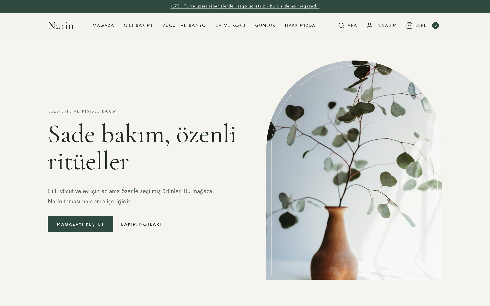
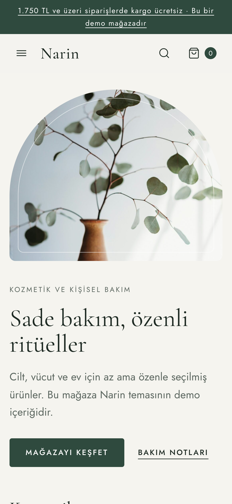
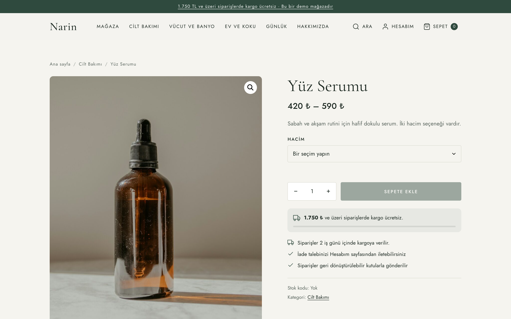
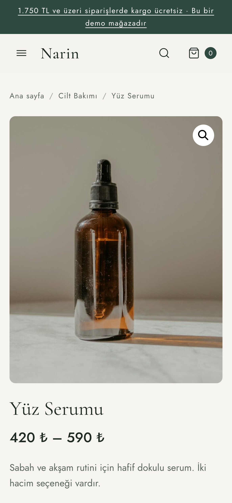
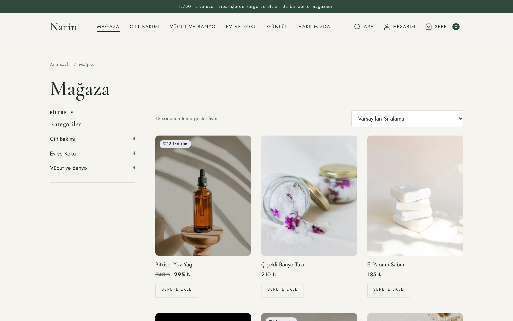
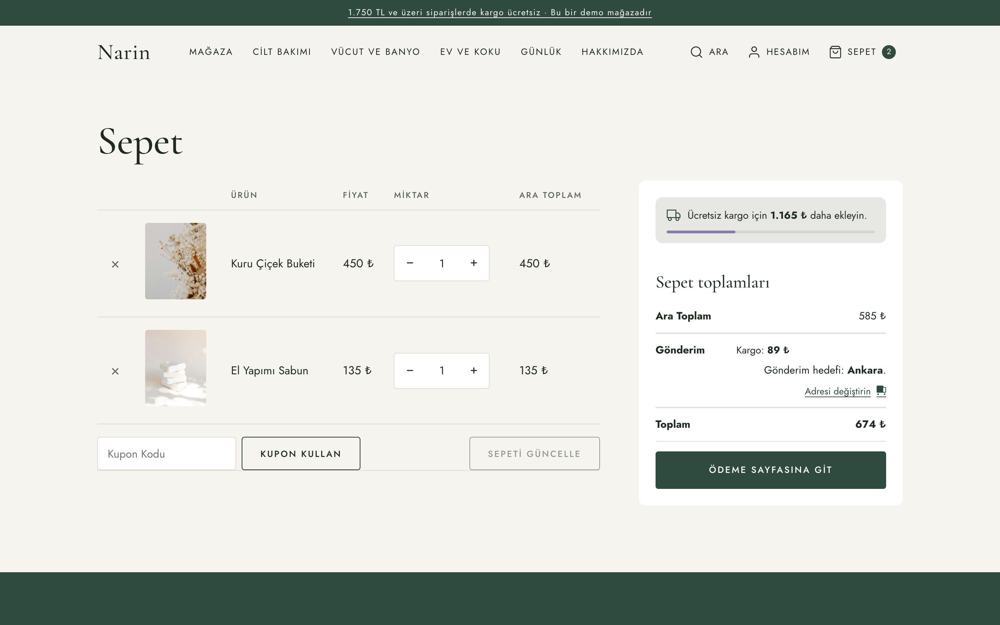
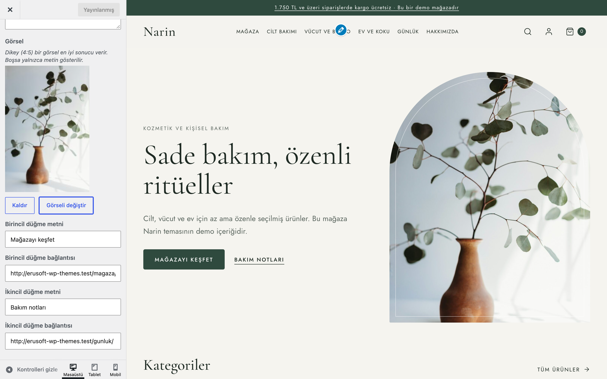

# Narin

Kozmetik, kişisel bakım, ev ve hediye gibi küçük mağazalar için sakin ve zarif bir WooCommerce teması: kemerli giriş görseli, yuvarlak kategori kartları, filtre çekmeceli mağaza, kargo bölgenizden okunan ücretsiz kargo çubuğu, kart düzenli sepet, ödeme ve hesap sayfaları.

> **English:** An elegant, calm classic WooCommerce theme for small shops. Arched hero, round category tiles, a product grid with a filter drawer, a two-column product page with a free-shipping progress bar read from your shipping zones (hidden when no free-shipping method applies), card-style cart, checkout, order-received and account pages, a "recently viewed" strip (stored only in the visitor's browser) and mobile buy bars. Every WooCommerce change is made with hooks and CSS: the theme ships no template overrides, so notices, structured data and other plugins' output keep working. Self-hosted Cormorant Garamond + Jost, no external requests, works without WooCommerce. Turkish UI, translation-ready.

[](https://www.gnu.org/licenses/gpl-2.0.html)   

## Ekran görüntüleri

<table>
  <tr>
    <td width="70%"><br><sub><b>Ana sayfa</b>: kemerli giriş görseli</sub></td>
    <td width="30%"><br><sub><b>Mobil</b>: 390 px</sub></td>
  </tr>
  <tr>
    <td><br><sub><b>Ürün</b>: varyasyon, ücretsiz kargo çubuğu, maddeler</sub></td>
    <td><br><sub><b>Ürün</b>: mobil</sub></td>
  </tr>
  <tr>
    <td><br><sub><b>Mağaza</b>: kategori filtresi, sıralama</sub></td>
    <td><br><sub><b>Sepet</b>: adet düğmeleri, özet kartı</sub></td>
  </tr>
</table>


<sub><b>Özelleştirici</b>: tüm ayarlar tek panelde</sub>

Görüntülerdeki mağaza, ürünler, fiyatlar, adres ve iletişim bilgileri kurgusaldır (demo içerik).

## Özellikler

| Alan | Neler var |
|---|---|
| **Üst bilgi** | İsteğe bağlı duyuru çubuğu, logo ya da site başlığı (temanın başlık yazı tipiyle), iki seviyeli menü, arama paneli, Hesabım ve sepet bağlantısı (ürün sayısı sayfa yenilenmeden güncellenir). Mobilde odak tuzaklı, Escape ile kapanan çekmece menü. |
| **Ana sayfa** | Giriş (üst etiket, başlık, metin, kemerli görsel, iki düğme), öne çıkan kategoriler (kategori görseli yoksa kategorideki bir ürünün görseli), yeni ürünler, sayfanın kendi blok içeriği, son yazılar, "öne çıkan bilgiler" şeridi. Bölümler açılıp kapatılabilir; sıra filtreyle değiştirilebilir. |
| **Mağaza ve kategoriler** | Sayfa yolu, başlık ve açıklama, alt kategori listesi ve isteğe bağlı filtre bileşen alanı (geniş ekranda yan sütun, 1024 px altında çekmece), sonuç sayısı, sıralama, sayfalama. |
| **Ürün sayfası** | Galeri (WooCommerce yakınlaştırma, ışık kutusu, kaydırıcı) ve yapışkan özet iki sütunda; adet düğmeleri; ücretsiz kargo ilerleme çubuğu; kargo notu ve onay işaretli maddeler (yalnızca doldurulursa); sekmeler; ilgili ürünler; "Son baktıklarınız"; mobilde sepete ekle düğmesi ekrandan çıkınca alttan beliren satın alma çubuğu. |
| **Ücretsiz kargo çubuğu** | Eşik, müşterinin kargo adresine uyan bölgedeki etkin "Ücretsiz gönderim" yönteminden okunur (WooCommerce'in kendi hesabıyla, indirim ayarı dahil). Böyle bir yöntem yoksa, kupon gerektiriyorsa ya da kargo zaten ücretsizse çubuk gizlenir. Sepet parçası (cart fragment) olarak güncellendiği için önbellekli sayfalarda da doğru gösterilir. |
| **Sepet, ödeme, sipariş** | Sepet iki sütun (ürünler + özet kartı), adet değişince sepet kendiliğinden güncellenir; ödeme iki sütun, sipariş özetinde küçük ürün görselleri, ödeme düğmesinin üstünde kargo notu; sipariş alındı sayfası kartlı özet. Mobilde toplam tutar ve devam düğmesi alt çubukta. |
| **Hesabım** | Kullanıcı kartı, menü ve panoda Siparişler / Adresler / Hesap bilgileri kartları (WooCommerce menüsünde olanlar). |
| **Blog** | Kart düzenli liste, kategori çipleri, arama, tekil yazı (önceki/sonraki, etiketler, aynı kategoriden üç yazı, yorumlar), 404 sayfası (arama ve yeni ürünler). |
| **İletişim** | "İletişim" sayfa şablonu: sayfa içeriği, adres/telefon/e-posta/çalışma saatleri (yalnızca dolu olanlar) ve Özelleştirici'ye girdiğiniz form eklentisi kısa kodu. |
| **SEO** | Belge başlığı, Open Graph etiketleri, ana sayfada Organization + WebSite JSON-LD. Ürün yapılandırılmış verisini WooCommerce üretir. Yoast SEO, Rank Math, SEOPress veya All in One SEO etkinse temanın etiketleri kendiliğinden kapanır. |
| **Erişilebilirlik** | İçeriğe geç bağlantısı, görünür odak çerçevesi, klavyeyle açılan alt menüler (Escape kapatır, odak düğmeye döner), çekmece ve filtre panelinde odak tuzağı + Escape, azaltılmış hareket tercihine uyum. |
| **Gizlilik ve hız** | Dış istek yok: yazı tipleri temayla gelir, simgeler satır içi SVG'dir, emoji betiği ön yüzde kapatılır. "Son baktıklarınız" yalnızca ziyaretçinin tarayıcısında tutulur. Analitik veya izleme kodu yoktur. |

Boş bırakılan her ayar ziyaretçiye hiçbir şey göstermez: boş kutu, `tel:` bağlantısı ya da "Firma adı" gibi yer tutucu metin çıkmaz. Yöneticiler, içerik bekleyen yerlerde kısa bir ipucu ve ilgili Özelleştirici bölümüne bağlantı görür.

### Renkler ve yazı tipleri

| Belirteç | Değer | Kullanım |
|---|---|---|
| Ana renk (Özelleştirici) | `#2F4A3E` çam yeşili | Düğmeler, bağlantılar, duyuru çubuğu, alt bilgi |
| Vurgu rengi (Özelleştirici) | `#8A7BAA` lavanta | İndirim etiketi zemini, ilerleme çubuğu, simgeler |
| Zemin rengi (Özelleştirici) | `#F5F4EF` keten | Sayfa arka planı |
| Metin | `#1E2A23` | Başlık ve gövde metni |
| İkincil metin | `#5B665F` | Açıklamalar, meta bilgiler |
| Çizgi | `#DCDCD2` | Ayırıcılar, kenarlıklar |

Başlıklar **Cormorant Garamond**, gövde metni **Jost** (ikisi de SIL OFL 1.1, latin + latin-ext WOFF2, temayla birlikte). Özelleştirici'den kapatılırsa sistem yazı tipleri kullanılır.

## Gereksinimler

- WordPress 6.5+ (7.1 ile denendi)
- PHP 8.0+
- WooCommerce 9.0+ (11.2.1 ile denendi). WooCommerce olmadan da çalışır: mağaza bölümleri ve bağlantıları gizlenir, blog ve sayfalar normal görünür.
- Sepet ve ödeme sayfalarında tema, WooCommerce'in klasik kısa kodlarını (`[woocommerce_cart]`, `[woocommerce_checkout]`) biçimlendirir. Blok tabanlı sepet/ödeme sayfaları da çalışır ama WooCommerce'in kendi blok görünümüyle gösterilir.

## Kurulum

1. **Görünüm → Temalar → Yeni ekle → Tema yükle** ile `narin.zip` dosyasını yükleyip etkinleştirin.
2. **Ayarlar → Okuma**: "Statik sayfa" seçin ve bir ana sayfa belirleyin (yazı sayfası olarak isterseniz "Günlük" gibi bir sayfa).
3. **WooCommerce → Ayarlar → Gönderim**: ücretsiz kargo çubuğu için bölgenize "Ücretsiz gönderim" yöntemi ve "En az sipariş tutarı" ekleyin.
4. **Görünüm → Özelleştir → Narin**: göstermek istediğiniz bölümleri doldurun.
5. **Görünüm → Menüler**: "Ana menü" ve en fazla üç "Alt bilgi" sütunu konumuna menü atayın (sütun başlığı menünün adıdır).
6. İletişim sayfası için sayfa özniteliklerinden **İletişim** şablonunu seçin.

Tema etkinleştirildiğinde hiçbir sayfa, menü, ürün ya da ayar kendiliğinden oluşturulmaz.

## Özelleştirici ayarları (Görünüm → Özelleştir → Narin)

| Bölüm | Ayar | Varsayılan |
|---|---|---|
| Renkler ve yazı tipleri | Ana renk, vurgu rengi, zemin rengi | `#2F4A3E`, `#8A7BAA`, `#F5F4EF` |
| | Temayla gelen yazı tipleri | Açık |
| Duyuru çubuğu | Metin, bağlantı | Boş (çubuk gizli) |
| Ana sayfa: giriş | Üst etiket, başlık, açıklama, görsel, birincil/ikincil düğme | Başlık = site başlığı, açıklama = slogan, diğerleri boş |
| Ana sayfa: bölümler | Kategoriler / yeni ürünler / son yazılar anahtarı ve başlıkları, ürün sayısı, öne çıkan bilgiler | Hepsi açık, 4 ürün, öne çıkan bilgiler boş |
| Mağaza | Ücretsiz kargo çubuğu, kargo notu, ürün sayfası maddeleri, "Son baktıklarınız", mobil satın alma çubuğu | Çubuk açık, not ve maddeler boş, diğerleri açık |
| Firma ve iletişim | Firma unvanı, adres, telefon, e-posta, çalışma saatleri, iletişim formu kısa kodu | Boş (unvan boşsa site başlığı) |
| Sosyal medya | Instagram, Facebook, X, YouTube, LinkedIn | Boş |
| Alt bilgi | Kısa tanıtım metni, alt satır notu | Boş (tanıtım boşsa slogan) |

Logo **Site kimliği** bölümünden yüklenir; yüklenmezse site başlığı Cormorant Garamond ile yazılır. Site simgesi yoksa ana renkte, baş harfli bir simge kullanılır.

## Filtreler

| Filtre | Varsayılan | Ne yapar |
|---|---|---|
| `narin_setting` | Kayıtlı değer | Her ayarın okunan değeri (`$value, $key`) |
| `narin_home_sections` | `hero, categories, products, content, posts, highlights` | Ana sayfa bölümlerinin sırası; `template-parts/home/<ad>.php` |
| `narin_home_categories_limit` | `4` | Ana sayfada gösterilecek kategori sayısı |
| `narin_free_shipping_threshold` | Bölgedeki ücretsiz gönderim tutarı | Çubuğun kullandığı eşik (`$threshold, $zone`); `0` döndürmek çubuğu gizler |
| `narin_social_links` | Girilen profiller | Sosyal bağlantı listesi |
| `narin_seo_enabled` | SEO eklentisi yoksa `true` | Temanın Open Graph ve JSON-LD çıktısı |
| `narin_open_graph_tags` | Başlık, açıklama, URL, görsel… | Open Graph etiketleri |
| `narin_json_ld` | Organization + WebSite | Ana sayfadaki yapılandırılmış veri |

```php
// Örnek: yazıları kategorilerden önce göster, ana sayfada 6 kategori listele
add_filter('narin_home_sections', fn() => ['hero', 'posts', 'categories', 'products', 'content', 'highlights']);
add_filter('narin_home_categories_limit', fn() => 6);
```

## Demo kurulumu (depodan, WP-CLI)

`demo/` klasörü yalnızca depoda bulunur, ZIP'e girmez. WooCommerce kurulu bir WordPress'te, depo kökünden:

```bash
wp theme activate narin
wp eval-file themes/narin/demo/setup.php   # kurgusal mağaza: 3 kategori × 4 ürün (biri varyasyonlu), kargo bölgesi, havale, 9 sayfa, 3 yazı, 16 görsel, 4 menü
wp eval-file themes/narin/demo/reset.php   # demo içeriğini siler, değiştirilen ayarları geri yükler
```

Betik idempotenttir. Demo mağaza ("Narin Demo Kozmetik Ltd. Şti."), ürünler, fiyatlar, kargo ücreti (89 TL, 1.750 TL üzeri ücretsiz), adres ve iletişim bilgileri uydurmadır. Kurulum; mağaza, sepet, ödeme ve hesap sayfalarını kısa kodlu sayfalar olarak oluşturur ve WooCommerce'e atar, "Yakında" modunu kapatır, para birimi biçimini ve ürün görseli kırpmasını (4:5) ayarlar, demo dışındaki yayımlanmış yazıları geçici olarak taslağa alır. Demo kargo bölgesi, demo kurulu kaldığı sürece bölge listesinin en başına konur (diğer bölgeler bir sıra aşağı kayar); `reset.php` bölgeyi siler ve diğer bölgelerin sırasını kurulumdan önceki hâline döndürür. Demo yalnızca kendi oluşturduğu kategori, terim ve menüleri kullanır; sitede aynı adla bulunanlara dokunmaz, gerekirse kendi kopyasını "(Narin demo)" ekiyle oluşturur. "Hacim" niteliği önceden varsa silinmez. `reset.php` bunların hepsini, Narin tema ayarlarını ve menü konumlarını ilk kurulumdaki hâline döndürür.

## Sınırlamalar

- Klasik (PHP) temadır; tam site düzenleyicisi (FSE) şablonları yoktur.
- Tema hiçbir WooCommerce şablonunu ezmez; görünüm kancalar ve CSS ile değişir. Bu yüzden bir eklenti WooCommerce'in varsayılan HTML'ini büyük ölçüde değiştirirse görünüm o eklentinin biçimine döner.
- Blok tabanlı sepet ve ödeme sayfaları WooCommerce'in kendi görünümüyle gösterilir; temanın iki sütunlu düzeni, adet düğmeleri ve mobil çubukları klasik kısa kod sayfalarında çalışır.
- Form, analitik ve gelişmiş SEO gibi eklenti işleri temada yoktur; bunlar için eklenti kullanın. İletişim sayfası bir form eklentisinin kısa kodunu gösterebilir.
- Başlıktaki sepet sayısını WooCommerce'in sepet parçaları (`wc-cart-fragments`) betiği günceller; betik sepet ve ödeme sayfalarında yüklenmez (orada sepet sunucuda çizilir, sayı sepet güncellenince tema betiğiyle yenilenir). Önbellek eklentisi kullanıyorsanız sepet ve ödeme sayfalarını önbellekten hariç tutun.
- Ana menü iki seviyeye kadar desteklenir.
- Ana renk olarak açık bir ton seçilirse düğmelerdeki beyaz yazının kontrastı düşer; koyu bir ton seçin.

## SSS

**Temayı değiştirirsem ayarlarım ne olur?** Özelleştirici ayarları WordPress'in tema ayarları (`theme_mod`) olarak `narin_` önekiyle kaydedilir. Başka bir temaya geçince silinmez; Narin'e geri dönerseniz yerinde durur. Tema kendi başına sayfa, menü veya ürün oluşturmadığı için kaldırılacak başka bir veri yoktur.

**WooCommerce kurulu değilse çalışır mı?** Evet. Mağaza bölümleri ve bağlantıları gizlenir; blog ve sayfalar normal görünür.

**Yazı tipleri dışarıdan mı yükleniyor?** Hayır. Cormorant Garamond ve Jost tema klasöründen gelir; Özelleştirici'den kapatılırsa sistem yazı tipleri kullanılır. Temanın ön yüzü dış istek yapmaz.

**"Son baktıklarınız" şeridi ziyaretçi bilgisini sunucuya yollar mı?** Hayır. Liste yalnızca ziyaretçinin tarayıcısında (`localStorage`) tutulur.

**Başka bir dile çevrilebilir mi?** Tema `narin` metin alanıyla çeviriye hazırdır ve `languages/` klasörünü yükler; arayüz Türkçedir. Klasörde şu an hazır bir çeviri dosyası yoktur.

**Yoast SEO veya Rank Math ile çakışır mı?** Hayır. Bu eklentilerden biri etkinse temanın Open Graph ve JSON-LD etiketleri kendiliğinden kapanır.

## Sürüm notları

Bkz. [CHANGELOG.md](CHANGELOG.md).

## Destek

- Önce bu sayfadaki **SSS** ve **Sınırlamalar** bölümlerine göz atın; sık karşılaşılan durumlar orada.
- Hata mı buldunuz? [GitHub Issues](https://github.com/erayusta/erusoft-wp/issues) üzerinden bildirin. WordPress, WooCommerce, PHP ve tema sürümünü, adımları ve beklenen/gerçekleşen sonucu yazmanız işi hızlandırır.
- Kurulum, yapılandırma, özel geliştirme veya entegrasyon desteği için **[hello@erusoft.com](mailto:hello@erusoft.com)** adresine yazın. Erusoft hakkında: [erusoft.com](https://erusoft.com).
- Lütfen şifre, API anahtarı veya müşteri verisi (ad, telefon, TCKN, sipariş dökümü) göndermeyin; ekran görüntülerindeki kişisel verileri karartın.

## Lisans ve kaynaklar

- Kod: GPL-2.0-or-later (deponun `LICENSE` dosyası).
- Yazı tipleri: Cormorant Garamond, © 2015 The Cormorant Project Authors; Jost, © 2020 The Jost Project Authors; ikisi de [SIL Open Font License 1.1](fonts/OFL.txt).
- Simgeler: [Feather](https://feathericons.com), MIT Lisansı, [`assets/icons/LICENSE`](assets/icons/LICENSE).
- Demo ve `screenshot.png` görselleri: Unsplash Lisansı, kaynaklar [`demo/images/CREDITS.md`](demo/images/CREDITS.md) dosyasında.

---

Geliştirme: [Erusoft](https://erusoft.com) · Diğer eklenti ve temalar: [wordpress.erusoft.com](https://wordpress.erusoft.com)
