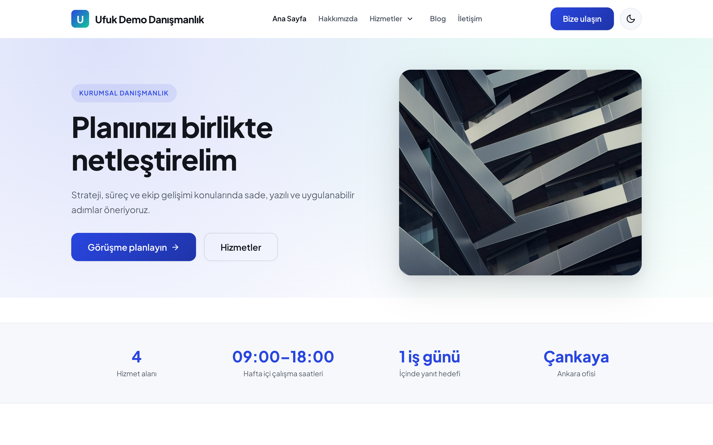
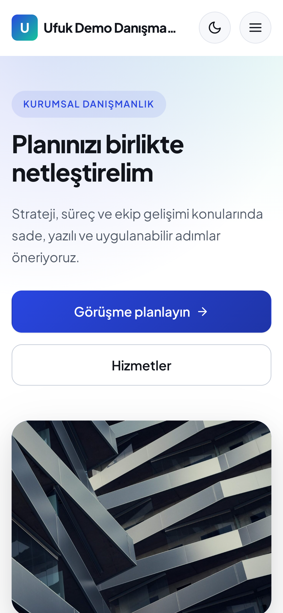
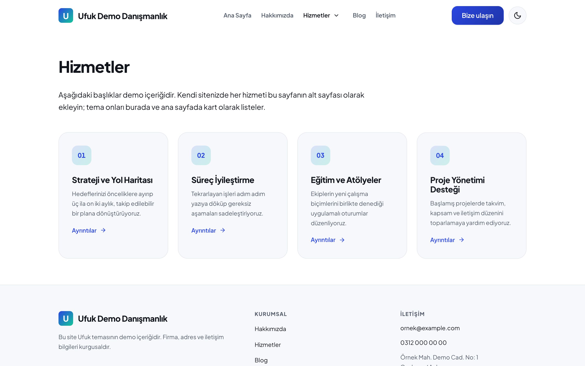
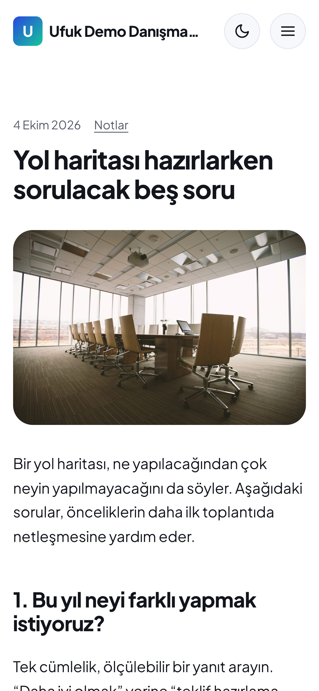
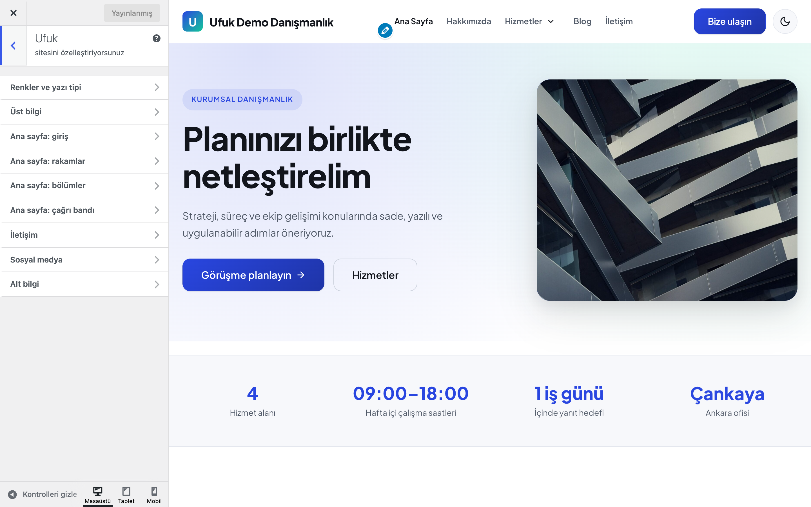

# Ufuk

Kurumsal siteler için sade ve hızlı WordPress teması: ana sayfa bölümleri Özelleştirici'den ve kendi sayfalarınızdan kurulur, açık/koyu mod ve spam korumalı iletişim formu içerir.

> **English:** A clean, fast classic corporate theme. The static front page is built from Customizer settings and your own pages (hero, figures, services from child pages, about, latest posts, call to action, contact). Light/dark mode, a spam-protected contact form that only sends e-mail (never stores messages), a self-hosted OFL font and no external requests. Empty settings render nothing for visitors. Turkish UI, translation-ready.

[](https://www.gnu.org/licenses/gpl-2.0.html)  

## Ekran görüntüleri

<table>
  <tr>
    <td width="70%"><br><sub><b>Ana sayfa</b>: giriş, rakamlar bandı</sub></td>
    <td width="30%"><br><sub><b>Mobil</b>: 390 px</sub></td>
  </tr>
  <tr>
    <td><br><sub><b>Hizmetler</b>: alt sayfalardan numaralı kartlar</sub></td>
    <td><br><sub><b>Yazı</b>: mobil görünüm</sub></td>
  </tr>
</table>


<sub><b>Özelleştirici</b>: tüm ayarlar tek panelde</sub>

Görüntülerdeki firma, adres ve iletişim bilgileri kurgusaldır (demo içerik).

## Özellikler

| Alan | Neler var |
|---|---|
| **Ana sayfa** | Giriş (üst etiket, başlık, metin, görsel, iki düğme), rakamlar bandı (en fazla 4), sayfanın kendi içeriği, hizmet kartları, hakkımızda, son yazılar, çağrı bandı, iletişim. Her bölüm açılıp kapatılabilir. |
| **Hizmetler** | Seçtiğiniz "Hizmetler" sayfasının alt sayfaları numaralı kart olarak hem ana sayfada hem o sayfanın altında listelenir. Öne çıkan görsel varsa kartta gösterilir. |
| **İletişim** | "İletişim" sayfa şablonu ve ana sayfa bölümü: e-posta, telefon, adres, çalışma saatleri (yalnızca dolu olanlar) ve form. |
| **Form** | Nonce, bal küpü (honeypot) alanı, IP başına 10 dakikada 5 mesaj sınırı (IP özetlenerek tutulur), temizlenmiş alanlar, `wp_mail` ile gönderim. Mesajlar veritabanına yazılmaz. JavaScript yoksa normal form gönderimiyle çalışır. İsterseniz bir form eklentisinin kısa kodunu girersiniz, temanın formu yerine o gösterilir. |
| **Görünüm** | Ana renk ve ikincil renk (CSS değişkeni olarak), açık + koyu mod veya yalnızca açık, logo veya baş harf işareti, tema yazı tipi ya da sistem yazı tipi. |
| **Blog** | Kart düzenli liste, kenar çubuğu widget alanı, arşiv, arama, tekil yazı (önceki/sonraki, etiketler, yorumlar), 404. |
| **SEO** | Belge başlığı, Open Graph etiketleri, ana sayfada Organization + WebSite JSON-LD. Yoast SEO, Rank Math, SEOPress veya All in One SEO etkinse kendiliğinden devre dışı kalır. |
| **Erişilebilirlik** | İçeriğe geç bağlantısı, görünür odak çerçevesi, klavyeyle açılan alt menüler (Escape kapatır, odak düğmeye döner), mobil menüde Escape, azaltılmış hareket tercihine uyum, JavaScript olmadan da görünen içerik. |
| **Gizlilik** | Dış istek yok: yazı tipi temayla gelir, simgeler satır içi SVG'dir. Sosyal medya bağlantıları yalnızca girildiğinde görünür. |

Boş bırakılan her ayar ziyaretçiye hiçbir şey göstermez: boş kutu, `tel:` bağlantısı ya da "Firma adı" gibi yer tutucu metin çıkmaz. Yöneticiler, içerik bekleyen bölümlerin yerinde kısa bir ipucu ve ilgili Özelleştirici bölümüne bağlantı görür.

## Gereksinimler

- WordPress 6.5+
- PHP 8.0+
- WooCommerce gerekmez.

## Kurulum

1. **Görünüm → Temalar → Yeni ekle → Tema yükle** ile `ufuk.zip` dosyasını yükleyip etkinleştirin.
2. **Ayarlar → Okuma**: "Statik sayfa" seçin ve bir ana sayfa belirleyin (yazı sayfası olarak isterseniz "Blog" gibi bir sayfa).
3. **Görünüm → Özelleştir → Ufuk**: göstermek istediğiniz bölümleri doldurun.
4. **Görünüm → Menüler**: "Ana menü" ve "Alt bilgi menüsü" konumlarına menü atayın. Ana menü iki seviyeyi destekler.
5. İletişim sayfası için sayfa özniteliklerinden **İletişim** şablonunu seçin.

Tema etkinleştirildiğinde hiçbir sayfa, menü ya da ayar kendiliğinden oluşturulmaz.

## Nasıl kullanılır

Boş bir kurulumda ilk ana sayfayı kurmak için:

1. Temayı etkinleştirin. "Ana sayfa" adlı bir sayfa ve "Hizmetler" adlı bir sayfa oluşturun; Hizmetler'in altına "Demo Hizmet" gibi iki alt sayfa ekleyin (öne çıkan görsel isteğe bağlı).
2. **Ayarlar → Okuma**'da statik sayfa olarak "Ana sayfa"yı seçin.
3. **Görünüm → Özelleştir → Ufuk** altında giriş başlığını ve açıklamayı yazın, bir düğme metni ve bağlantısı girin.
4. Ana sayfa bölümlerinde "Hizmetler" sayfası olarak oluşturduğunuz sayfayı seçin; alt sayfalar numaralı kartlar olarak görünür.
5. İletişim bölümüne `ornek@example.com` gibi bir e-posta girin, "İletişim" şablonlu bir sayfa oluşturup Özelleştirici'de seçin; deneme mesajı gönderip e-postanın geldiğini doğrulayın.
6. **Görünüm → Menüler**'den ana menüyü atayın. Hızlı bir önizleme isterseniz yukarıdaki demo kurulumunu kullanabilirsiniz.

## Özelleştirici ayarları (Görünüm → Özelleştir → Ufuk)

| Bölüm | Ayar | Varsayılan |
|---|---|---|
| Renkler ve yazı tipi | Ana renk, ikincil renk | `#2946E0`, `#14C79A` |
| | Renk modu | Açık + koyu (sistemi izler, ziyaretçi değiştirebilir) |
| | Temayla gelen yazı tipi | Açık |
| Üst bilgi | Düğme metni + bağlantısı | Boş (düğme gizli) |
| Ana sayfa: giriş | Üst etiket, başlık, açıklama, görsel, birincil/ikincil düğme | Etiket = site sloganı, başlık = site başlığı, diğerleri boş |
| Ana sayfa: rakamlar | 4 × değer + etiket | Boş (bant gizli) |
| Ana sayfa: bölümler | Bölüm anahtarları; Hizmetler sayfası, başlığı ve giriş metni; Hakkımızda sayfası ve maddeleri; son yazılar başlığı ve sayısı | Tüm bölümler açık, sayfalar seçilmemiş, 3 yazı |
| Ana sayfa: çağrı bandı | Başlık, metin, düğme | Boş (bant gizli) |
| İletişim | Firma unvanı, e-posta, telefon, adres, çalışma saatleri, iletişim sayfası, form açık/kapalı, form alıcısı, form kısa kodu | Boş; form açık; alıcı = yönetici e-postası |
| Sosyal medya | Instagram, Facebook, X, LinkedIn, YouTube | Boş |
| Alt bilgi | Kısa tanıtım metni | Boş (site sloganı kullanılır) |

Varsayılanlar temanın kökündeki `theme-settings.json` dosyasından okunur; Özelleştirici'de kaydedilen değerler her zaman önceliklidir.

## Filtreler

| Filtre | Varsayılan | Ne yapar |
|---|---|---|
| `ufuk_setting` | Kayıtlı değer | Her ayarın okunan değeri (`$value, $key`) |
| `ufuk_home_sections` | `hero, stats, content, services, about, posts, cta, contact` | Ana sayfa bölümlerinin sırası; `template-parts/home/<ad>.php` |
| `ufuk_services_limit` | `8` | Listelenecek en fazla hizmet (alt sayfa) |
| `ufuk_social_links` | Girilen profiller | Sosyal bağlantı listesi |
| `ufuk_contact_rate_limit` | `5` | Süre penceresinde IP başına mesaj |
| `ufuk_contact_rate_window` | `600` | Süre penceresi (saniye) |
| `ufuk_contact_client_ip` | `REMOTE_ADDR` | Vekil sunucu arkasında gerçek IP'yi vermek için |
| `ufuk_contact_mail` | Alıcı, konu, gövde, başlıklar | `wp_mail` argümanları |
| `ufuk_seo_enabled` | SEO eklentisi yoksa `true` | Temanın Open Graph ve JSON-LD çıktısı |
| `ufuk_open_graph_tags` | Başlık, açıklama, URL, görsel… | Open Graph etiketleri |
| `ufuk_json_ld` | Organization + WebSite | Ana sayfadaki yapılandırılmış veri |

```php
// Örnek: çağrı bandını iletişim bölümünün sonrasına al, form sınırını 3'e indir
add_filter('ufuk_home_sections', fn() => ['hero', 'services', 'about', 'posts', 'contact', 'cta']);
add_filter('ufuk_contact_rate_limit', fn() => 3);
```

## Demo kurulumu (depodan, WP-CLI)

`demo/` klasörü yalnızca depoda bulunur, ZIP'e girmez. Boş bir WordPress kurulumunda, depo kökünden:

```bash
wp theme activate ufuk
wp eval-file themes/ufuk/demo/setup.php   # kurgusal firma, 9 sayfa, 3 yazı, 5 görsel, 2 menü, Özelleştirici değerleri
wp eval-file themes/ufuk/demo/reset.php   # demo içeriğini ve değiştirilen ayarları geri alır
```

Betik idempotenttir. Demo firma ("Ufuk Demo Danışmanlık Ltd. Şti."), adresi ve iletişim bilgileri uydurmadır.

- Kurulum, demo dışındaki yayımlanmış yazıları geçici olarak taslağa alır; `reset.php` onları yeniden yayımlar. Taslaktayken düzenlenen bir yazı (son değişiklik zamanı farklıysa) taslak olarak bırakılır ve komut bunu uyarı olarak yazar.
- Demo yalnızca kendi oluşturduğu kategori ve menüleri işaretler ve siler. Aynı adda bir menünüz ya da aynı kısa adda bir kategoriniz varsa ona dokunulmaz; demo kendine "(Ufuk demo)" ekli ayrı bir menü / kategori açar.
- İlk kurulumdan önce kayıtlı olan Ufuk ayarlarınız ve menü konumlarınız saklanır; `reset.php` bunları silmek yerine geri yükler.

## Sınırlamalar

- Klasik (PHP) temadır; tam site düzenleyicisi (FSE) şablonları yoktur. Sayfa içerikleri blok düzenleyiciyle yazılır.
- Referans/yorum (testimonial) bölümü yoktur; gerçek yorumlarınızı ana sayfanın kendi içeriğine bloklarla ekleyebilirsiniz.
- Rakamlar bandına yalnızca doğrulayabileceğiniz bilgiler girin; tema örnek rakam göstermez.
- Ana menü iki seviyeye kadar desteklenir.
- İletişim formu bir güvenlik anahtarı (nonce) kullanır. Tam sayfa önbelleği (önbellek eklentisi, CDN) formu içeren sayfayı uzun süre saklarsa anahtarın süresi dolar ve gönderim "Oturum süresi doldu" hatası verir: iletişim sayfasını (ve formu gösteriyorsa ana sayfayı) önbellekten hariç tutun ya da önbellek süresini 12 saatin altında tutun.
- İletişim formu mesajları saklamaz; e-posta gönderimi sunucunuzun `wp_mail` ayarına bağlıdır (SMTP eklentisi önerilir). Dosya eki desteklemez.
- Ana renk olarak açık bir ton seçilirse düğmelerdeki beyaz yazının kontrastı düşer; koyu bir ton seçin.
- WooCommerce şablonu içermez.

## SSS

**Temayı değiştirirsem ya da silersem Özelleştirici ayarlarım ne olur?** Ayarlar tema ayarları (`theme_mod`) olarak `ufuk_` önekiyle saklanır. Başka bir temaya geçince veritabanında kalır, Ufuk'a dönünce yeniden kullanılır; tema silindiğinde de WordPress bunları kendiliğinden temizlemez. Sayfalarınız, yazılarınız ve menüleriniz temadan bağımsızdır. Tema kendi tablosunu oluşturmaz.

**İletişim formu mesajları nerede saklanır?** Hiçbir yerde: mesaj yalnızca `wp_mail` ile gönderilir, veritabanına yazılmaz. Yalnızca spam sınırı için IP özetini ve kısa süreli geçici kayıtları (transient) tutar.

**Dışarıya istek yapar mı?** Hayır. Yazı tipi temayla gelir, simgeler satır içi SVG'dir.

**Çeviri destekli mi?** Evet; metin alanı `ufuk` ve çeviri klasörü `languages/` olarak tanımlıdır, arayüz Türkçedir.

**SEO eklentisi kullanırsam çakışır mı?** Yoast SEO, Rank Math, SEOPress veya All in One SEO etkinse temanın Open Graph ve JSON-LD çıktısı kendiliğinden kapanır.

**Önbellek eklentisiyle sorun olur mu?** İletişim formunun güvenlik anahtarı nedeniyle sayfayı önbellekten hariç tutmanız gerekebilir (Sınırlamalar).

**WooCommerce ile kullanılır mı?** Tema WooCommerce şablonu içermez.

## Sürüm notları

Bkz. [CHANGELOG.md](CHANGELOG.md).

## Destek

- Önce bu sayfadaki **SSS** ve **Sınırlamalar** bölümlerine göz atın; sık karşılaşılan durumlar orada.
- Hata mı buldunuz? [GitHub Issues](https://github.com/erayusta/erusoft-wp/issues) üzerinden bildirin. WordPress, PHP ve tema sürümünü, adımları ve beklenen/gerçekleşen sonucu yazmanız işi hızlandırır.
- Kurulum, yapılandırma, özel geliştirme veya entegrasyon desteği için **[hello@erusoft.com](mailto:hello@erusoft.com)** adresine yazın. Erusoft hakkında: [erusoft.com](https://erusoft.com).
- Lütfen şifre, API anahtarı veya müşteri verisi (ad, telefon, TCKN, sipariş dökümü) göndermeyin; ekran görüntülerindeki kişisel verileri karartın.

## Lisans ve kaynaklar

- Kod: GPL-2.0-or-later (deponun `LICENSE` dosyası).
- Yazı tipi: Plus Jakarta Sans, © 2020 The Plus Jakarta Sans Project Authors, [SIL Open Font License 1.1](fonts/OFL.txt).
- Simgeler: [Feather](https://feathericons.com), MIT Lisansı, [`assets/icons/LICENSE`](assets/icons/LICENSE).
- Demo ve `screenshot.png` görselleri: Unsplash Lisansı, kaynaklar [`demo/images/CREDITS.md`](demo/images/CREDITS.md) dosyasında.

---

Geliştirme: [Erusoft](https://erusoft.com) · Diğer eklenti ve temalar: [wordpress.erusoft.com](https://wordpress.erusoft.com)
