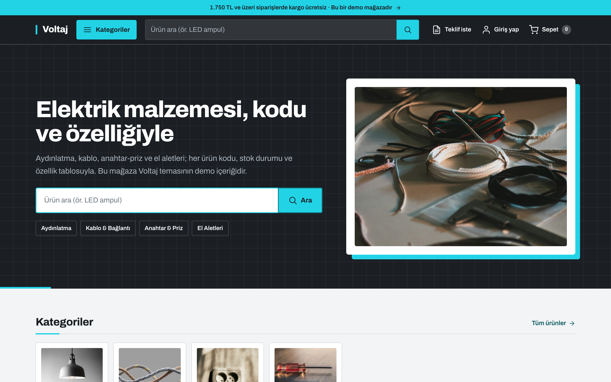
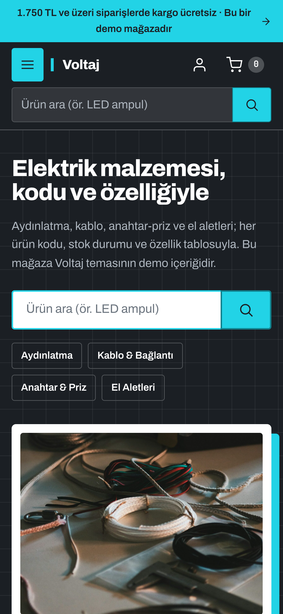
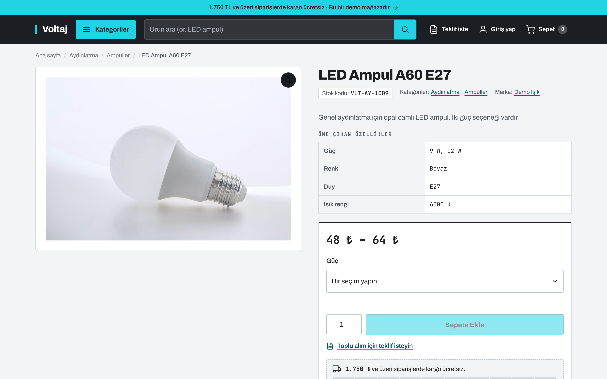
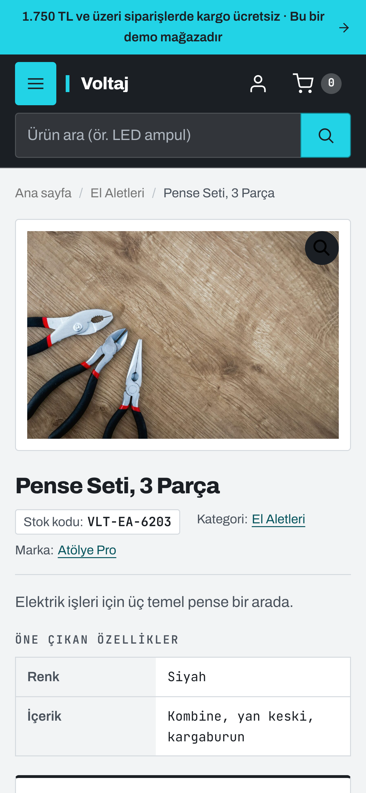
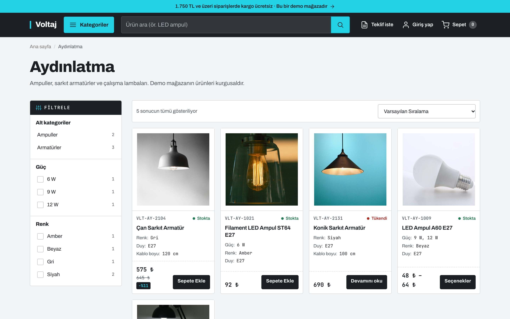
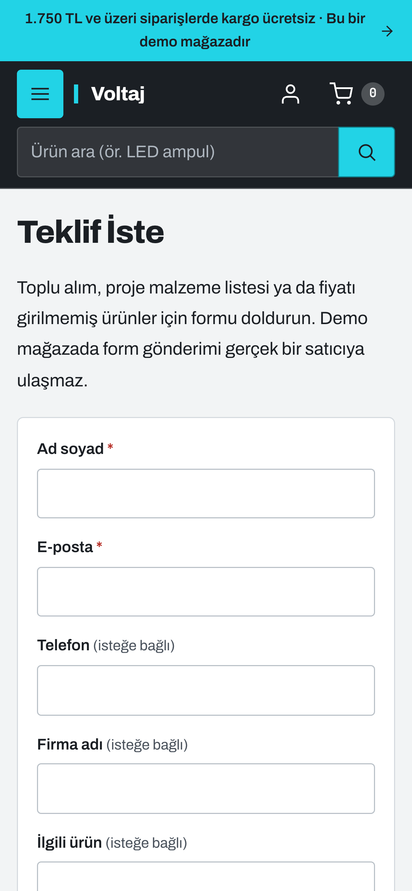
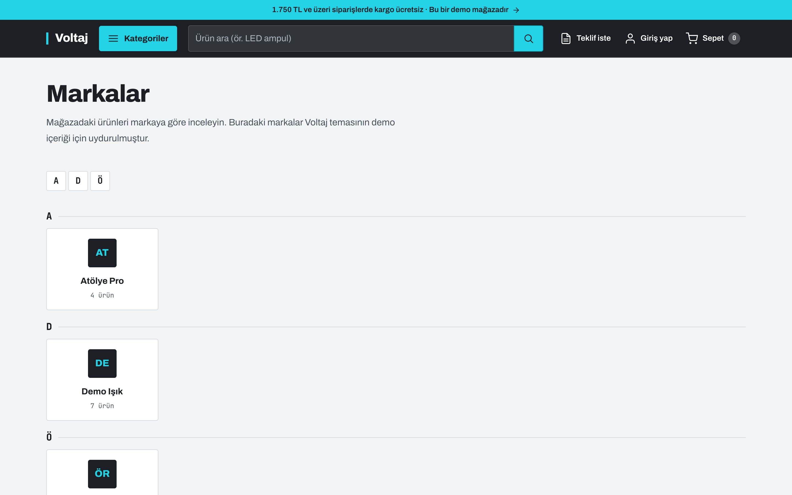
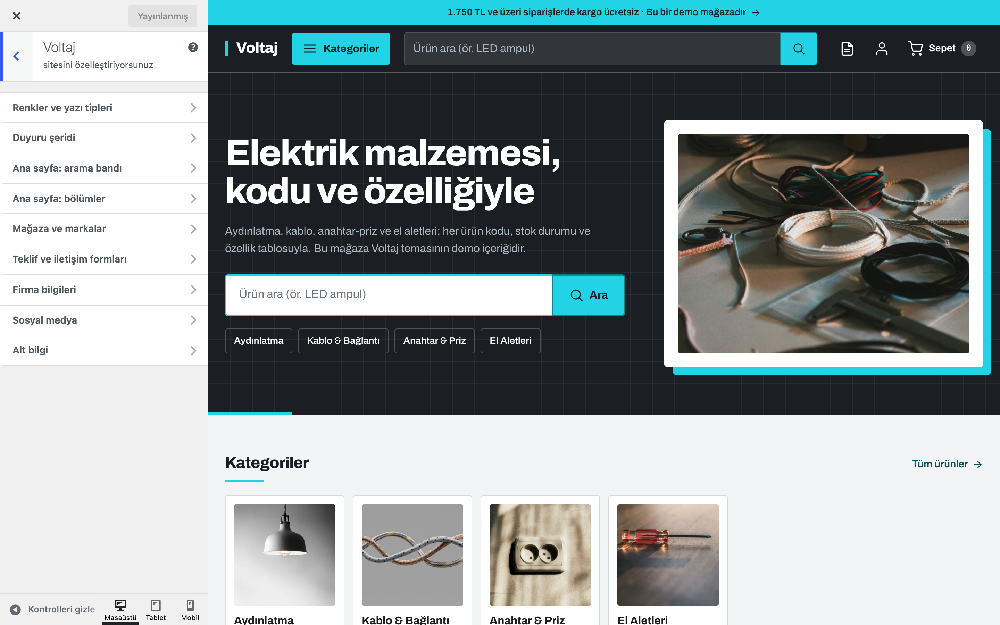

# Voltaj

Elektrik malzemesi, aydınlatma, kablo, anahtar-priz, el aletleri gibi teknik ürün satan mağazalar için WooCommerce teması: tek satırlık yapışkan başlıkta tam genişlikte ürün araması ve ürün kategorilerinden kurulan iki bölmeli katalog paneli, ürün kodu ve stok durumunu öne alan ürün kartları, özellik tablolu ürün sayfası, sayımlı nitelik filtreleri, markalar sayfası, teklif ve iletişim formları, ödeme adımları ve sipariş sayfasında kopyalanabilir banka bilgileri.

> **English:** A classic WooCommerce theme for technical and electrical supply stores. One sticky header with a full-width product search and a two-pane catalogue panel built from your product categories (cached, keyboard accessible, a drawer on mobile); spec-first product cards (SKU, stock state, key attributes); a product page with a spec table, a framed buy box and a free-shipping progress bar read from your shipping zones; attribute filters with counts; a brands page (WooCommerce `product_brand`); quote-request and contact forms that are e-mailed and never stored; a blog table of contents; checkout steps; copyable IBAN and order number on the order-received page; a mobile buy bar and a "recently viewed" strip kept in the visitor's browser. No WooCommerce template overrides: everything is hooks and CSS, so notices, structured data and other plugins' output keep working. Self-hosted Archivo + JetBrains Mono, no external requests, works without WooCommerce. Turkish UI, translation-ready.

[](https://www.gnu.org/licenses/gpl-2.0.html)   

## Ekran görüntüleri

<table>
  <tr>
    <td width="70%"><br><sub><b>Ana sayfa</b>: arama bandı, kategori kısayolları</sub></td>
    <td width="30%"><br><sub><b>Mobil</b>: 390 px</sub></td>
  </tr>
  <tr>
    <td><br><sub><b>Ürün</b>: kod satırı, özellik tablosu, satın alma kutusu</sub></td>
    <td><br><sub><b>Ürün</b>: mobil</sub></td>
  </tr>
  <tr>
    <td><br><sub><b>Kategori</b>: alt kategoriler, sayımlı nitelik filtreleri</sub></td>
    <td><br><sub><b>Teklif İste</b>: mobil form</sub></td>
  </tr>
  <tr>
    <td><br><sub><b>Markalar</b>: harf dizini</sub></td>
    <td><br><sub><b>Özelleştirici</b>: Voltaj paneli</sub></td>
  </tr>
</table>

Görüntülerdeki mağaza, markalar, ürünler, ürün kodları, fiyatlar, adres ve iletişim bilgileri kurgusaldır (demo içerik).

## Özellikler

| Alan | Neler var |
|---|---|
| **Üst bilgi** | Tek, yapışkan, koyu çubuk: logo ya da site başlığı · "Kategoriler" düğmesi · tam genişlikte ürün araması · Teklif iste / Hesabım / Sepet (ürün sayısı sayfa yenilenmeden güncellenir). İsteğe bağlı ince duyuru şeridi. 1024 px altında arama ikinci satıra iner. |
| **Katalog paneli** | Ürün kategorilerinden üç seviyeye kadar kurulur (ana kategoriler solda, alt kategoriler ve kırılımları sağda, ana menü en sağda); HTML önbellekte tutulur ve kategori ya da ürün değişince yenilenir. "Katalog paneli" konumuna menü atarsanız otomatik ağaç yerine o menü gösterilir. Tıklama, Enter/Space ve ok tuşlarıyla kullanılır; Escape kapatır, odak düğmeye döner. Mobilde odak tuzaklı, akordeonlu sol çekmece. |
| **Ana sayfa** | Arama bandı (başlık, metin, büyük arama kutusu, kategori kısayolları, isteğe bağlı görsel), kategori ızgarası, öne çıkan ürünler (yoksa en yeniler), marka şeridi, bilgi kartları, son yazılar ve sayfanın kendi blok içeriği. Bölümler açılıp kapatılabilir; sıra filtreyle değiştirilebilir. |
| **Ürün kartı** | Kırpılmayan ürün görseli, mono yazıyla ürün kodu ve renkli stok noktası, ad, görünür niteliklerden ilk N "etiket: değer" satırı, fiyat (indirimde eski fiyat ve küçük "−%N" etiketi) ve düğme. Fiyatı girilmemiş ürünlerde "Fiyat teklifle belirlenir" yazar, düğme teklif formuna gider. |
| **Mağaza ve kategoriler** | Sayfa yolu, başlık ve açıklama, filtre sütunu: alt kategoriler ve WooCommerce nitelikleri (`pa_*`) için sayımlı filtreler (yalnızca katalogda görünen ürünler sayılır; tükenen ürünleri gizliyorsanız onlar da sayılmaz). Filtreler WooCommerce'in kendi `filter_<nitelik>` parametrelerini kullanır; sıralama niteliğin ayarındaki düzeni izler. 1024 px altında filtreler çekmecede. İsteğe bağlı "Mağaza filtreleri" bileşen alanı (ör. fiyat filtresi). |
| **Ürün sayfası** | Solda galeri (yakınlaştırma, ışık kutusu, kaydırıcı), sağda başlık, kod/kategori/marka satırı, kısa açıklama, "Öne çıkan özellikler" tablosu ve çerçeveli satın alma kutusu: fiyat ve indirim notu, stok, adet, sepete ekle, "Toplu alım için teklif isteyin" bağlantısı ve ücretsiz kargo çubuğu. Altta sekmeler, ilgili ürünler, "Son baktıklarınız"; mobilde satın alma kutusu ekrandan çıkınca alttan beliren satın alma çubuğu. |
| **Ücretsiz kargo çubuğu** | Eşik, müşterinin kargo adresine uyan bölgedeki etkin "Ücretsiz gönderim" yönteminden okunur (WooCommerce'in kendi hesabıyla, indirim ayarı dahil). Böyle bir yöntem yoksa, kupon gerektiriyorsa ya da kargo zaten ücretsizse çubuk gizlenir. Satın alma kutusunda ve sepet özetinde gösterilir; sepet parçası (cart fragment) olarak güncellenir. |
| **Sepet, ödeme, sipariş** | Üç adımlı ilerleme göstergesi (Sepet → Teslimat ve ödeme → Sipariş onayı). Sepet ve ödeme geniş ekranda iki sütun (özet sağda, yapışkan). Havale/EFT siparişlerinde sipariş alındı sayfası ödenecek tutarı, açıklamaya yazılacak sipariş numarasını ve WooCommerce'te girdiğiniz banka hesaplarını kopyalama düğmeleriyle gösterir. |
| **Markalar** | "Markalar" sayfa şablonu: seçilen marka taksonomisinin (varsayılan WooCommerce `product_brand`) terimleri, harf dizini, logo (terimin görseli) ya da baş harfler, ürün sayıları. |
| **Teklif ve iletişim** | "Teklif İste" ve "İletişim" sayfa şablonları: tema formu e-postayla gönderilir, veritabanında saklanmaz; nonce, bal küpü alanı ve IP başına hız sınırı vardır. JavaScript açıkken sayfa yenilenmeden, kapalıyken normal form gönderimiyle çalışır. Ürün sayfasındaki teklif bağlantısı ürün adını ve kodunu forma doldurur. İletişim formunun yerine bir form eklentisinin kısa kodu gösterilebilir. |
| **Blog** | Kart düzenli liste, tekil yazıda okuma süresi ve en az iki H2/H3 başlığı olan yazılarda yapışkan içindekiler tablosu, ilgili yazılar, yorumlar; 404 ve arama sayfaları. |
| **SEO** | Belge başlığı, Open Graph etiketleri, ana sayfada Organization + WebSite JSON-LD. Ürün yapılandırılmış verisini WooCommerce üretir. Yoast SEO, Rank Math, SEOPress veya All in One SEO etkinse temanın etiketleri kendiliğinden kapanır. |
| **Erişilebilirlik** | İçeriğe geç bağlantısı, görünür odak halkası, klavyeyle kullanılan katalog paneli, çekmece ve filtre panelinde odak tuzağı + Escape, form ve kopyalama sonuçları için canlı bölge, azaltılmış hareket tercihine uyum. |
| **Gizlilik ve hız** | Dış istek yok: yazı tipleri temayla gelir, simgeler satır içi SVG'dir, emoji betiği ön yüzde kapatılır. CSS alanlara bölünür ve yalnızca gereken sayfada yüklenir. "Son baktıklarınız" yalnızca ziyaretçinin tarayıcısında (localStorage) tutulur. Analitik veya izleme kodu yoktur. |

Boş bırakılan her ayar ziyaretçiye hiçbir şey göstermez: boş kutu, `tel:` bağlantısı ya da "Firma adı" gibi yer tutucu metin çıkmaz. Yöneticiler, içerik bekleyen yerlerde kısa bir ipucu ve ilgili Özelleştirici bölümüne bağlantı görür.

## Tasarım

Ziyaretçi çoğu zaman ne aradığını bilir; tasarım bu yüzden aramayı, kategori ağacını ve özellik tablosunu öne alır. Koyu grafit zemin üzerinde tek bir camgöbeği vurgu; ince çizgiler, 4 px köşeler, ürün kodu ve teknik değerler için eş aralıklı yazı. Ayrıntılar ve kontrast tablosu: [`DESIGN.md`](DESIGN.md).

| Belirteç | Değer | Kullanım |
|---|---|---|
| Ana renk (Özelleştirici) | `#1B1F24` grafit | Başlık çubuğu, arama bandı, alt bilgi, metin |
| Vurgu rengi (Özelleştirici) | `#22D3E6` camgöbeği | Birincil düğmeler, odak halkası, etkin durumlar (üzerinde her zaman grafit yazı) |
| Bağlantı rengi | Vurgudan otomatik koyulaştırılır (varsayılanla `#07555E`) | Açık zeminde bağlantılar |
| Zemin / yüzey | `#F2F4F5` / `#FFFFFF` | Sayfa, kartlar ve tablolar |
| Stok renkleri | `#1E7B4F` / `#8A5300` / `#B3261E` | Stokta / ön sipariş / tükendi |

Başlık ve gövde **Archivo**, ürün kodu, fiyat ve teknik değerler **JetBrains Mono** (ikisi de SIL OFL 1.1, değişken ağırlık, latin + latin-ext WOFF2, temayla birlikte). Özelleştirici'den kapatılırsa sistem yazı tipleri kullanılır.

## Gereksinimler

- WordPress 6.5+ (7.1 ile denendi)
- PHP 8.0+
- WooCommerce 9.6+ (11.2.1 ile denendi); markalar WooCommerce'in kendi `product_brand` taksonomisini kullanır (Özelleştirici'den başka bir ürün taksonomisi de seçilebilir). WooCommerce olmadan da çalışır: mağaza öğeleri gizlenir, başlıktaki düğme ana menüyü açar, blog ve sayfalar normal görünür.
- Sepet ve ödeme sayfalarında tema WooCommerce'in klasik kısa kodlarını (`[woocommerce_cart]`, `[woocommerce_checkout]`) biçimlendirir. Blok tabanlı sepet/ödeme sayfaları da çalışır ama WooCommerce'in kendi blok görünümüyle gösterilir.

## Kurulum

1. **Görünüm → Temalar → Yeni ekle → Tema yükle** ile `voltaj.zip` dosyasını yükleyip etkinleştirin.
2. **Ayarlar → Okuma**: "Statik sayfa" seçin ve bir ana sayfa belirleyin.
3. Sayfa özniteliklerinden **Markalar**, **Teklif İste** ve **İletişim** şablonlarını kullanan sayfalar oluşturun (teklif bağlantıları "Teklif İste" şablonlu sayfayı kendiliğinden bulur).
4. **WooCommerce → Ayarlar → Gönderim**: ücretsiz kargo çubuğu için bölgenize "Ücretsiz gönderim" yöntemi ve "En az sipariş tutarı" ekleyin. Kopyalanabilir banka bilgileri için **Ödemeler → Doğrudan banka havalesi** altında hesaplarınızı girin.
5. **Görünüm → Özelleştir → Voltaj**: göstermek istediğiniz bölümleri ve firma bilgilerini doldurun; form alıcısı boşsa site yöneticisinin e-postası kullanılır.
6. **Görünüm → Menüler**: "Ana menü", isteğe bağlı "Katalog paneli" ve en fazla üç "Alt bilgi" sütunu konumuna menü atayın (sütun başlığı menünün adıdır).

Tema etkinleştirildiğinde hiçbir sayfa, menü, ürün ya da ayar kendiliğinden oluşturulmaz.

## Özelleştirici ayarları (Görünüm → Özelleştir → Voltaj)

| Bölüm | Ayar | Varsayılan |
|---|---|---|
| Renkler ve yazı tipleri | Vurgu rengi, ana (koyu) renk, temayla gelen yazı tipleri | `#22D3E6`, `#1B1F24`, açık |
| Duyuru şeridi | Metin, bağlantı | Boş (şerit gizli) |
| Ana sayfa: arama bandı | Başlık, açıklama, görsel, arama kutusu ipucu | Başlık = site başlığı, açıklama = slogan, diğerleri boş |
| Ana sayfa: bölümler | Kategoriler / ürünler / markalar / bilgi kartları / yazılar anahtarları ve başlıkları, ürün sayısı, bilgi kartları ("Başlık \| açıklama" satırları) | Hepsi açık, 8 ürün, bilgi kartları boş |
| Mağaza ve markalar | Marka taksonomisi, kartta özellik satırı sayısı, ürün sayfası özellik tablosu satır sayısı, toplu alım teklif bağlantısı, ücretsiz kargo çubuğu, "Son baktıklarınız", mobil satın alma çubuğu | `product_brand`, 3, 8, diğerleri açık |
| Teklif ve iletişim formları | Form alıcısı, İletişim şablonunda tema formu, iletişim formu kısa kodu, teklif formu üst metni | Boş (alıcı = yönetici e-postası), form açık |
| Firma bilgileri | Firma unvanı, adres, telefon, e-posta, çalışma saatleri, vergi dairesi/no | Boş (unvan boşsa site başlığı) |
| Sosyal medya | Instagram, Facebook, X, YouTube, LinkedIn | Boş |
| Alt bilgi | Kısa tanıtım metni, alt satır notu | Boş (tanıtım boşsa slogan) |

Logo **Site kimliği** bölümünden yüklenir; yüklenmezse site başlığı solunda vurgu çizgisiyle yazılır. Site simgesi yoksa grafit zeminde baş harfli bir simge kullanılır.

## Filtreler

| Filtre | Varsayılan | Ne yapar |
|---|---|---|
| `voltaj_setting` | Kayıtlı değer | Her ayarın okunan değeri (`$value, $key`) |
| `voltaj_home_sections` | `hero, categories, products, brands, info, posts, content` | Ana sayfa bölümlerinin sırası; `template-parts/home/<ad>.php` |
| `voltaj_home_categories_limit` / `voltaj_home_brands_limit` | `8` / `12` | Ana sayfadaki kategori ve marka sayısı |
| `voltaj_info_icons` | `truck, file-text, headphones, shield, package, tool` | Bilgi kartlarının sırayla kullandığı simgeler |
| `voltaj_catalog_limits` | `roots 16, children 24, leaves 8` | Katalog panelindeki en fazla ana / alt / alt kırılım kategori sayısı |
| `voltaj_nav_cache_ttl` | 12 saat | Katalog paneli önbelleğinin süresi |
| `voltaj_attribute_filters` | Nitelik grupları | Filtre sütunundaki grup ve terimler (`$groups, $scope`) |
| `voltaj_filter_terms_limit` / `voltaj_filters_cache_ttl` | `20` / 6 saat | Grup başına terim sayısı, sayım önbelleğinin süresi |
| `voltaj_brand_taxonomy` | Özelleştirici seçimi | Marka olarak kullanılan taksonomi |
| `voltaj_key_attributes` | Görünür nitelikler | Kartta ve özellik tablosunda gösterilen satırlar (`$rows, $product, $limit`) |
| `voltaj_stock_state` | Stokta / Ön siparişle / Tükendi | Stok etiketi (`$state, $product`) |
| `voltaj_price_on_request` | Fiyatı boş basit ürünler | Ürünün "fiyat teklifle" sayılıp sayılmayacağı |
| `voltaj_show_price` | Çekirdek fiyat kancası yerindeyse `true` | Fiyatın kart altında, satın alma kutusunda, mobil çubukta ve "Son baktıklarınız"da gösterilip gösterilmeyeceği (`$show, $product, $context`; `loop` veya `single`). Bir eklenti `woocommerce_template_loop_price` / `woocommerce_template_single_price` kancasını tema kancalarından önce kaldırırsa tema da fiyat göstermez. |
| `voltaj_free_shipping_threshold` | Bölgedeki ücretsiz gönderim tutarı | Çubuğun kullandığı eşik (`$threshold, $zone`); `0` döndürmek çubuğu gizler |
| `voltaj_checkout_steps` | Sepet, Teslimat ve ödeme, Sipariş onayı | Adım göstergesinin etiketleri |
| `voltaj_bacs_copy` | `true` | `false`: sipariş sayfasında WooCommerce'in kendi banka listesi gösterilir |
| `voltaj_bacs_show_for_statuses` | `on-hold, pending` | Banka bilgilerinin gösterildiği sipariş durumları |
| `voltaj_form_mail` | Alıcı, konu, gövde, başlıklar | Teklif/iletişim e-postası |
| `voltaj_form_rate_limit` / `voltaj_form_rate_window` | `5` / 10 dakika | IP başına gönderim sınırı |
| `voltaj_form_client_ip` | `REMOTE_ADDR` | Hız sınırı için istemci IP'si (vekil sunucu arkasında) |
| `voltaj_toc_min_headings` | `2` | İçindekiler tablosu için gereken en az başlık sayısı |
| `voltaj_words_per_minute` | `200` | Okuma süresi hesabı |
| `voltaj_social_links` | Girilen profiller | Sosyal bağlantı listesi |
| `voltaj_css_areas` | Görünüme göre | Yüklenecek CSS alanları (`assets/css/<ad>.css`) |
| `voltaj_seo_enabled` | SEO eklentisi yoksa `true` | Temanın Open Graph ve JSON-LD çıktısı |
| `voltaj_open_graph_tags` / `voltaj_json_ld` | Başlık, açıklama, URL, görsel… / Organization + WebSite | Open Graph etiketleri ve ana sayfadaki yapılandırılmış veri |

```php
// Örnek: markaları ürünlerden önce göster, katalog panelinde en fazla 10 ana kategori listele
add_filter('voltaj_home_sections', fn() => ['hero', 'categories', 'brands', 'products', 'info', 'posts', 'content']);
add_filter('voltaj_catalog_limits', fn($l) => array_merge($l, ['roots' => 10]));
```

## Demo kurulumu (depodan, WP-CLI)

`demo/` klasörü yalnızca depoda bulunur, ZIP'e girmez. WooCommerce kurulu bir WordPress'te, depo kökünden:

```bash
wp theme activate voltaj
wp eval-file themes/voltaj/demo/setup.php   # kurgusal mağaza: 4 ana + 4 alt kategori, 15 ürün, 3 marka, kargo bölgesi, havale, 10 sayfa, 2 yazı, 16 görsel, 4 menü
wp eval-file themes/voltaj/demo/reset.php   # demo içeriğini siler, değiştirilen ayarları geri yükler
```

Betik idempotenttir. Demo mağaza ("Voltaj Demo Teknik Malzeme Ltd. Şti."), markalar (Demo Işık, Örnek Kablo, Atölye Pro), `VLT-…` ürün kodları, fiyatlar, kargo ücreti (89 TL, 1.750 TL üzeri ücretsiz), Çankaya/Ankara adresi, telefon, e-posta ve açıkça sahte banka hesabı (TR00 ile başlayan, tamamı sıfır bir IBAN) uydurmadır. Ürünler arasında "Güç" niteliğiyle varyasyonlu bir ürün, indirimli, tükenmiş ve fiyatsız (teklifle) birer ürün vardır. Kurulum; mağaza, sepet, ödeme ve hesap sayfalarını kısa kodlu sayfalar olarak oluşturup WooCommerce'e atar, Markalar / Teklif İste / İletişim şablonlu sayfaları ekler, "Yakında" modunu kapatır, para birimi biçimini, ürün görseli kırpmasını (1:1) ve ödeme sayfasındaki gizlilik notlarının Türkçesini ayarlar, demo dışındaki yayımlanmış yazıları geçici olarak taslağa alır. Demo kargo bölgesi, demo kurulu kaldığı sürece bölge listesinin en başına konur (diğer bölgeler bir sıra aşağı kayar). Demo yalnızca kendi oluşturduğu kategori, marka, nitelik terimi ve menüleri kullanır; sitede aynı adla bulunanlara dokunmaz, gerekirse kendi kopyasını "(Voltaj demo)" ekiyle oluşturur. "Güç" ve "Renk" nitelikleri önceden varsa silinmez. `reset.php` demo bölgesini siler, diğer bölgelerin sırasını, değiştirilen seçenekleri (banka hesapları dahil), Voltaj tema ayarlarını ve menü konumlarını ilk kurulumdan önceki hâline döndürür; taslağa alınan yazıları, arada düzenlenmedilerse yeniden yayımlar.

## Sınırlamalar

- Klasik (PHP) temadır; tam site düzenleyicisi (FSE) şablonları yoktur.
- Tema hiçbir WooCommerce şablonunu ezmez; görünüm kancalar ve CSS ile değişir. Bir eklenti WooCommerce'in varsayılan HTML'ini büyük ölçüde değiştirirse görünüm o eklentinin biçimine döner.
- Arama WordPress'in varsayılan aramasıdır: ürün adında ve açıklamasında arar, ürün kodunda (SKU) veya marka adında aramaz. Kodla arama için bir arama eklentisi kullanın.
- Blok tabanlı sepet ve ödeme sayfaları WooCommerce'in kendi görünümüyle gösterilir; adım göstergesi, iki sütunlu düzen ve ücretsiz kargo çubuğu klasik kısa kod sayfalarında çalışır.
- Teklif ve iletişim formları yalnızca e-posta gönderir; mesajlar saklanmaz, dosya eki alınmaz. E-postaların ulaşması için sitenizin e-posta gönderimi (SMTP) doğru ayarlanmış olmalıdır.
- Nitelik filtreleri WooCommerce'in genel nitelikleri (`pa_*`) içindir; ürüne özel (yerel) nitelikler kartta ve özellik tablosunda görünür ama filtrelenemez.
- Başlıktaki sepet sayısını WooCommerce'in sepet parçaları (`wc-cart-fragments`) betiği günceller; betik sepet ve ödeme sayfalarında yüklenmez (orada sepet sunucuda çizilir, sayı sepet güncellenince tema betiğiyle yenilenir). Önbellek eklentisi kullanıyorsanız sepet ve ödeme sayfalarını önbellekten hariç tutun.
- Ana menü ve alt bilgi menüleri tek seviyelidir; katalog paneli üç seviyeye kadar gösterir.
- Vurgu rengi olarak koyu bir ton seçilirse düğmelerdeki grafit yazının kontrastı düşer; açık ve parlak bir ton seçin.

## Lisans ve kaynaklar

- Kod: GPL-2.0-or-later (deponun `LICENSE` dosyası).
- Yazı tipleri: Archivo, © 2020 The Archivo Project Authors; JetBrains Mono, © 2020 The JetBrains Mono Project Authors; ikisi de [SIL Open Font License 1.1](fonts/OFL.txt).
- Simgeler: [Feather](https://feathericons.com), MIT Lisansı, [`assets/icons/LICENSE`](assets/icons/LICENSE). Sosyal medya bağlantısındaki X simgesi X Corp.'un ticari markasıdır ve yalnızca profile bağlantı vermek için kullanılır; MIT lisansı kapsamında değildir.
- Demo ve `screenshot.png` görselleri: Unsplash Lisansı, kaynaklar [`demo/images/CREDITS.md`](demo/images/CREDITS.md) dosyasında.

---

Geliştirme: [Erusoft](https://erusoft.com) · Diğer eklenti ve temalar: [wordpress.erusoft.com](https://wordpress.erusoft.com)
